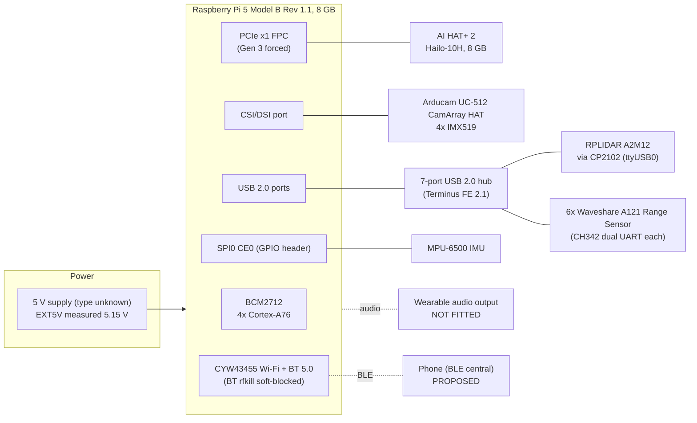

# 02 — Complete Hardware Architecture

Status labels: **CONFIRMED** (code, or observed on this Pi on 2026-10-09) · **HW-VERIFIED** (manufacturer documentation; source IDs `[Sx]` are in [references.md](references.md)) · **DER** (derived by arithmetic from cited values) · **PROPOSED** · **NOT IMPLEMENTED** · **NEEDS VALIDATION**.

> Values marked HW-VERIFIED are **manufacturer specifications, not system measurements**. A datasheet range is the best case for the part on its own, not what the worn device achieves.

---

## 1. Block diagram

## 2. What is physically attached (observed 2026-10-09, CONFIRMED)

| Item | Evidence on the device |
|---|---|
| Board | `/proc/device-tree/model` = "Raspberry Pi 5 Model B Rev 1.1"; 7.9 GiB RAM; 4 cores; Debian 13 (trixie); kernel `6.18.39+rpt-rpi-2712` |
| AI accelerator | `/dev/hailo0`; packages `h10-hailort 5.1.1`, `hailo-h10-all 5.1.1`, `hailo-tappas-core 5.1.0`; `config.txt` has `dtparam=pciex1`, `pciex1_gen=3`, `kernel=kernel_hailo.img` |
| Cameras | `config.txt`: `dtoverlay=imx519,cam1` **and** `dtoverlay=imx519,cam0` (two CSI ports configured); I2C buses `/dev/i2c-{1,4,6,10,11,13,14}` |
| LiDAR | `10c4:ea60` Silicon Labs CP2102 → `/dev/ttyUSB0` (`config.LIDAR_PORT`, 256000 baud) |
| Radar | 6 × `1a86:55d2` QinHeng "USB Dual_Serial" (CH342); each gives two ttyACM interfaces (`-if00`, `-if02`); serials `5AEC021929`, `…934`, `…938`, `…975`, `5AEC022220`, `…273` |
| USB hub | `1a40:0201` Terminus FE 2.1 7-port hub. **Every sensor is on USB 2.0 bus 001**; the USB 3 buses are empty |
| Other USB | `0eef:0005` D-WAV (an eGalax/Waveshare touchscreen) on bus 003. Not used by the app |
| IMU | `/dev/spidev0.0` (SPI0 CE0), `dtparam=spi=on` |
| Bluetooth | `hci0` 98:FE:54:02:09:5B, alias "Shappe", BlueZ 5.82; **Powered: no, PowerState: off-blocked** (`rfkill`: soft blocked) |
| Audio | PipeWire 1.4.2; **the only sink is "Built-in Audio Digital Stereo (HDMI)"**; espeak-ng 1.52.0 installed |
| Thermals (idle, app stopped) | 58.7 °C, `get_throttled=0x0`, EXT5V 5.146 V |

---

## 3. Components

Each component answers the 15 standard questions in the same order: what · why · purpose · how it works · output · connection · data path · capability · limits · power and heat · software · compatibility · failure detection · used in code? · send to app?

### 3.1 Raspberry Pi 5 (main computer)

**Level 1:** the device's brain. It runs every sensor reader, the AI and the decision logic, and will run the Bluetooth link.

| # | Answer |
|---|---|
| What | BCM2712, 4 × Cortex-A76 at 2.4 GHz, 512 KB L2 per core, 2 MB L3 [S21]. This unit has 8 GB RAM (CONFIRMED) |
| Why | It has the only Raspberry Pi PCIe connector the AI HAT+ 2 needs, two 4-lane MIPI camera/display connectors [S21], and enough CPU for LiDAR and radar processing in Python |
| How data reaches software | Linux devices: `/dev/ttyUSB0` (LiDAR), `/dev/ttyACM*` (radar), libcamera/Picamera2 (cameras), `/dev/hailo0` (NPU), `/dev/spidev0.0` (IMU) |
| Power | 5 V 5 A (25 W), or 5 V 3 A with a 600 mA USB peripheral limit; the USB limit is 1.6 A with a 5 A supply [S22]. Bare-board active current is about 800 mA; peak about 12 W [S22, S23]. The official 27 W PSU gives 5.1 V 5 A [S24] |
| Thermal | Arm cores throttle progressively from 80 to 85 °C; at 85 °C both Arm and GPU throttle [S22]. The Active Cooler fan runs at 30 % from 50 °C up to 100 % at 75 °C [S22]. Whether this unit has an Active Cooler fitted is NEEDS VALIDATION |
| RTC | On board, but it needs an external battery cell [S22]. Without one the wall clock may be wrong after a cold boot with no network. **The protocol therefore never relies on wall-clock time for freshness** (see [06 §5](06-interface-control-document.md)) |
| Failure detection | systemd watchdog (`deploy/shappe-guide.service`, `WatchdogSec=30`, heartbeats `guidance` and `event_loop`), CONFIRMED. `/health` endpoint, CONFIRMED. SoC temperature and throttle flags are read by `tools/walk_logger.py` (CONFIRMED) and by the BLE prototype (PROPOSED) |
| In code? | Yes: everything |
| Send to app | Uptime, SoC temperature, throttle and under-voltage flags, software versions (PROPOSED, in STATE and events) |

### 3.2 Raspberry Pi AI HAT+ 2 (Hailo-10H NPU)

**Level 1:** a dedicated AI chip that recognises objects in camera pictures fast enough, with little load on the CPU.

| # | Answer |
|---|---|
| What | Hailo-10H, 40 TOPS (INT4) [S26, S27]; Hailo rates the chip 40 TOPS INT4 / 20 TOPS INT8 at about 2.5 W typical, chip only [S31]. 8 GB on-board RAM [S27]. HAT+ form factor; ships with a 16 mm stacking header [S26] |
| Why | Real-time YOLO detection on four camera directions is impractical on the CPU. Detection is about 90 ms per pass on the NPU (measured, README 2026-09-25) |
| How it works | Models are compiled offline by the Hailo Dataflow Compiler into **HEF** files and run by **HailoRT** [S28, S32]. This repo ships `model/yolo26m.hef` (COCO-80 detector) and `model/best.hef` (segmentation, classes person/path/tactile per `model/metadata.yaml`) |
| Output | Bounding boxes, class and confidence (detection); a per-pixel class map (segmentation, debug view only) |
| Connection | PCIe x1. Gen 3 is forced (`pciex1_gen=3`); Raspberry Pi says the Pi 5 "isn't certified for Gen 3.0 … might be unstable", but applies Gen 3 automatically for the AI HATs [S22, S28] |
| Data path | `utils/hailo_device.py` (one shared `VDevice`) → `hailo_inference.py` (letterbox to 640, DFL decode, per-class NMS, `DETECTION_CLASSES` filter) → `pi_camera_utils` detection thread → `shared_state` camera store |
| Limits | Only models compiled for the Hailo-10H with a matching HailoRT 5.x run. **Not every model or layer can run on the NPU**; unsupported operations must run on the CPU or be redesigned. `hailo-h10-all` cannot co-exist with `hailo-all` (Hailo-8 stack) [S28]. It uses the Pi 5's only PCIe connector, so NVMe needs a PCIe switch [S33] |
| Power and heat | Whole-board draw NOT FOUND in official docs; chip 2.5 W typical [S31]. The heatsink is "optional" but advised under sustained load [S26]. Ambient 0–50 °C [S26] |
| Software | `hailo-h10-all 5.1.1`, `python3-h10-hailort 5.1.1` (CONFIRMED installed) |
| Failure detection | `hailo_ok` in `/health` and `get_system_health()` (CONFIRMED); `_FailStreak` with 5 s reset, retry back-off `(2, 5, 10, 30) s` (`HAILO_RETRY_BACKOFF_S`) |
| In code? | Yes |
| Send to app | `hailo_ok` (STATE health bit 4) |

### 3.3 Arducam UC-512 CamArray with 4 × Sony IMX519

**Level 1:** four cameras, one per direction, on one adapter board that feeds a single camera port. The app looks at one camera at a time, very quickly in turn.

| # | Answer |
|---|---|
| What | The "UC-512 Camarray HAT" in Arducam kit B0388 "16MP IMX519 Autofocus Synchronized Quad-Camera Kit" [S1]. IMX519: 4656 × 3496, 1.22 µm pixels, 1/2.53″, rolling shutter, 2-lane CSI-2 [S4] |
| How it works | The HAT merges up to four sensors into **one** CSI-2 stream (2 lanes at 1 Gbps/lane) [S1]. Modes [S2]: `0x00` 4-in-1 (2 × 2 mosaic, 1/4 resolution each); `0x01`/`0x11` dual; `0x02/0x12/0x22/0x32` single camera 0/1/2/3. The mode is selected with `i2cset -y <bus> 0x24 0x24 <val>` |
| Synchronisation | In 4-in-1 mode, cameras 0+1 are synchronised, 2+3 are synchronised, and 2/3 are **one frame behind** 0/1 [S1]. Exposure, gain, white balance and focus are **shared by all four** [S2] |
| How the app uses it | **`CAMERA_CYCLE = True` (CONFIRMED, uncommitted):** the board is switched between single-camera channels live (I2C bus 11 per `config.py`; Arducam documents buses 4/6 for a Pi 5, see below). Each frame is credited to a camera only when its `SensorTimestamp` falls after the switch. The schedule (`_schedule`) is front ×2, right, front ×2, left, front ×2, back: **6 front frames per cycle against 1 for each other camera** (2 : 1 against the other cameras combined). Empty channels are never visited, because switching to one stops the stream for good. Channel map `CAMERA_HAT_CHANNEL = {right: 0, front: 1, left: 2, back: 3}` (measured 2026-10-08). The 4-in-1 mosaic is still supported (`CAMERA_CYCLE = False`) but was seen to **corrupt the picture** on this unit; see project memory and the README "Known limits" |
| Output | 1920 × 1080 RGB888 per frame (`CAMERA_WIDTH/HEIGHT`). Each frame is stored as a direction quadrant with its own capture time |
| Frame rate | README: ~24 fps front, ~6 fps each other camera with three cameras present (cycle mode). Arducam's quad-mode figures disagree with each other: 1080p30 [S1] vs 1080p60 [S3]. **NEEDS VALIDATION** on this unit |
| Field of view | See §4. The effective HFOV at 1920 × 1080 is likely **~57°** (DER), not the 70° the code assumes (`SIMPLE_CAMERA_HFOV_DEG = 70.0  # ASSUMED`) |
| Limits | One shared auto-exposure (a bright view darkens the others) [S2]. No frame buffer on the HAT [S6]. In cycle mode, cameras are **not** simultaneous: the back camera's picture may be ~0.3 s older than the front's (NEEDS VALIDATION). Low light, glare and rain degrade detection. Camera loss went silent before 2026-10-07; it now raises `/health` warnings (cameras missing or corrupted; since 2026-10-09 also a black or blurred picture per camera), the voice says "Camera off" when the front camera cannot see, and a stream with no frame for 15 s is closed and reopened |
| Discrepancy | The code uses I2C bus 11, but Arducam documents bus 6 (cam0) or 4 (cam1) for a Pi 5 [S2]. Bus numbering depends on the kernel and overlay; the code value was measured on this unit. `config.txt` enables IMX519 on **both** CSI ports. Which port the app's default `Picamera2()` opens must be checked with `rpicam-hello --list-cameras` (NEEDS VALIDATION) |
| Power | HAT power NOT FOUND in vendor docs |
| Failure detection | Corrupt-frame detector (`CAMERA_CORRUPT_PCT`) with restart and front-only fallback; `camera_ok`; warnings "Camera feed lost", "No camera connected: …" (CONFIRMED) |
| In code? | Yes. `utils/pi_camera_utils.py` (capture, cycle, detection and seg threads) |
| Send to app | `camera_ok` (STATE bit 3), and the camera warnings in `health_changed`. **Never images.** |

### 3.4 SLAMTEC RPLIDAR A2M12

**Level 1:** a laser on a spinning head that measures the distance to everything around the user, in one flat slice at its mounting height, 15 times a second.

| # | Answer |
|---|---|
| Specs [S9] | Range 12 m (white) / 10 m (black), minimum 0.2 m; 16 kHz sampling; 10 Hz typical, 5–15 Hz adjustable; 0.225° at 10 Hz; UART 3.3 V TTL **256000 8N1**; 785 nm laser, **IEC 60825 Class 1**; 190 g; 0–40 °C; Ø76 × 41 mm |
| Project settings | `LIDAR_RPM = 900` (15 Hz, top of range); `LIDAR_MAX_DISTANCE = 12000` mm; this unit's full-PWM speed was measured at 1380 RPM (`LIDAR_MAX_RPM`) |
| Data path | CP2102 USB-UART → `/dev/ttyUSB0` → `lidar_utils._ScanStream`: its own packet-sync parser, backlog dropping (`LIDAR_MAX_BACKLOG_S = 0.25`), and rejection of partial scans (gap > 20°) → a single-slot mailbox → the analysis thread → `shared_state` lidar store |
| Output | About 260 points per scan (angle, distance, quality) → 8 sectors, 4 cones and a corridor, BEV grid, heading, movers |
| Power [S9] | 5 V (4.9–5.2 V); **inrush up to 2.5 A**, start-up up to 1.5 A, running 450 mA typical / 600 mA max. The code soft-starts the motor (`_open_without_motor`, PWM ramp) and re-asserts PWM every second (CONFIRMED) |
| Limits | One horizontal plane (overhead and kerb hazards are invisible). Sunlight: "outdoor … without direct sunlight" [S9]. Glass and mirrors give missing points [S11]. Dark surfaces have shorter range. A sweep takes ~67 ms, during which the user moves; this is not corrected (README; under 10 cm at walking pace) |
| Failure detection | `lidar_ok`; freshness (`LIDAR_STALE_S = 1.0`); "Sensors offline" spoken once the newest scan is older than 2 s (`SIMPLE_LIDAR_FRESH_S`). `SIMPLE_OFFLINE_S = 3` covers a different case: no range reading ahead for 3 s; `startup_gate` reports `lidar_absent` after 20 s; simulation is **opt-in only** and is flagged "SIMULATED — do not navigate" (CONFIRMED) |
| Send to app | `lidar_ok` (bit 1), the front clearance in ALERT (`front_ft`), and the surroundings list on request |

### 3.5 Waveshare A121 Range Sensor × 6 (Acconeer A121, 60 GHz)

**Level 1:** six small radars that see glass and other things the laser passes through, in six directions, out to about 4 m.

| # | Answer |
|---|---|
| What | Waveshare "A121 Range Sensor", SKU 33777 [S18]: STM32L431 MCU, USB-C through a **WCH CH342 dual UART**. SERIAL-A carries the Exploration Tool server; SERIAL-B carries the UART firmware. 5 V, 80 mA max [S18]. Flashed by choosing "XM125" in the Exploration Tool [S18]. It is firmware-compatible with Acconeer's XM125 but is not the XM125 module itself (DER from [S13]) |
| Sensor [S12] | Acconeer A121: 57–64 GHz pulsed coherent radar; EIRP 11.4 dBm; HPBW **E-plane 53°, H-plane 65°** (simulated); up to 23 m depending on the object; distance accuracy 2.7–5.1 mm std; radial resolution 30 mm (P1) to 222 mm (P5). It can see through plastic or glass covers |
| Mode used | Exploration Tool **distance detector** (acconeer-exptool 7.18.2, CONFIRMED): CFAR threshold, `RADAR_REFLECTOR_SHAPE = "PLANAR"` (on trial since 2026-10-05), `RADAR_PROFILE = 5` (passed as `max_profile`, an upper limit), range `RADAR_START_MM 250` to `RADAR_END_MM 4000`, update rate 6 Hz. The detector outputs **distances and strengths only; no velocity, no classification** [S14] |
| Geometry | Bearings 30/90/150/210/270/330° per board **serial**, never by USB port (`RADAR_BEARINGS`; optional overlay `radar_bearings.json`, absent today). With a 65° beam that gives about 5° of overlap. Six boards map onto four guidance directions (`cardinal_sources`, half-angle = beam/2 + 22.5°) |
| Data path | Discovery probes ttyACM for `get_system_info`, excluding the LiDAR → one supervisor thread per board (`_run_board`/`_stream_board`) → `_StallGuard` forces a reconnect when no progress (5 s streaming, 30 s calibrating) → `_publish` → per-direction nearest echo with sources → `shared_state` radar store |
| Limits | Range 0.25–4 m as configured. The 222 mm resolution at P5 merges close echoes. A beam sees whatever is in its cone (floor, cane, own body); the code requires a measured board and grazing tests before calling something glass. Head-on flat glass is **unproven** (README, NEEDS VALIDATION). Waveshare's "horizontal 53°" vs Acconeer's H-plane 65° depends on board orientation [S18 vs S12] |
| Power | Board 80 mA max [S18]. A121 itself ~74.5 mA at 1.8 V while measuring at P1 (DER [S12]) |
| Failure detection | Per-board online/stale (`RADAR_STALE_S = 1.5`); `radar_ok`, `radar_down` list, "Radar half-covered/delayed/offline" warnings; front-glass coverage (`front_glass_coverage`) produces the spoken "Glass sensor off/on" (CONFIRMED) |
| Send to app | `radar_ok` (bit 2), `front_glass_ok` (bit 5), and the `radar_down` list in `get_status` |

### 3.6 TDK InvenSense MPU-6500 IMU

| # | Answer |
|---|---|
| What [S35] | 6-axis IMU: gyro ±250…2000 °/s, accelerometer ±2…16 g, SPI 1 MHz (20 MHz for sensor reads), 3.4 mA. TDK lists it as not recommended for new designs [S36] |
| Use | `gyro_reader.py` at 100 Hz: yaw integral, bias correction against the LiDAR, step and cadence detection, tilt (CONFIRMED) |
| **Gating** | `GYRO_MOUNTING_CONFIRMED = False` and `GYRO_GAIT_CONFIRMED = False`: the gyro **reports only**. It does not steer heading, and stride learning is off (CONFIRMED) |
| Send to app | Nothing in v1 |

### 3.7 Bluetooth radio (Infineon CYW43455 on the Pi 5)

| # | Answer |
|---|---|
| What | Dual-band 802.11ac Wi-Fi plus **Bluetooth 5.0 with BLE**, connected over SDIO [S23] |
| State on this Pi | BlueZ 5.82, adapter `hci0`, roles central + peripheral, 5 advertising instances (`ble_bridge.gatt_server --check`, CONFIRMED). **Soft-blocked by rfkill** |
| Coexistence | Wi-Fi and Bluetooth share 2.4 GHz on one chip. Whether they share one antenna is not stated in Raspberry Pi docs (NOT FOUND). Running BLE alongside the Wi-Fi dashboard, or a Bluetooth audio headset, is **NEEDS VALIDATION** |
| USB 3 noise | USB 3.0 can raise the 2.4 GHz noise floor by ~20 dB [S34]. Today every device is on USB 2.0, so the risk is low. Keep it in mind if a USB 3 device is added |
| In code? | **No.** The prototype is in `ble_bridge/` (PROPOSED) |

### 3.8 Audio output: **missing (critical gap)**

| | |
|---|---|
| Code | `utils/pi_voice.py` speaks with `espeak-ng -s 170 -v en-us` through the default PipeWire sink. It refuses `hdmi`, `dummy` and `null` sinks (a person cannot hear them on a wearable) (CONFIRMED) |
| Device | Only an HDMI sink exists (CONFIRMED). `AUDIO_ENABLED = False` (CONFIRMED) |
| Consequence | **The device has no audible output of its own today.** The README's intended earpiece ("an earpiece when one is paired") is not present |
| Options (PROPOSED, see [08 §4](08-safety-reliability-failure-management.md)) | (a) a USB audio adapter plus a wired **bone-conduction** headset, which leaves the ears open to traffic sound; this is recommended. (b) A Bluetooth A2DP headset paired to the Pi; it shares the radio with BLE (NEEDS VALIDATION) and adds A2DP latency. (c) An I²S DAC with a small speaker, which is not private and is quiet outdoors |
| Haptics | NOT IMPLEMENTED (no motor, no driver). PROPOSED: an I²C haptic driver plus an LRA/ERM motor on the GPIO header (the header passes through the AI HAT+ 2 stacking header) |

### 3.10 Arducam ToF depth camera (planned, not bought)

| | |
|---|---|
| What | Arducam ToF camera: 240 × 180 distances per frame, 940 nm, up to 4 m, about 30 fps, CSI-2. Lens about 70° diagonal (58.5° × 45.6° on the 4:3 sensor) (NEEDS VALIDATION) |
| Port | The Pi 5's CAM0 (the UC-512 is on CAM1): `/boot/firmware/config.txt` needs `dtoverlay=arducam-pivariety,cam0` there instead of `dtoverlay=imx519,cam0`. SDK: `pip install ArducamDepthCamera` |
| Mount | Just below the front camera, aimed about 20° further down ("aimed apart" in the 3D design), rigid against it: its depth is placed on the camera's picture by a bench calibration (`tools/tof_calibrate.py`) |
| Interference | None expected: the IMX519's IR-cut filter blocks 940 nm |
| In code? | Yes, off: `TOF_ENABLED = False`, `TOF_USE_DISTANCE = False` (`utils/tof_camera.py`, `utils/depth_fusion.py`, `routers/tof_router.py`; see [03 §3.5](03-perception-and-navigation-pipeline.md)) |

### 3.9 USB hub

A Terminus FE 2.1 7-port **USB 2.0** hub carries the LiDAR and all six radar boards (CONFIRMED). Whether it is self-powered is NEEDS VALIDATION. The worst-case steady draw through it is about 0.6 A (LiDAR) + 6 × 0.08 A (radars) ≈ **1.1 A** (DER), which is within the Pi's 1.6 A USB budget only with a 5 A supply. The LiDAR's **2.5 A inrush** is why the motor is soft-started.

---

## 4. Field of view and blind spots

| Sensor | Coverage | Basis |
|---|---|---|
| LiDAR | 360° in **one horizontal plane** at its mounting height; 0.2–12 m | [S9], CONFIRMED config |
| Radar | 6 × ~65° (H-plane) beams at 30/90/150/210/270/330°, 0.25–4.0 m; ~5° overlaps | [S12], CONFIRMED config |
| Cameras | 4 directions (front/right/back/left). Lens 67°H × 53°V by pinhole at full sensor width (DER [S4, S5]; Arducam also publishes 66° × 49.5° [S1]). At 1920 × 1080 the IMX519 mode is a **binned crop**, which narrows the effective HFOV to about **57°** (DER: 1920 × 2 × 1.22 µm over f = 4.28 mm) | NEEDS VALIDATION |
| Implication | 4 × ~57° ≈ 228° of camera coverage, so roughly **four ~33° wedges between cameras with no identity information**. LiDAR and radar still range those wedges | DER, NEEDS VALIDATION |

**Never claim 360° vision.** The code itself flags its HFOV value as "ASSUMED, not measured", and project notes from 2026-10-08 suspect it is ~10° too wide.

Vertical blind spots, from the single LiDAR plane:
- overhead obstacles (branches, signs, truck mirrors);
- low obstacles below the plane;
- **drop-offs** (stairs down, kerbs, platform edges).

The segmentation model (path and tactile classes) exists but is debug-view only. **None of these hazards is warned about today** (NOT IMPLEMENTED).

## 5. Power budget and battery

| Load | Typical | Max / peak | Source |
|---|---|---|---|
| Pi 5 board | ~0.8 A at 5 V active | ~12 W peak | [S22, S23] |
| Hailo-10H chip | 2.5 W | NOT FOUND (board) | [S31] |
| RPLIDAR A2M12 | 0.45 A at 5 V | 0.6 A run, 2.5 A inrush | [S9] |
| 6 × A121 board | — | 6 × 0.08 A = 0.48 A | [S18] |
| UC-512 + 4 × IMX519 | NOT FOUND | NOT FOUND | — |
| MPU-6500 | 3.4 mA | — | [S35] |
| **Rough total** | **~12–20 W** under load (DER; NEEDS VALIDATION with a USB-C power meter) | | |

- **Battery: NOT IMPLEMENTED.** No battery, fuel gauge or UPS HAT exists in the code or on the device; EXT5V reads 5.15 V. A wearable needs a battery that can deliver 5 V at 5 A (a USB-PD source the Pi recognises as 5 A, or `PSU_MAX_CURRENT=5000` [S22]).
- **Battery reporting:** only possible once a gauge (I²C fuel gauge or UPS HAT) is added. Until then the BLE protocol reports battery as `null`, and the Battery Service 0x180F is **not** exposed (it must not show a fake value).
- **Lithium packs:** they must meet UN 38.3 and IEC 62133-2 for transport and safety (see [08 §9](08-safety-reliability-failure-management.md)).
- **Runtime estimate (DER):** a 20,000 mAh / 74 Wh pack at ~15 W average gives roughly 4 h after conversion losses. NEEDS VALIDATION.

## 6. Thermal

- **Pi 5:** throttles at 80–85 °C [S22]. It measured 58.7 °C idle with the app stopped (CONFIRMED). The full-load temperature with the NPU, LiDAR analysis and camera cycling, worn under clothing in summer, is **NEEDS VALIDATION**.
- **AI HAT+ 2:** ambient limit 0–50 °C [S26]. A body-worn enclosure in sun can exceed that, so the enclosure needs ventilation and a test.
- **What the device does today when hot:** nothing. Throttling slows detection, which shows up as a "detection stalled" warning. The BLE prototype adds `thermal_warning` (SoC ≥ 80 °C or throttle bits) and `power_warning` (under-voltage) events (PROPOSED).

## 7. Shared-resource conflicts

| Resource | Conflict | Status |
|---|---|---|
| PCIe | The only connector is used by the AI HAT+ 2, so there is no NVMe without a PCIe switch [S33]. Gen 3 is uncertified [S22] | CONFIRMED / NEEDS VALIDATION (stability over long runs) |
| GPIO header | The AI HAT+ 2 sits on it through a 16 mm stacking header [S26]. The MPU-6500 uses SPI0 CE0 through the passthrough. A haptic driver would also go here | NEEDS VALIDATION (mechanical stack with the UC-512 HAT) |
| CSI | The UC-512 needs one port; both ports have an IMX519 overlay in `config.txt`. The planned ToF takes CAM0, replacing that port's IMX519 overlay (§3.10) | NEEDS VALIDATION (which port the app opens) |
| NPU time | Detection and segmentation share one NPU through HailoRT's scheduler; segmentation runs only while its view is open (`SEG_ALWAYS = False`) | CONFIRMED |
| USB 2.0 bandwidth | LiDAR (~3,900 points/s over USB, `LIDAR_MEAS_RATE_HZ`; the sensor itself samples at 16 kHz [S9]) and six radars share one USB 2.0 hub. Fine for data rates; the current budget is the constraint (§3.9) | CONFIRMED / DER |
| 2.4 GHz radio | Wi-Fi (dashboard), BLE (app) and an optional A2DP headset all share the CYW43455 | NEEDS VALIDATION |
| Mechanical | LiDAR scan plane height and clearance, which nothing worn may block; camera aiming; the radar faces must stay uncovered | NEEDS VALIDATION |
| EMC | The 60 GHz radar does not overlap 2.4 GHz. LiDAR motor noise on the 5 V rail: the datasheet asks for ≤ 50 mV ripple [S9] | NEEDS VALIDATION |

## 8. Performance and resource budget

| Quantity | Value | Kind |
|---|---|---|
| Camera capture | 30 fps (mosaic); ~24 fps front / ~6 fps others (cycle) | README measurement 2026-09-25 / README estimate |
| Front detection | 11 /s, median 106 ms old | Measured (README) |
| Detection pass | ~90 ms (79 ms NPU), 2 quadrants | Measured (README) |
| LiDAR | **README says ~23 scans/s**, but `LIDAR_RPM = 900` implies 15 Hz. The measurement probably predates the RPM change | **NEEDS VALIDATION** (re-measure) |
| Radar | 6 Hz per board, configured | CONFIRMED config |
| Guidance decision | ~6 ms per poll; loop at 5 Hz (`PI_VOICE_TICK_HZ`) | Measured (README) / CONFIRMED |
| BLE bridge | 10 Hz poll of `/guidance/walk`, 1 Hz `/health`; STATE ≤ 5 Hz and ≥ 1 Hz | PROPOSED |
| BLE traffic | At most ~5 STATE (20 B) + rare ALERT (20 B + text) + ~1 EVENT per second: **< 1 kB/s**, well within BLE | DER |
| RAM | 2.5 GiB used of 7.9 GiB with the app **stopped** | CONFIRMED (snapshot) |

**How to measure the open items:**
- `tools/walk_logger.py` logs temperature, throttling and markers to CSV during walks.
- `/camera/stats` reports `camera_fps` per camera.
- `/lidar/reader` reports scan rate.
- `hailo_stats` and `tools/hailo_monitor.py` report NPU use.
- A USB-C inline power meter measures power over a 30 min walk.
- The latency method is in [03 §9](03-perception-and-navigation-pipeline.md).

## 9. Mounting considerations (all NEEDS VALIDATION)

- The LiDAR must have an unobstructed 360° plane (arms, bag straps and a cane handle all intrude). The code drops returns nearer than 300 mm for mover tracking (`LIDAR_MOVERS_MIN_RANGE_MM`), which is "the wearer's own arm or cane".
- The radar faces must be uncovered or behind thin plastic. Each board's bearing must be **measured** and recorded by serial (`/radar/test`, `POST /radar/calibrate`).
- The camera channel map was measured on 2026-10-08. If the cameras are re-plugged it must be re-measured (`CAMERA_HAT_CHANNEL`).
- The IMU mounting must be confirmed before `GYRO_MOUNTING_CONFIRMED` can be set to True.
