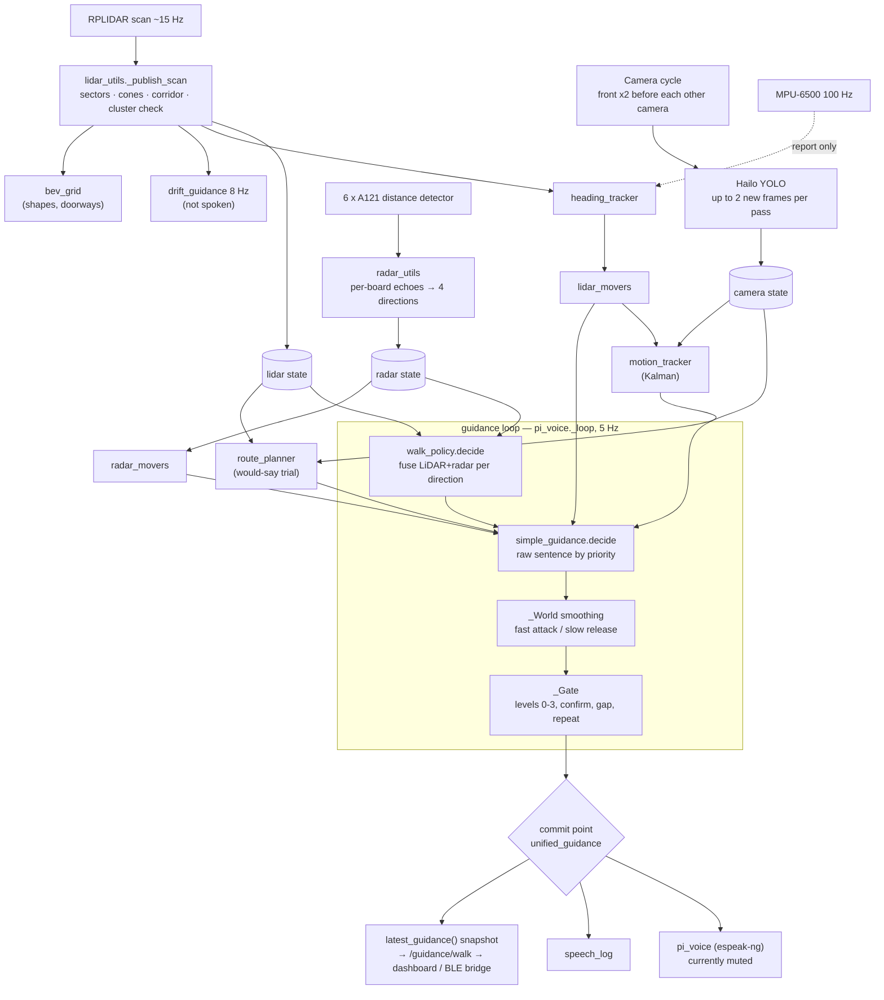

# 03 — AI Perception and Navigation Pipeline

How a laser return, a radar echo or a camera box becomes one spoken sentence. Everything here is **CONFIRMED** from the code unless it is labelled otherwise. File references are relative to the repository root.

---

## 1. The safety model (the rules the code is built on)

**Level 1:** each sensor is trusted only for what it is good at. The laser measures *where* things are. The cameras say *what* they are. The radar exists to catch *glass*. The gyro says how fast the user is *turning*. When information is missing or old, the device stays quiet rather than guess.

**Level 2.** These rules are stated in the README "safety model" and enforced in code:

| Rule | Where |
|---|---|
| LiDAR is the geometry backbone. With a stale scan (> 1 s) the device holds and says nothing new. Once the newest scan is older than 2 s (`SIMPLE_LIDAR_FRESH_S`) it says "Sensors offline". `SIMPLE_OFFLINE_S` (3 s) covers a separate case: no range reading ahead | `simple_guidance.guidance`, `_World.offline` |
| Cameras give **identity only** and never decide whether a path is clear. A camera distance is only a check against the laser | `front_object` (`_range_matches`), `sensor_fusion.detection_distance` |
| Radar **only overrides for glass**. LiDAR and radar are averaged unless they disagree by ≥ `WALK_GLASS_GAP_FT` (2 ft); then the **nearer measured** reading wins | `walk_policy.fuse`, `_is_glass` |
| A sensor that is alive but sees nothing means "clear to its own range" (LiDAR 40 ft, radar 13.1 ft). A dead or stale sensor means "no information", never "clear" | `walk_policy.read_direction` |
| Simulated data is never evidence; it is flagged "SIMULATED — do not navigate" | `sensor_fusion.get_system_health`, simulation opt-in flags |
| Feet are the one user-facing unit. Millimetres are converted at the edges: `walk_policy._mm_to_ft` (decisions), `sensor_fusion.mm_to_ft` (hazard list) and `MM_PER_FT` inside `simple_guidance` | `walk_policy` |
| Advisory layers (drift, BEV grid, movers, spatial scan) **can never stop the user or clear a direction** | README, `bev_grid`, `spatial_scan` |
| One speaker and one commit point: only `unified_guidance.get_unified_guidance` calls `pi_voice.speak` | `unified_guidance.py` |
| Nothing ever says it is safe to cross a road | `traffic_light_detection.py` (colour is always UNKNOWN) |

## 2. Data flow at a glance

## 3. Sensor processing

### 3.1 LiDAR (`utils/lidar_utils.py`)

1. **Read.** A reader thread does bulk serial reads with its own packet-sync parser. It drops backlog older than 0.25 s and rejects partial scans (an angular gap over 20°). Each complete scan goes into a single-slot mailbox, so the analysis thread always works on the newest scan and never on a queue of old ones.
2. **Sectors.** Eight 45° sectors (front, front_right … front_left) hold the minimum distance. They are used for threat awareness and the hazard list.
3. **Cones and corridor.** Four 10° cones (`GUIDANCE_CONE_DEG`) centred on front/right/back/left are used for steering. The **body corridor** is a 300 mm half-width strip straight ahead out to 2.5 m (`GUIDANCE_CORRIDOR_*`), which catches a post that is outside the narrow cone but in the user's path.
4. **Cluster confirmation.** A return counts only if it is part of a cluster (`_cluster_min`) or was also seen in the previous scan (`_persists`). A single stray reflection is ignored.
5. **Unswept marking.** An angle the scan did not cover is marked unknown, not clear.
6. **Downstream on each scan:** heading → movers (`lidar_movers`, then the Kalman `motion_tracker`) → drift (rate-limited to 8 Hz) → BEV grid → WebSocket broadcast.

### 3.2 Radar (`utils/radar_utils.py`, `radar_calibration.py`)

1. Each of the six boards runs the Acconeer **distance detector** through the Exploration Tool:
   - CFAR threshold;
   - `PLANAR` reflector shape (on trial since 2026-10-05);
   - profiles up to 5 (`max_profile`);
   - 0.25–4.0 m;
   - 6 Hz.

   The detector returns **distances and strengths only**, with no velocity or class [S14].
2. Boards are identified by **USB serial** and given a measured bearing. A board with no measured bearing gets a provisional `portN` key and is not used as a direction.
3. **Six to four.** Each guidance direction takes the nearest live echo from the boards whose beams overlap it (`cardinal_sources`: half-angle = 65/2 + 22.5°).
4. **Per-board glass judgement:**
   - `walk_policy._single_board_glass_ft` with a grazing-angle test;
   - the door-in-wall rule (`_centred_echo`, `_matches_ahead`), so that a pane in a doorway is not dismissed as the wall around it;
   - radar is trusted inside the cone only within `RADAR_CONE_TRUST_MM` (~1.1 ft).
5. **Stall guard.** If no progress is made (5 s streaming, 30 s calibrating), the link is forced to reconnect.

### 3.3 Cameras and AI (`utils/pi_camera_utils.py`, `hailo_inference.py`)

1. **Capture.** In cycle mode the board shows one camera at a time. Each frame is attributed by its sensor timestamp after the switch. The schedule is front ×2, right, front ×2, left, front ×2, back: 6 front frames per cycle against 1 for each other camera.
2. **Detection.** In cycle mode, each pass takes up to 2 cameras that have a new, not-yet-detected frame, in the order front, right, left, back; a front camera with no new frame is skipped. (`DETECTION_FRONT_EVERY_PASS`, front every pass plus one in rotation, applies only to the 2 × 2 mosaic mode.) Each detection does:
   - letterbox to 640 with OpenCV;
   - YOLO DFL decode;
   - per-class NMS (`DETECTION_CONF = 0.5`, `DETECTION_IOU = 0.7`).
3. **Class filter.** Only classes in `DETECTION_CLASSES` (the keys of `SIMPLE_NAMED_OBJECTS`) survive. The detector is **COCO-80**, so the classes that can actually fire today are:
   - person; car, truck, bus, motorcycle, bicycle, train;
   - dog, horse, cow, sheep, elephant, bear;
   - potted plant; traffic light / stop sign / parking meter (spoken as "Pole"); fire hydrant; bench.

   Words such as "Stairs", "Pothole", "Bollard" and "Pole" (as a class) are in the vocabulary for a custom model but **cannot fire with the shipped COCO model**.
4. **Freshness.** A camera result older than 2 s (`SIMPLE_CAMERA_FRESH_S`) is ignored.
5. **Segmentation** (path, tactile, person) feeds only a debug view and never the voice.

### 3.4 Distance for camera objects (`sensor_fusion.detection_distance`, uncommitted)

A camera box has no reliable range of its own.
- **Size estimate.** The code estimates range from box height, a typical object height (`SIMPLE_OBJECT_HEIGHT_M`) and the assumed lens HFOV (`SIMPLE_CAMERA_HFOV_DEG = 70`).
- **Laser match.** It then picks the **laser range in the box's bearing** that agrees with the estimate within a ratio of 0.5–1.4. The bearing window is widened to cover a lens HFOV anywhere from 55° to 75° (`DETECTION_DISTANCE_HFOV_DEG`).
- **Seated person.** A wide person box is treated as seated (1.3 m).

**What the label shows:**
- When a laser return fits, the label shows that laser distance (source `lidar`).
- Otherwise (no fitting return, or the LiDAR not current), it shows the camera's own size estimate, marked as an estimate: source `camera` or `camera_cut`, printed on the dashboard as "≈N ft est." or "≤N ft est.".

These label distances feed only `/camera/stats` and `/camera/distances`, which are display-only. **They never decide blocking.**

With the ToF depth camera (§3.5) and `TOF_USE_DISTANCE`, a box the ToF measured takes that distance first (source `tof`); until then its reading is only shown beside the label, as "(ToF N ft)".

### 3.5 Measured distance from the ToF depth camera (`utils/depth_fusion.py`, `utils/tof_camera.py`; added 2026-10-13, uncommitted, off until the sensor is fitted)

The Arducam ToF (240 × 180 distances) is to sit just below the front camera. Both are pinhole cameras with different numbers (focal length in pixels, image centre, distortion, position, aim), so the depth picture is not stretched over the camera's. Each depth pixel is placed with its own distance:
1. `P = d · K_tof⁻¹ · [u, v, 1]`: the point the ToF pixel (u, v) measured at distance d;
2. `P′ = R · P + t`: that point in the camera's frame;
3. `[u′, v′] = K_cam · P′ / Z′`: the camera pixel it lands on (each lens's distortion included).

- **Numbers.** K_tof, K_cam, R and t come from the bench calibration (`tools/tof_calibrate.py` → `calibration/tof_calibration.json`). Until it exists the lenses are taken as ideal and placed as designed, and `/health` says "not calibrated":
  - the ToF: 70° diagonal on its 4:3 sensor, 58.5° × 45.6°;
  - the camera's 960 × 540 front picture: a centre crop of the 66° lens, 56.4° × 33.5°;
  - the ToF 3.8 cm below the camera, aimed 20° further down.
- **Pairing.** Each detection pass uses the ToF frame captured nearest its picture, within 60 ms (`TOF_PAIR_MAX_S`). A frame is placed only when a pass uses it (about 7 ms on the Pi 5).
- **A box's distance** (`DepthFrame.box_depth`):
  - the box is trimmed (15 % each side, 10 % at the top, 20 % at the bottom: the ground at its feet);
  - the depth points inside are grouped where they are no more than 0.3 m apart along the ground;
  - the nearest group holding at least 20 % of them (and 6) is the thing: the person, not the wall behind;
  - it gives the distance along the ground, the straight-line range, the bearing, the point count and the spread;
  - a box the ToF cannot see (above its view, beyond 4 m) gets nothing and keeps the size estimate.
- **Who uses it.** Every front detection carries `depth`. With `TOF_USE_DISTANCE` (False) it replaces the box-size range in:
  - `detection_distance` (source `tof`);
  - the guidance (`simple_guidance._box_range`: the object on the path, the ranged vehicle, steering);
  - the route planner's camera faces;
  - the Kalman tracker (range σ 5 cm + 2 %; boxes the frame cuts off are then usable).

  While False, nothing spoken changes.
- **Routes:** `/tof/status`, `/tof/depth.jpg`, `/tof/overlay.jpg` (the camera's picture with the depth dots drawn on it: the calibration check), and `POST /tof/calibrate/capture` and `/tof/calibrate/reload` (admin token).
- **Desk test** (`tools/tof_fusion_sim.py`, 26 checks; a synthetic street through a ToF with known, distorted lenses, 1° off the design):
  - every dot lands within 0.05 px of its true point;
  - a person 1.9 m ahead of a wall measures 1.88 m (true 1.87); a 12 cm pole at 3 m and a person at 1 m with the head cut off are measured too;
  - nothing at 5 m, or above the ToF's view;
  - the wrong ways are measurably wrong: the depth picture stretched ~275 px off, angles only ~22 px within 1.6 m, the design numbers on that rig ~23 px;
  - the solver, run on rendered checkerboard pictures, places the dots within 0.14 px (median);
  - the wall check tells a reading along the ray from one along the axis.

## 4. The decision: `walk_policy.decide`

**Level 1:** for each of four directions, how far can the user walk, and is that distance glass? If the front is blocked, which way should they turn?

**Level 2:**

| Step | Logic | Constants |
|---|---|---|
| Read direction | LiDAR cone/corridor distance plus radar for the direction, with freshness checks | `LIDAR_STALE_S 1.0`, `RADAR_STALE_S 1.5` |
| Fuse | Average, unless the readings differ by ≥ 2 ft and the nearer one is a real measurement; then the nearer reading is used. The direction is flagged `glass` only when the **radar** is the measured nearer reading by ≥ 2 ft and the laser arc does not corroborate it (`_is_glass`) | `WALK_GLASS_GAP_FT 2.0` |
| Memory | Side directions keep their last measurement for 3 s (`_carry_measured`) | `WALK_MEASURED_MEMORY_S 3.0` |
| Blocked | Front clearance < 4 ft | `WALK_BLOCK_FT 4.0` |
| Turn choice | Order left, right, back. Needs ≥ 2 ft of room and a 1.5 ft margin; 0.8 ft hysteresis; held for 4 s. Ranking: back last, then directions the radar cannot see, then most room (`choose_turn`). The BEV/spatial `preferred_side` is consulted only by `simple_guidance.safer_side`, when walk_policy has not picked left or right | `WALK_MIN_TURN_FT`, `WALK_TURN_MARGIN_FT`, `WALK_TURN_HYSTERESIS_FT`, `WALK_TURN_HOLD_S` |
| Result | `unknown` / `walk_straight` / `caution_forward` / `stop` / `turn_left|right|back`, with `front_ft`, `glass_ahead`, and per-direction `distance_ft`, `lidar_ft`, `radar_ft`, `fusion` | Units: feet |

## 5. The sentence: `simple_guidance`

### 5.1 Raw sentence (`decide` → `_sentence`), highest priority first

1. **Vehicle approaching.** A front-camera vehicle box grows faster than walking alone would explain (`_Vehicles`: Theil-Sen on box size, ego-motion discount, miss distance ≤ 2 m). Sentences: "Vehicle approaching, move left/right", or "Vehicle approaching" when there is no room to step aside. Level 3.
2. **Mover** (LiDAR or radar mover, §6). Spoken **only if `LIDAR_MOVERS_SPEAK`**, which is **False** today, so it is logged as "would say".
3. **Blocked** (front < 4 ft), most specific first:
   - "Blocked by glass" → "Blocked by wall" → "Vehicle in front, be careful";
   - "Near left/right wall" (a wall close beside);
   - drifting;
   - a steer-past sentence ("Person in front, turn left");
   - "X in front";
   - "Turn left/right".
4. **Not blocked:**
   - "Vehicle in front, be careful";
   - "Glass ahead" (pane on the path inside 12 ft);
   - "Near left/right wall, move right/left" (inside 4 ft);
   - "Glass on left/right, move right/left";
   - "Drifting toward left/right wall, turn slightly right/left" (closing ≥ 0.2 ft/s inside 5 ft, converging within 20 ft);
   - "Wall ahead" (inside 12 ft);
   - steer-past;
   - "X ahead";
   - "Walk straight".

The object word X comes from the front camera only when the box sits in the central band, is big enough, and its size-estimated range **agrees with the laser's front range** (`front_object`).

### 5.2 Smoothing (`_World`, `_Hold`)

- Each hazard flag turns **on fast and off slowly**: attack 0.2 s (`SIMPLE_ALERT_CONFIRM_S`), release 1.0 s (`SIMPLE_CLEAR_CONFIRM_S`). Single-poll dropouts are tolerated.
- Object and glass identities are held 3 s after they are last seen (`SIMPLE_OBJECT_RELEASE_S`, `SIMPLE_GLASS_RELEASE_S`).

### 5.3 The speech gate (`_Gate`)

| Rule | Value |
|---|---|
| Urgency levels | 0 walk straight · 1 advisory · 2 blocked/turn/mover · 3 vehicle approaching (`_LEVEL`) |
| A more urgent sentence | Said as soon as the current sentence's airtime ends; a level-3 vehicle warning does not wait. Separately, any **urgent** sentence (rule `blocked`, `vehicle_approaching` or `mover_approaching`, i.e. levels 2 and 3) makes `pi_voice` stop the utterance that is playing |
| A calmer or equal sentence | Must hold for 1 s (`SIMPLE_CONFIRM_S`) and wait ≥ 3 s after the last (`SIMPLE_MIN_GAP_S`) |
| Same episode, changed wording | Must settle for 6 s (`SIMPLE_SETTLE_S`) |
| Repeats of the same blocked sentence | 30 s, doubling to a 120 s cap (`SIMPLE_REPEAT_S`, `SIMPLE_REPEAT_MAX_S`) |
| Withheld | "Walk straight" while unconfirmed, at a crossing (5 s after a front-camera traffic light), or during the start-up hold |
| Each admission | Increments **`cue_seq`**, the only "announce now" signal |

### 5.4 Start-up and status notices

- `startup_gate` keeps the device silent until the LiDAR has settled: it waits up to 15 s for optional sensors, then a 2 s settle, then 6 samples within 1.5 ft.
- "Glass sensor off/on" is spoken when front radar coverage is lost or regained (3 s loss, 10 s recovery confirmation).
- "Camera off/on" is spoken the same way when the front camera can no longer name what is ahead, or can again (`sensor_fusion.front_camera_coverage`: no fresh front detections, or a black picture; 5 s loss, 10 s recovery confirmation, 45 s start-up grace). Like the glass notice it is only said while the path is clear (added 2026-10-09; desk-tested, NEEDS VALIDATION on the device).

## 6. Movers (uncommitted, silent trial)

**`lidar_movers`:**
- **Segmentation.** The scan is split into blobs: a break at 200 mm + 6 %/m, or a 3° gap; at least 3 points; at most 2 m wide.
- **Tracking.** Blobs are followed within a 0.5 m gate. A Theil-Sen velocity is fitted over 1.2 s (≥ 6 samples).
- **User's own motion.** It is estimated by least squares from tracks that are still (≥ 4 tracks, RMS ≤ 0.2 m/s).
- **Mover test.** A track is a mover if its own speed is ≥ 0.4 m/s, confirmed over 3 scans.
- **Closest point of approach.** Horizon 5 s; it is a threat if it passes within 1 m (a Person) or 2 m (a Vehicle, `SIMPLE_VEHICLE_MISS_M`).
- **Modes:** crossing, toward, behind.
- **Word.** "Person" if ≤ 0.9 m wide and < 3 m/s, otherwise "Vehicle". The front camera can override the word within 10°.

**`radar_movers`:**
- It only covers where the LiDAR sees nothing (`lidar_sees`).
- It tracks per-board range: closing ≥ 0.4 m/s after removing the user's walk, confirmed over 2 frames.
- It pauses while the user turns faster than 10 °/s.
- Its word is always "Something".

**`motion_tracker` (Kalman, added 2026-10-13, uncommitted):**
- **Detections.** The clean `lidar_movers` blobs, plus the people and vehicles the front camera names. A camera thing is placed by bearing (where its box sits in the frame) and range (box height against the class's typical height). Its error is an ellipse: 0.1 m + 15 % along the line of sight, 2° across it. Frames older than 0.4 s are not used.
- **The user's own motion.** Each scan, `heading_tracker`'s turn (`scan_yaw_deg`) and step (`scan_fwd_mm`, `scan_right_mm`) are taken off, so every velocity is the thing's own, over the ground. Without odometry, `lidar_movers`' still-things estimate is used. Its residual turn also corrects the heading tracker's own error.
- **Filter.** One constant-velocity Kalman filter per track: position, velocity and their covariance. A person may accelerate 1.2 m/s² any way. A moving vehicle may accelerate 1.5 m/s² along its heading but only 0.4 across it (a car brakes; it does not slide sideways).
- **Association.** A detection joins a track only if all of these hold:
  - it is the most likely track, inside the 99 % Mahalanobis gate (χ² ≤ 9.21);
  - it lies within 1 m of where the track should be (2 m for a vehicle; 1 m more while the track is new; plus twice the detection's own error);
  - it is the same kind of thing (a person-sized blob is never a car).
- **Moving.** All of the following:
  - followed for 0.6 s and 6 sightings;
  - faster than `lidar_movers`' threshold (0.4 m/s, raised 0.07 m/s per metre, plus the doubt in the user's own speed and the slide of a near thing walked past);
  - at least 3σ in its own direction. A camera is least sure along its line of sight, which is exactly where a parked car's wobbling range points.
  - A vehicle must also hold its heading within 20° for 0.8 s and have travelled 1 m in the last second (a track that swapped between two passing cars swings).
- **Warning.** Same as `lidar_movers`: the closest approach passes within 1 m (a Person) or 2 m (a Vehicle) inside 5 s. It is held for 3 scans and reported as crossing, toward or behind. With `MOTION_TRACKER_WARN` it stands in for `lidar_movers`' threat. It is spoken only with `LIDAR_MOVERS_SPEAK`, which is still False.
- **Desk test** (`tools/route_sim.py`, 14 tracker scenes, the rig's scan density and blind arc):
  - **speed error:** median 0.04–0.11 m/s;
  - **warning timing:** a person crossing into the user's way is warned about 3.1 s ahead, and a car seen by the camera 1.7 s ahead;
  - **no false movers:** none in a still room, while walking with or without odometry, past a parked car, or with two cars passing each other.
  - **Cost:** about 1.6 ms per scan on the Pi 5. NEEDS VALIDATION on real walks.

## 6a. The route planner (`utils/route_planner.py`, added 2026-10-13, uncommitted, would-say trial)

The planner looks for the best way through everything sensed, both as it is now and as things move.
- **Points on the ground.**
  - LiDAR returns from 0.3 m out (nearer is the wearer's own arm).
  - Glass where the walk policy puts it: an arc ±30° across the front at the radar's range, or 25–60° on one side for glass beside the user.
  - The near face of each thing the front camera names, at the range its size gives.
  - In each arc the LiDAR cannot see from where it is worn (`LIDAR_BLIND_ARCS_DEG`, currently the rig's back-left 170–290°):
    - the surfaces at its edges are carried on into it;
    - plus the nearest radar echo (`peaks_mm`) the LiDAR cannot account for;
    - 4 m if every echo is accounted for, 0.3 m where no board hears.
  - So no return there is never taken for open space.
- **Lanes.** For each direction from 90° left to 90° right in 5° steps, the planner measures how far a 0.6 m lane stays clear (0.44 m, the user's own width, when nothing wider fits), out to 4.5 m. The best way is the smallest turn giving 2.4 m: straight if that will do, otherwise the way chosen in the last 3 s while it stays clear. If nothing anywhere ahead is 1 m clear, the answer is to turn around.
- **In time.** Moving tracks are left out of the static points and predicted 4 s ahead. The prediction's doubt is one standard deviation, growing 0.1 m/s for people and 0.3 m/s for vehicles, capped at 0.8 m. The planner tries, in order:
  1. walking pace;
  2. half pace;
  3. waiting;
  4. if something is coming at the spot the user stands on, stepping aside where it stays clear longest (0.6 m of room needed).
  A moving thing may bend the way by 35° at most; past that, slowing or waiting beats a swerve toward traffic.
- **Speech (only with `ROUTE_PLANNER_SPEAK`, False):**
  - the blocked turn side, including "Turn around";
  - "Turn slightly left/right" past something no camera names, or the existing "<Object> ahead, turn slightly …" past something it does name;
  - waiting or stepping aside use the existing mover sentences (with `LIDAR_MOVERS_SPEAK`);
  - a vehicle that forces slowing is "Vehicle approaching from …, stop".
  - While False, each would-be sentence is logged as "would say" (`speech_log` source `route-planner`, and the test console).
- **Desk test** (`tools/route_sim.py`, 14 planner scenes through `walk_policy` and `simple_guidance.decide`):
  - straight in the open and in a clear corridor;
  - a slight turn past a post;
  - the open side in a corner, including a wall hidden in the blind arc;
  - turn around in a dead end;
  - never steered into glass;
  - waits for a car crossing as the user gets there, and walks on when it is gone;
  - steers past a person crossing or coming head-on;
  - "Person coming toward you, stop" in a corridor too narrow to pass.
  - **Cost:** about 5 ms per guidance tick with two moving people. NEEDS VALIDATION on real walks before `ROUTE_PLANNER_SPEAK` is turned on.
- **Not ported from the walk simulator:**
  - everything that needs the ToF's view of the ground (not yet bought): kerb and drop barriers, steps and holes, and the 4 m memory of low obstacles. (The camera + depth merge itself is in: §3.5, off.)
  - the camera explaining a radar echo away as not glass, which only matters once the LiDAR sits at shoulder height.

## 7. The hazard list (display, not speech)

`sensor_fusion.build_hazards` builds a ranked list per sector:
- fused range (LiDAR/radar);
- camera identity (if the camera is trusted);
- clock position (from the LiDAR angle);
- BEV shape (wall/pole/body);
- urgency: **danger ≤ 0.8 m, warning ≤ 1.5 m, caution ≤ 2.0 m** (a person or vehicle within 2 m escalates to warning), clear beyond.

It feeds the dashboard's "around you" list and the BLE `get_surroundings` command. **It does not drive speech.**

## 8. Answers to the key questions

| Question | Answer (all CONFIRMED in code) |
|---|---|
| How does it know something is ahead? | The LiDAR front cone (±5°) and body corridor (±300 mm to 2.5 m), cluster-confirmed, give `front_ft`. The front radar boards are fused in for glass |
| How does it estimate distance? | From the laser and radar together. `front_ft` is their **average** when they agree within 2 ft (a radar that hears nothing counts as 13.1 ft, a laser that sees nothing as 40 ft), and the **nearer measured** reading when they disagree. A camera size estimate appears only on display labels when no laser return fits, and never decides blocking |
| Left, centre or right? | LiDAR angle → sector and clock position. Camera boxes are placed in a central band or the left/right of the front frame. Turn choice compares the left and right clearances |
| Nearby vs immediate risk? | Fixed distance bands: < 4 ft = blocked (level 2); 4–12 ft = "… ahead" (level 1). Vehicles use box-growth time-to-contact and miss distance (level 3). Movers use closest approach ≤ 1 m (person) or 2 m (vehicle) within 5 s |
| Camera sees it, LiDAR doesn't? | Not named on the path (the range-agreement check fails) and never "blocked". **Exception:** an approaching vehicle from the camera alone is still warned, even when the LiDAR is offline or stale |
| LiDAR sees it, camera can't classify? | A generic sentence: "Blocked by wall" if it fits a wall surface, otherwise "Turn left/right" when blocked, or nothing extra when not blocked. The hazard list says "obstacle" or the BEV shape ("pole", "wall") |
| How does radar help in bad conditions? | Only for **transparent** obstacles in this design. 60 GHz radar is largely unaffected by darkness, but the code does not use radar for rain, fog or dust (ENV trust is disabled) |
| False-alert reduction | Cluster/persistence check, smoothing (attack/release), 1 s confirmation, per-board glass grazing test, door-in-wall rule, camera-laser range agreement, class filter, simulation never counts |
| Avoiding overload | Closed vocabulary; one sentence at a time; 3 s minimum gap; 6 s settle; repeat back-off 30 → 120 s; "Walk straight" withheld while not confirmed |

### Raw, inferred and validated

| Kind | Examples | Who may act on it |
|---|---|---|
| **Raw measurement** | A LiDAR point (angle, mm), a radar echo (mm, strength), a camera box (class, confidence, pixels) | Internal only |
| **Inferred information** | Fused direction clearance, a glass flag, the hazard list, mover tracks, the BEV shape, drift | Display, logs, `get_surroundings`. **Not authoritative** |
| **Committed instruction** | The gated sentence with a new `cue_seq` | The voice, and the phone **only when `cue_seq` steps** |

The term "validated" is reserved for field-validated behaviour, and **none of the instructions are field-validated yet**.

## 9. Latency

| Stage | Typical / bound | Basis |
|---|---|---|
| LiDAR sweep plus analysis | ~67 ms sweep at 15 Hz + analysis | Config + README |
| Camera to detection | Median 106 ms old (front) | README measurement |
| Guidance loop tick | ≤ 200 ms wait (5 Hz); ~6 ms compute | Config + README |
| Smoothing attack | 0.2 s for a new hazard | Config |
| Gate | 0 s for an urgent cut-in (level 3) or an escalation once airtime ends; 1 s confirmation plus 3 s minimum gap for calm sentences | Config |
| Pi voice start | espeak-ng process start, NEEDS VALIDATION | — |
| BLE bridge poll | ≤ 100 ms (10 Hz) | PROPOSED |
| BLE notification | One connection interval, typically 15–30 ms (iOS rules: ≥ 15 ms) | [QA1931]; NEEDS VALIDATION |
| Phone TTS start | NEEDS VALIDATION (platform-dependent) | — |

**Proposed targets** (engineering proposals, not measurements):
- **Hazard onset → device voice starts:** ≤ 600 ms p95 for level ≥ 2.
- **Hazard onset → phone voice or haptic starts:** ≤ 900 ms p95.
- **Level 3 (vehicle):** ≤ 500 ms device, ≤ 800 ms phone, after the vehicle is confirmed.

**How to measure:**
1. **Device side.** The speech log records admit time and `started`/`completed` delivery events per `cue_seq` (`/guidance/log`). ALERT carries `age_ms` (decision age at send).
2. **Phone side.** The app records the receive time and TTS-start time, and sends `alert_ack{app_latency_ms}`. The bridge keeps the last 50 acks (`get_diagnostics`).
3. **End to end.** Film the walker, an obstacle board and the phone with one camera at ≥ 120 fps. Count frames from the board entering the 4 ft line to audio onset; the audio waveform is visible in the video. Repeat ≥ 20 times per scenario and report the median and p95.

## 10. Calibration and synchronisation

| Item | State |
|---|---|
| Radar bearings | Measured per serial; recorded in `config.RADAR_BEARINGS` or the `radar_bearings.json` overlay (absent today). The hub-port comments are stale (audit NEW-047) |
| Camera channel map | Measured on 2026-10-08 |
| Camera HFOV | **Assumed 70°**; probably ~57° (see [02 §4](02-hardware-architecture.md)). NEEDS VALIDATION. It affects every camera range estimate |
| ToF ↔ front camera | Not fitted. Design numbers until `tools/tof_calibrate.py solve` (checkerboard 9 × 6 inner corners, 35 mm, matte; 15–25 views both see); check on `/tof/overlay.jpg`. Whether the SDK reads along each ray: `tools/tof_calibrate.py wall` (`TOF_DEPTH_IS_RADIAL`). Lock the camera's focus. NEEDS VALIDATION |
| LiDAR orientation | `LIDAR_MIRROR = False`, "verified, do not flip" |
| Gyro mounting, stride | Not confirmed (gates off); there is no `stride.json` |
| Time sync | No common clock. Every reading carries a wall-clock stamp **and** a monotonic receive time. A reading is current only if **both** its stamp age and its monotonic receive time are within the limit (`reading_is_current` in `utils/freshness.py`, with 0.5 s tolerance for a future stamp after a clock step). Camera frames carry their own capture time. LiDAR and camera are **not** time-aligned beyond freshness windows |
| Confidence | Detector confidence ≥ 0.5 (`DETECTION_CONF`, applied inside the engine). The later `SIMPLE_VEHICLE_MIN_CONF = 0.45` therefore never comes into play. Laser and radar have no per-reading confidence; trust comes from cluster, persistence and fusion rules |
