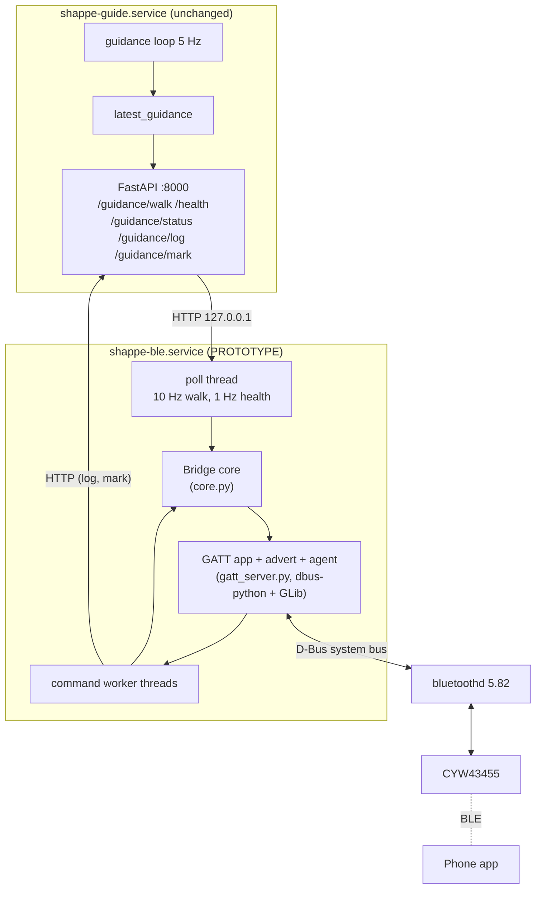

# 04 — Bluetooth Communication Architecture

> **Status.**
> - **Product:** there is **no Bluetooth code in the product today** (NOT IMPLEMENTED; a repository search found no `bluetooth`/`gatt`/`bluez`).
> - **Design:** everything below is **PROPOSED**.
> - **Prototype:** a reference implementation exists in [`ble_bridge/`](../ble_bridge/README.md). Its logic is desk-tested (34 tests) and its BlueZ access is checked read-only (`--check`). It has **not** yet run over the air.
> - **Contract:** the exact byte- and field-level contract is in [06 — ICD](06-interface-control-document.md).

---

## 1. What the link is for, and what it is not for

**Level 1:** the phone is a companion. It mirrors the device's warnings (spoken or vibrated) when the device cannot speak, shows whether the device is healthy, and lets the user ask "what's around me?". The **device stays responsible for safety**: it senses, decides and (once local audio exists) warns by itself, so a dropped Bluetooth link must never silence a warning.

**Level 2.** Data that crosses the link (all small):

| Direction | Content | Rate |
|---|---|---|
| Device → phone | **ALERT**: an announcement the device's speech gate admitted (phrase id + level + flags + front clearance), plus its text | Rare: ≥ 3 s apart, except escalations |
| Device → phone | **STATE**: the current instruction, health bits and status; it doubles as the heartbeat | 1–5 Hz, 20 bytes |
| Device → phone | **EVENTS**: health changes, sensor loss and recovery, thermal and power, sessions, command responses | Occasional, JSON |
| Phone → device | **COMMAND**: hello, ping, status and surroundings queries, session start/stop, alert acknowledgement, tester mark | User-driven |

**Not on the link:**
- video or images;
- raw LiDAR, radar or IMU data;
- location;
- anything that changes how the device decides. In v1 no command can alter guidance thresholds or silence the device.

## 2. Protocol choice

| Criterion | **BLE (GATT)** | Bluetooth Classic (SPP/RFCOMM) | Wi-Fi (today's dashboard over HTTP) |
|---|---|---|---|
| iOS | ✅ Core Bluetooth, any app | ❌ Third-party apps need MFi for Classic accessories | ✅ but needs a shared network (hotspot) |
| Android | ✅ | ✅ | ✅ |
| Power on phone | Low | Medium | High |
| Latency | One connection interval (≥ 15 ms on iOS [QA1931]) | Low | Low, but depends on the network |
| Payload | 20 B at the default ATT MTU, up to 512 B attribute values [Core ATT §3.2.9]; MTU up to 517 on BlueZ/Android | Stream | Unlimited |
| Background on phone | iOS `bluetooth-central` mode delivers notifications [Apple]; Android needs a foreground service | Android only | Very limited |
| Pairing and encryption | LE Secure Connections (Core 4.2+) | Legacy/SSP | WPA2/3 + HTTP (the dashboard has no TLS) |
| Works with no infrastructure | ✅ | ✅ | ❌ |
| Effort | Medium | Medium (iOS blocked) | Exists today |

**Decision: BLE** with the Pi as the GATT server. Classic is ruled out by iOS. Wi-Fi stays for the existing field-test dashboard (`/`, `/test`), but it needs a shared network and a browser tab in the foreground, so it is not suitable for a walking user.

**Video:** BLE cannot carry useful video; even at full rate it carries kilobytes, not megabytes, per second. Any future "show me the camera" feature for a sighted helper must use Wi-Fi (the existing MJPEG `/camera/stream/{sector}`), and needs its own privacy review ([08 §8](08-safety-reliability-failure-management.md)).

## 3. Roles

| Role | Device | Why |
|---|---|---|
| **Peripheral + GATT server** | Raspberry Pi (BlueZ 5.82) | The Pi owns the data and must keep working with no phone. Phones are built to be centrals, and iOS background mode supports a central talking to an accessory [Apple bluetooth-central]. BlueZ supports the peripheral role on this adapter (`Roles: central, peripheral`, CONFIRMED) |
| **Central + GATT client** | Phone app | It scans for the service UUID, connects, subscribes and writes commands |

**Process boundary (key design decision).** The BLE server is a **separate process** (`ble_bridge`, its own systemd unit) that reads the navigation service's existing loopback API:
- `GET /guidance/walk`: the guidance loop's snapshot, never re-running the pipeline;
- `GET /health`;
- `GET /guidance/status`;
- `GET /guidance/log`;
- `POST /guidance/mark`.

The consequences:
1. A BLE crash, stall or BlueZ restart **cannot** affect the guidance loop or its watchdog.
2. There are **no changes** to production code for v1.
3. The same bridge can serve a mock source for app development.

The cost is ≤ 100 ms of polling delay (10 Hz poll vs the 5 Hz loop). An in-process hook can remove that later if measurements show it matters.

## 4. GATT design (summary; exact table in [06 §3](06-interface-control-document.md))

| Service | Characteristic | UUID | Properties | Purpose |
|---|---|---|---|---|
| Device Information **0x180A** (SIG) | Manufacturer 0x2A29, Model 0x2A24, Hardware Rev 0x2A27, Firmware Rev 0x2A26, Software Rev 0x2A28 | SIG 16-bit | read | Identity and versions. **Serial Number 0x2A25 is deliberately omitted**, because a stable serial readable without pairing would make the device trackable |
| Battery **0x180F** (SIG) | Battery Level 0x2A19 | SIG 16-bit | — | **NOT IMPLEMENTED; not exposed** until a fuel gauge exists. It must never report a fake value |
| **Shappe Navigation** (custom) | — | `37e90001-0882-43f6-ae9b-b733c720c46d` | primary | All application data |
| | PROTOCOL_INFO | `37e90002-…` | encrypted read | Versions, capabilities, limits, device id, vocabulary revision |
| | ALERT | `37e90003-…` | encrypted read + notify | Announcements (binary record) + text |
| | STATE | `37e90004-…` | encrypted read + notify | Current instruction + health; **1 Hz heartbeat** |
| | COMMAND | `37e90005-…` | encrypted write (with response) | JSON commands |
| | EVENTS | `37e90006-…` | encrypted notify | JSON events and command responses |

The UUID base `37e9xxxx-0882-43f6-ae9b-b733c720c46d` was randomly generated on 2026-10-09 for this project. The 16-bit field `xxxx` distinguishes the attributes. It is **application-specific**, not a SIG-assigned number.

**Why so few characteristics:**
- Each subscription and each notification queue is a place for an app bug. Health is carried as bits in STATE and as events, rather than as a separate characteristic.
- Responses share EVENTS with events and are matched by `id`.

**Notifications, not indications.**
- An indication's confirmation is **ATT-level only**: it proves the phone's Bluetooth stack received the bytes, *not* that the user heard anything [Core ATT §3.4.7].
- Indications allow one outstanding PDU and add a round trip per alert.
- Delivery is instead made observable with the optional `alert_ack` command, which reports what the app actually did (spoken, haptic, shown, suppressed or expired). **The device never waits for it.**

## 5. Message protocol (design rationale)

| Option | Pros | Cons | Use |
|---|---|---|---|
| JSON everywhere | Readable, built into every platform | 150–600 B per message, so it fragments at the default MTU | — |
| CBOR | Compact, schema-free | Needs a library on each platform; harder to debug in nRF Connect | Not chosen |
| **Fixed binary for the hot path + JSON for the rest** | ALERT/STATE are **20 bytes** and fit the smallest ATT MTU with no negotiation or fragmentation. JSON stays readable where size doesn't matter | Two decoders, both small | **Chosen** |

- **Frame header (6 bytes) on every value:** version, type, per-characteristic sequence number, fragment index/count. Fragmentation applies only to JSON and ALERT_TEXT.
- **ALERT and STATE records (14 bytes):** they carry
  - **epoch**: incremented when the bridge or the navigation service restarts, so counters can reset safely;
  - **cue_seq**: the device's own announcement counter;
  - **age_ms**: the decision's age when sent, so freshness is checkable without clock sync;
  - **phrase_id**: an index into the append-only phrase registry `ble_bridge/contract/vocab_v1.json`, 300 sentences, revision 3, sha `690108ffa2ae7139`;
  - level, flags/status, and front clearance or health bits.
- **Text is also sent** (ALERT_TEXT), so an app with an older phrase registry still speaks correctly.

**Why phrase ids:** the app can localise ("Glass ahead" → another language), choose a haptic pattern per phrase, and avoid string matching. The registry is generated from `utils/simple_guidance.ALLOWED` and checked by a test. Ids are never reused.

## 6. Security

### 6.1 Threats considered

1. **Eavesdropping.** Alerts reveal where a disabled person is and what is around them.
2. **Spoofing a device** to feed false "Walk straight" messages to the phone.
3. **Unauthorised commands.**
4. **Tracking** by the static address or a serial number.
5. **Denial of service** (jamming, connection hogging).

### 6.2 Controls

| Control | v1 prototype (`ble_bridge`) | Production (PROPOSED) |
|---|---|---|
| Link encryption | All custom characteristics use BlueZ `encrypt-read` / `encrypt-notify` / `encrypt-write`, so an unencrypted access gets ATT **Insufficient Encryption (0x0F)** [BlueZ gatt-server.c] | `encrypt-authenticated-*`, which needs a MITM-protected bond and returns ATT 0x05 |
| Pairing method | **LE Secure Connections "Just Works"** (agent `NoInputNoOutput`). Encrypted, but **no MITM protection** [Core SMP]. Acceptable for a supervised lab only | **Passkey Entry, device = DisplayOnly.** The Pi's own voice speaks the 6-digit passkey into the user's earpiece and the user types it into the phone's system pairing dialog (accessible with VoiceOver/TalkBack). This needs the local audio output from [08 §4](08-safety-reliability-failure-management.md) |
| Pairing window | Pairable only for 180 s after the bridge starts (`--pair-window`); the agent rejects requests after that | Opened by a **physical button** on the device, NOT IMPLEMENTED (no button exists). Spoken "Pairing open" / "Pairing closed" |
| Owner model | One bonded phone expected; a warning is printed if more than one connects | One owner phone. A second phone needs the button and the owner's consent. Factory reset clears all bonds |
| Command authority | **No v1 command can change guidance or silence the device**, so encryption is sufficient | Any future settings command requires an authenticated bond **and** an application-layer ownership proof (HMAC challenge with a per-device secret set at claim time), with replay protection by nonce |
| Privacy (address) | BlueZ default `Privacy=off` (static public address) | `Privacy=device` in `/etc/bluetooth/main.conf`, so the Pi uses resolvable private addresses; bonded phones resolve them with the IRK [BlueZ main.conf] |
| Identity | `device_id` is a random 16-hex id stored on the device (`~/.local/state/shappe-ble/state.json`), sent only after encryption (in PROTOCOL_INFO). **No MAC or serial is used for identity** | Same. The app pins the bonded peripheral and checks `device_id` on every connect |
| Spoof resistance | The phone accepts a device only after an encrypted bond, and the mock device always identifies itself (`Shappe-M`, `mock: true`, simulated bit) | Plus authenticated pairing |

### 6.3 Key storage and reset

- **Device bonds:** stored by BlueZ in `/var/lib/bluetooth/<adapter>/<phone>/info` (LongTermKey, IRK, …) [BlueZ settings-storage]. A factory reset (PROPOSED) runs `bluetoothctl remove <addr>` for every bonded device and clears the state file.
- **Phone bonds:** iOS and Android keep them in the system. The app cannot read them, and on iOS it cannot start pairing itself: pairing starts automatically when a protected attribute is accessed [Apple ADG via Nordic].
- **Recovery:** if either side loses the bond, the user removes the device in phone Settings → Bluetooth and re-pairs during a pairing window. BlueZ's default `JustWorksRepairing=never` refuses a silent re-pair over an existing bond, which is the safe default; the device-side bond must also be removed. The app must explain this with spoken, step-by-step instructions ([07 §5](07-user-journeys-and-accessibility.md)).

### 6.4 Known risks to test (NEEDS VALIDATION)

1. **iOS pairing trigger.** Apple's guidance says to reject with **Insufficient Authentication (0x05)** to trigger pairing. BlueZ `encrypt-*` returns **Insufficient Encryption (0x0F)**. Field reports suggest iOS also pairs on 0x0F, but this must be confirmed on current iPhones. If it fails, switch to `encrypt-authenticated-*`, which returns 0x05 but requires passkey pairing.
2. **Android bonding.** The app should call `createBond()` before subscribing, and again on GATT_INSUFFICIENT_AUTHENTICATION/ENCRYPTION, rather than relying on implicit pairing.
3. **Just Works is open to a man-in-the-middle during the pairing window.** Mitigations: the short window, physical presence, and future passkey pairing.

## 7. Privacy and data handling (CONFIRMED current state + PROPOSED rules)

| Data | Today (CONFIRMED) | Over BLE (PROPOSED rule) |
|---|---|---|
| Camera images | Processed on the device. MJPEG streams are served on the LAN at `/camera/*` with no authentication (the security model relies on Host/Origin checks, not login). **No image recording code was found** | **Never sent** |
| Audio recording | None (no microphone in the code) | None |
| Location / GPS | None | None |
| Speech log | In memory (`SPEECH_LOG_TO_FILE = False`); a file only for field tests | The last ≤ 20 lines on request (`get_speech_log`), only over an encrypted link |
| Detected people | Class, box and distance in memory; nothing identifies a person | Only object class and distance in `get_surroundings` |
| Diagnostics | — | Counters, last acks, versions. No user data |
| Phone side | — | Store preferences locally. Diagnostic logs are opt-in, kept 7 days by default, deletable from Settings, and never uploaded without explicit consent |

The **LAN dashboard** exposes the cameras to anyone on the same network who can reach port 8000. That is outside BLE, but must be addressed before any public use (see [08 §8](08-safety-reliability-failure-management.md)).

---

## 8. Raspberry Pi BLE implementation guide

### 8.1 Architecture



### 8.2 Dependencies (CONFIRMED present; nothing new to install)

| Need | On this Pi |
|---|---|
| BlueZ with the D-Bus GATT and advertising APIs | `bluez 5.82-1.1+rpt2`, `bluetooth.service` active |
| D-Bus bindings | `dbus-python 1.4.0` and PyGObject (`gi`) in the system Python; the venv uses `--system-site-packages`, so they are visible |
| Permissions | The BlueZ D-Bus policy lets any user send to `org.bluez`, and lets bluetoothd call back into `GattCharacteristic1`, `LEAdvertisement1` and `Agent1` (`/usr/share/dbus-1/system.d/bluetooth.conf`). Confirmed in practice by `--check` running as the `shappe` user |
| Tests | `jsonschema 4.19.2` (system) for the schema test |

### 8.3 Files (complete, in [`ble_bridge/`](../ble_bridge/))

| File | Role |
|---|---|
| `protocol.py` | Wire format: UUIDs, frame header, fragmentation/reassembly, ALERT/STATE/ALERT_TEXT codecs, JSON helpers, sequence arithmetic |
| `core.py` | **Event-to-BLE adapter, command handler and connection state**: `on_walk` (cue-step → ALERT), `on_health` (transitions → events), `on_unreachable`, `tick` (heartbeat), `on_command` (12 commands, rate limit 10/s), epoch/device-id persistence |
| `sources.py` | `HttpSource` (loopback HTTP, 0.5 s timeout), `read_system()` (SoC temperature, `vcgencmd get_throttled`), `MockSource` with scenarios `sidewalk`, `glass_door`, `sensor_failure`, `service_crash`, `thermal` |
| `gatt_server.py` | **GATT server, advertising, pairing agent, connection manager**: `Application`/`Service`/`Characteristic` D-Bus objects, `Advertisement` (peripheral, service UUID, name), `Agent` (NoInputNoOutput, window-gated), device `PropertiesChanged` tracking, long reads (offset), notification by `PropertiesChanged(Value)`, `--check` |
| `shappe-ble.service` | systemd **user** unit (not installed) |
| `test_ble_bridge.py` | 34 desk tests (protocol, registry sync, bridge, commands, scenarios, schema) |
| `contract/` | `vocab_v1.json`, `schema_v1.json`, `test_vectors.json` (16 golden vectors, 75 frames) |

### 8.4 Bring-up procedure (supervised; nobody wearing the device)

```bash
cd ~/Documents/lidar
venv/bin/python -m unittest ble_bridge.test_ble_bridge -v      # 1. desk tests: expect 34 OK
venv/bin/python -m ble_bridge.gatt_server --check              # 2. read-only adapter check
sudo rfkill unblock bluetooth                                  # 3. the adapter is soft-blocked today (the bridge powers it on at start)
venv/bin/python -m ble_bridge.gatt_server --mock sidewalk      # 4. mock first: advertises "Shappe-M"
#    phone: nRF Connect (Android) or LightBlue (iOS) → scan → "Shappe-M" → connect → pair (Just Works)
#    → read PROTOCOL_INFO → subscribe ALERT, STATE, EVENTS → watch the scenario loop every 30 s
sudo btmon                                                     # 5. (other terminal) HCI trace: MTU, security, notifications
venv/bin/python -m ble_bridge.gatt_server                      # 6. live, with shappe-guide running
```

**Do not start `shappe-guide` (the navigation service) unsupervised.** It spins the LiDAR motor and opens every sensor.

### 8.5 Configuration (PROPOSED for production, not applied)

`/etc/bluetooth/main.conf`:

| Key | Value | Why |
|---|---|---|
| `[General] ControllerMode` | `le` | No Classic profiles needed. **Do not set this** if an A2DP headset will be paired to the Pi |
| `[General] Privacy` | `device` | Resolvable private addresses, so the device cannot be tracked |
| `[General] JustWorksRepairing` | `never` | Default; refuses silent re-pairing |
| `[General] SecureConnections` | `on` (or `only` after testing old phones) | LE Secure Connections |
| `[GATT] ExchangeMTU` | 517 (default) | Larger MTU when the phone asks |
| `[General] Name` | `Shappe` | Matches the advertisement |

Also:
- rfkill: make the unblock persistent (`systemd-rfkill` remembers state).
- Adapter auto-power: BlueZ `[Policy] AutoEnable=true` (default).

### 8.6 Startup, recovery and supervision

| Situation | Behaviour |
|---|---|
| Boot | `shappe-ble.service` (user unit) starts after `shappe-guide.service`, with `Restart=always`, `RestartSec=3`, `Nice=5` (lower priority than guidance) |
| Navigation service down | Polls fail → `service_unreachable` event, STATE `status=unreachable` with all health bits 0. The bridge keeps advertising so the phone can tell the user |
| Navigation service restarts | `cue_seq` goes backwards → the bridge bumps `epoch` and sends `service_restarted`. The first post-restart snapshot is only learned |
| Bridge restarts | A new epoch (persisted), so the phone resets its de-duplication. The phone reconnects automatically |
| bluetoothd restarts | The bridge's registrations vanish with it. The bridge watches the `org.bluez` bus name: when bluetoothd leaves, it exits non-zero and systemd (`Restart=always`) starts a fresh bridge that registers again (PROTOTYPE). A registration refused at start-up also exits non-zero |
| Adapter blocked | `--check` and start-up print `rfkill unblock` guidance; the unit retries |

### 8.7 Verification commands

```bash
bluetoothctl show                       # Powered: yes, Roles, advertising features
busctl tree org.bluez                   # /org/bluez/hci0 present
busctl introspect org.bluez /org/bluez/hci0 org.bluez.LEAdvertisingManager1
bluetoothctl devices Bonded             # who is bonded (BlueZ >= 5.65 syntax)
sudo btmon                              # live HCI: ATT MTU exchange, encryption, notifications
journalctl --user-unit=shappe-ble -f    # bridge log
venv/bin/python -m ble_bridge.make_vocab --check   # phrase registry still matches the device
```

### 8.8 Prototype vs production

| | Prototype (exists) | Production (to build) |
|---|---|---|
| Pairing | Just Works, timed window | Passkey spoken by the device; button-opened window |
| Multi-phone | Warn only | Enforce one owner; second phone by consent |
| Notifications | `PropertiesChanged` (one D-Bus call per frame) | `AcquireNotify` file-descriptor path for lower overhead, if measurements need it |
| MTU knowledge | From `hello.att_mtu` or the write `mtu` option | Plus `AcquireNotify` MTU |
| Polling | 10 Hz HTTP | Optional in-process publisher hook in `unified_guidance` (removes ≤ 100 ms) |
| bluetoothd restart | systemd restart | In-process re-registration |
| Tests | Desk only | Over-the-air test suite against iOS and Android reference phones ([09 §5](09-roadmap-and-integration-checklist.md)) |
