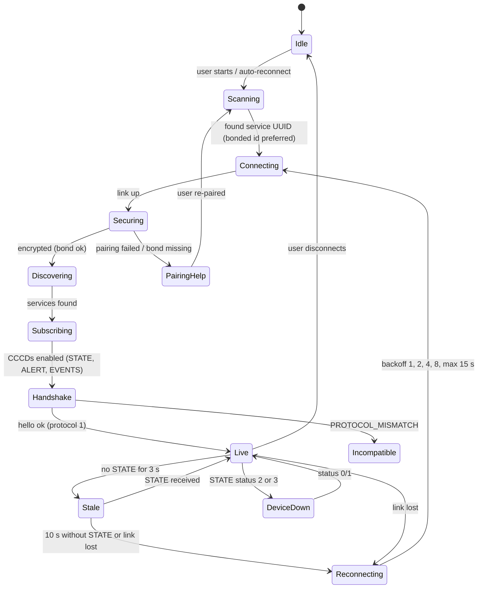

# 06 — Interface Control Document (ICD): Shappe BLE Protocol v1

| | |
|---|---|
| Status | **PROPOSED v1.0-draft** (2026-10-09). Reference implementation: `ble_bridge/protocol.py` + `ble_bridge/core.py`, desk-tested; **not yet tested over the air** |
| Normative artefacts | This document; [`ble_bridge/contract/schema_v1.json`](../ble_bridge/contract/schema_v1.json) (JSON Schema 2020-12); [`vocab_v1.json`](../ble_bridge/contract/vocab_v1.json) (phrase registry rev 3, sha `690108ffa2ae7139`, 300 phrases); [`test_vectors.json`](../ble_bridge/contract/test_vectors.json) (16 golden vectors) |
| Conformance | An implementation conforms if it decodes every `frames_hex` in `test_vectors.json` to its `expect`, and obeys the MUST rules in §8 |
| Keywords | MUST / SHOULD / MAY as in RFC 2119 |

If this document and `protocol.py` disagree, that is a bug; raise it. Do not pick one silently.

---

## 1. Roles and transport

| Item | Value |
|---|---|
| Device role | BLE **peripheral** and GATT **server** (Raspberry Pi 5, BlueZ 5.82) |
| App role | BLE **central** and GATT **client** |
| Advertising | Legacy advertising, connectable. AD = Flags + Complete List of 128-bit Service UUIDs (`37e90001-0882-43f6-ae9b-b733c720c46d`) + Local Name. `Shappe` (6 B) gives 29 B; the mock's `Shappe-M` (8 B) gives exactly 31 B. **A name over 8 bytes does not fit** a legacy advertisement and is shortened by BlueZ. To label a mock before pairing, read Device Information Model Number (`Shappe Guide MOCK`), which needs no pairing |
| Discovery filter | Apps MUST scan by **service UUID**, not by name. A name is a hint, never an identity |
| Connections | v1 supports **one** connected central. Behaviour with two is undefined |
| ATT MTU | Default 23 MUST work. Apps SHOULD request a larger MTU (Android `requestMtu(517)`; iOS negotiates automatically) and report the result in `hello.att_mtu` |
| Security | All custom characteristics need an **encrypted** link (bonded) in v1. Production will need an authenticated (MITM) bond. See [04 §6](04-bluetooth-communication-architecture.md) |

## 2. Units and conventions

| Quantity | Unit / form |
|---|---|
| Distance | **feet** (the device's one user-facing unit). Binary fields carry **tenths of a foot** (`front_dft`) |
| Age / latency | milliseconds, measured on the **device's monotonic clock** |
| Time stamps (`ts`) | ISO 8601 UTC with milliseconds, e.g. `2026-10-09T10:30:00.123Z`, from the device's wall clock. **It may be wrong** (the Pi has no RTC battery). Use it for logs only; use `uptime_ms` and `age_ms` for ordering and freshness |
| Integers in binary | Little-endian, unsigned unless noted (`level` is signed int8) |
| Text | UTF-8 |
| Booleans in JSON | `true`/`false` |
| Unknown | Binary: the sentinel noted per field. JSON: `null` |

## 3. GATT table

| Service | Characteristic | UUID | Direction | Properties / BlueZ flags (v1) | Max size | Purpose |
|---|---|---|---|---|---|---|
| **Device Information** (SIG) | — | `0x180A` | — | primary | — | Standard identity |
| | Manufacturer Name | `0x2A29` | D→A | read | ≤ 180 B UTF-8 | "Shappe project (prototype)" |
| | Model Number | `0x2A24` | D→A | read | ≤ 180 B | "Shappe Guide (Raspberry Pi 5)" or "Shappe Guide MOCK" |
| | Hardware Revision | `0x2A27` | D→A | read | ≤ 180 B | e.g. "Raspberry Pi 5 Model B Rev 1.1" |
| | Firmware Revision | `0x2A26` | D→A | read | ≤ 180 B | Linux kernel release |
| | Software Revision | `0x2A28` | D→A | read | ≤ 180 B | `guide <git sha>[+dirty]; ble-bridge 0.1; protocol 1` |
| **Battery** (SIG) | Battery Level | `0x180F` / `0x2A19` | — | **not exposed** | — | **NOT IMPLEMENTED** (no gauge). Reserved |
| **Shappe Navigation** | — | `37e90001-0882-43f6-ae9b-b733c720c46d` | — | primary | — | Application service |
| | PROTOCOL_INFO | `37e90002-0882-43f6-ae9b-b733c720c46d` | D→A | `encrypt-read` | 1 frame, ≤ ~480 B (GATT long read; model and software strings are left to Device Information and the `hello` result so it always fits 512 B) | Versions, capabilities, limits (§6.1) |
| | ALERT | `37e90003-0882-43f6-ae9b-b733c720c46d` | D→A | `encrypt-read`, `encrypt-notify` | 20 B (ALERT); ALERT_TEXT fragmented | Announcements (§5.2, §5.3) |
| | STATE | `37e90004-0882-43f6-ae9b-b733c720c46d` | D→A | `encrypt-read`, `encrypt-notify` | 20 B | Current state + heartbeat (§5.4) |
| | COMMAND | `37e90005-0882-43f6-ae9b-b733c720c46d` | A→D | `encrypt-write` (write **with** response) | frames of ≤ MTU−3 B; message ≤ 4096 B | JSON commands (§6.2) |
| | EVENTS | `37e90006-0882-43f6-ae9b-b733c720c46d` | D→A | `encrypt-notify` | fragmented; message ≤ 4096 B | JSON responses and events (§6.3, §6.4) |

- The CCCD (`0x2902`) of each notify characteristic is created by BlueZ. Apps enable notifications the platform way (Android: `setCharacteristicNotification` **and** writing `ENABLE_NOTIFICATION_VALUE` to `0x2902`).
- An access before encryption gets ATT error **0x0F Insufficient Encryption**, which SHOULD trigger pairing (see [04 §6.4](04-bluetooth-communication-architecture.md) for the iOS caveat).

## 4. Frame format (all custom characteristics)

```
offset size field        notes
0      1    version      = 1 (PROTOCOL_VERSION). Other value -> PROTOCOL_MISMATCH
1      1    type         see §4.1
2      2    seq          uint16 LE. Per characteristic, per connection, starts at 0 with the first
                         notification of each new connection, +1 per MESSAGE actually notified
                         (not per fragment; nothing is numbered while unsubscribed), wraps 65535 -> 0.
                         Read values always carry seq 0.
4      1    frag_index   0 .. frag_count-1
5      1    frag_count   1 .. 255
6      ..   payload      this fragment's bytes
```

- **Fragment payload size** = `min(ATT_MTU, 517) − 3 − 6`: 14 B at MTU 23, 176 B at MTU 185, 508 B at MTU 517.
- **Reassembly.** Concatenate the payloads of fragments 0…count−1 that share `type` and `seq`, in order. A gap, a new `index 0` before completion, an index/count mismatch, or more than **2 s** between first and last fragment MUST discard the partial message (and MAY log it). Messages are at most **4096 B** after reassembly.
- **Loss detection.** On a healthy link, notifications arrive in order and are not lost (ATT is reliable within a connection). A `seq` gap on a characteristic means a bug or a reconnect; log it as `link_gap`.

### 4.1 Message types

| Type | Name | Encoding | Characteristic | Fragmented |
|---|---|---|---|---|
| `0x01` | PROTOCOL_INFO | JSON | PROTOCOL_INFO (read) | No (long read) |
| `0x10` | ALERT | binary record (14 B) | ALERT | **Never** |
| `0x11` | ALERT_TEXT | `epoch u16, cue_seq u32, UTF-8 text` | ALERT | Yes |
| `0x20` | STATE | binary record (14 B) | STATE | **Never** |
| `0x30` | RESPONSE | JSON | EVENTS | Yes |
| `0x31` | EVENT | JSON | EVENTS | Yes |
| `0x40` | COMMAND | JSON | COMMAND (write) | Yes |

Receivers MUST ignore unknown types (forward compatibility).

## 5. Binary records

### 5.1 Common layout (ALERT and STATE): 14 bytes

```
offset size type   ALERT field                      STATE field
0      2    u16    epoch                            epoch
2      4    u32    cue_seq (this announcement)      cue_seq (latest known)
6      2    u16    age_ms                           age_ms
8      2    u16    phrase_id                        phrase_id (current instruction)
10     1    i8     level (-1..3)                    level (-1..3)
11     1    u8     flags                            status
12     2    u16    front_dft (tenths of a foot)     health_bits
```

| Field | Meaning |
|---|---|
| `epoch` | Incremented whenever the counter source may have restarted: at every bridge start (persisted), and whenever the navigation service's `cue_seq` goes backwards. **A different epoch means "new counter": reset de-duplication.** |
| `cue_seq` | The device's announcement counter (`notify.cue_seq`). It increments exactly when the device's speech gate admits a sentence |
| `age_ms` | How old the decision was when sent: ALERT: the guidance loop's snapshot age at the poll (`loop.age_s`); STATE: that age plus the time since the poll. `0xFFFF` = unknown; it saturates at `0xFFFE` |
| `phrase_id` | Id in the phrase registry (§7). `0` = no sentence; `0xFFFF` = not in the registry (use ALERT_TEXT) |
| `level` | 0 walk straight · 1 advisory · 2 blocked/turn/mover · 3 vehicle approaching · −1 none |
| `front_dft` | Fused front clearance (`path.front_ft` × 10). `0xFFFF` = unknown. **It is the clearance straight ahead, not necessarily the distance to the named object** |

### 5.2 ALERT flags (byte 11)

| Bit | Mask | Name | Meaning |
|---|---|---|---|
| 0 | `0x01` | ANNOUNCE | The device admitted this sentence for announcement (always 1 in v1) |
| 1 | `0x02` | URGENT | The device classed it urgent (blocked, vehicle approaching or mover) |
| 2 | `0x04` | DEVICE_VOICE | The Pi's own voice accepted this cue (`pi_voice.usable` and `accepted_seq == cue_seq`). **The app MUST NOT speak it again** |
| 3 | `0x08` | AUDIO_ENABLED | The device's `AUDIO_ENABLED`. **0 = no device, Pi or phone, may make sound** (the current setting) |
| 4 | `0x10` | REPLAY | A read-value copy of an old alert. **Never announce** |
| 5 | `0x20` | LOOP_STALE | The guidance loop was not updating when this was sent. Do not announce; show a warning |
| 6–7 | — | reserved | Ignore |

### 5.3 ALERT_TEXT (type 0x11)

`epoch u16 | cue_seq u32 | text (UTF-8, ≤ 200 B)`. It is sent immediately after the ALERT with the same `(epoch, cue_seq)`. The text is the exact sentence the device announced.

### 5.4 STATE status (byte 11) and health bits (bytes 12–13)

| status | Name | Meaning |
|---|---|---|
| 0 | ok | `/health` ok: guiding, all sensors OK |
| 1 | degraded | Guiding with LiDAR, but some other sensor is not OK (see bits and warnings) |
| 2 | down | Not guiding, or LiDAR not OK |
| 3 | unreachable | The bridge cannot reach the navigation service (crashed or restarting). All health bits are 0 |

| Bit | Mask | Name | Source |
|---|---|---|---|
| 0 | `0x0001` | guiding | `/health.guiding` and the loop is not stale |
| 1 | `0x0002` | lidar_ok | `/health.sensors.lidar_ok` |
| 2 | `0x0004` | radar_ok | `/health.sensors.radar_ok` |
| 3 | `0x0008` | camera_ok | `/health.sensors.camera_ok` |
| 4 | `0x0010` | hailo_ok | `/health.sensors.hailo_ok` |
| 5 | `0x0020` | front_glass_ok | `/guidance/status.front_glass_ok` |
| 6 | `0x0040` | audio_enabled | `notify.pi_voice.audio_enabled` |
| 7 | `0x0080` | device_voice_usable | `notify.pi_voice.usable` |
| 8 | `0x0100` | simulated_input | A `SIMULATED` warning, or a mock device. **Nothing reported is real** |
| 9 | `0x0200` | thermal_warn | SoC ≥ 80 °C, or throttle/cap/soft-limit active now |
| 10 | `0x0400` | undervoltage | `vcgencmd get_throttled` bit 0 |
| 11 | `0x0800` | loop_stale | `latest_guidance().loop.stale` |
| 12–15 | — | reserved | Ignore |

**Heartbeat.** STATE is notified when its content changes (at most every 200 ms) and **at least every 1000 ms**. An app that receives no STATE for **3000 ms** MUST treat the link as stale (§9).

### 5.5 Worked example: urgent "Blocked by glass" (from `test_vectors.json`)

```
01 10 0000 00 01 | 0300 2a000000 6e00 0500 02 0b 2400
ver=1 type=ALERT seq=0 frag 0/1 | epoch=3 cue=42 age=110ms phrase=5 level=2
flags=0x0b (ANNOUNCE|URGENT|AUDIO_ENABLED) front=36 -> 3.6 ft
then ALERT_TEXT at MTU 23 (2 fragments):
01 11 0100 00 02 0300 2a000000 426c6f636b656420      "Blocked "
01 11 0100 01 02 627920676c617373                      "by glass"
```

The human-readable form of the same event, for logs and debugging:

```json
{"kind": "alert", "epoch": 3, "cue_seq": 42, "age_ms": 110, "phrase_id": 5,
 "text": "Blocked by glass", "level": 2, "urgent": true, "device_voice": false,
 "audio_enabled": true, "replay": false, "loop_stale": false, "front_ft": 3.6}
```

## 6. JSON messages

All JSON messages are compact UTF-8 objects, validated by `schema_v1.json`. Receivers MUST ignore unknown fields.

### 6.1 PROTOCOL_INFO (read; the `hello` result adds `model`, `software`, `session`, `status`, `att_mtu`)

```json
{"v":1,"protocol":1,"min_protocol":1,"device_id":"0123456789abcdef","mock":false,
 "vocab":{"version":1,"revision":3,"sha":"690108ffa2ae7139"},"epoch":3,"units":{"distance":"ft"},
 "limits":{"max_message_bytes":4096,"alert_max_age_ms":2000,"heartbeat_ms":1000},
 "commands":["alert_ack","get_current","get_diagnostics","get_speech_log","get_status",
             "get_surroundings","hello","mark","ping","session_start","session_stop","set_device_settings"]}
```

### 6.2 COMMAND (app → device)

Envelope: `{"v":1,"id":<uint32>,"cmd":"<name>","args":{…}}`. The `id` is chosen by the app and echoed in the RESPONSE. It SHOULD increment per command.

| cmd | args | result (`ok:true`) | Notes |
|---|---|---|---|
| `hello` | `protocol` (1), `app`, `app_version`, `att_mtu` (23–517) | PROTOCOL_INFO + `model`, `software`, `session`, `status`, `att_mtu` | **Send first after subscribing.** Sets the fragment size |
| `ping` | `t` (app ms) | `t`, `uptime_ms` | Round-trip time |
| `get_status` | — | `status`, `unreachable_reason`, `guiding`, `sensors{lidar,radar,camera,hailo}`, `front_glass_ok`, `radar_down[]`, `warnings[]`, `loop{running,last_ok_age_s,error}`, `voice{audio_enabled,usable,output,error}`, `system{soc_c,throttled}`, `battery:null` | `battery` is always `null` in v1 |
| `get_current` | — | `instruction`, `phrase_id`, `action`, `rule`, `side`, `obstacle`, `front_ft`, `glass_ahead`, `reason`, `age_s`, `stale` | "What's the device saying now?" May be unspoken |
| `get_surroundings` | — | `level`, `summary`, `items[≤6]{object, clock, sector, distance_ft, urgency, source, shape}`, `age_s`, `stale` | The hazard list ([03 §7](03-perception-and-navigation-pipeline.md)). **Inferred, not authoritative** |
| `get_speech_log` | `limit` 1–20 | `entries[]{time, source, level, text, cue_seq, via, outcome}` | From `/guidance/log` |
| `get_diagnostics` | — | `stats{…}`, `epoch`, `last_cue`, `att_mtu`, `walk_age_s`, `acks[≤5]` | |
| `session_start` | — | `{id, started}` + event `session_started` | Idempotent: returns the running session |
| `session_stop` | — | `{id, started, duration_s}` + event `session_stopped` | `BAD_ARGS` if none is running. **Does not stop device guidance** |
| `alert_ack` | `epoch`, `cue_seq`, `outcome` ∈ spoken/haptic/shown/suppressed/expired/duplicate, `app_latency_ms` | `{}` | Diagnostic only. The device never waits for it |
| `mark` | `kind` ∈ right/wrong/missed/note, `note` ≤ 200 | `{ok, kind, last_said}` | Field-test verdict stamped into the device's speech log (`POST /guidance/mark`) |
| `set_device_settings` | any | — | **Always `NOT_SUPPORTED` in v1** |

Commands are rate-limited to **10 per second** (excess: `BUSY`).

### 6.3 RESPONSE (device → app, on EVENTS)

```json
{"v":1,"id":7,"ok":true,"result":{ … }}
{"v":1,"id":8,"ok":false,"error":{"code":"NOT_SUPPORTED","message":"device settings cannot be changed over Bluetooth in v1"}}
{"v":1,"id":null,"ok":false,"error":{"code":"BAD_FRAME","message":"fragment 2/5 of seq 4 out of order"}}
```

| Error code | When |
|---|---|
| `BAD_FRAME` | Header invalid, a fragment out of order, or a non-COMMAND type written |
| `BAD_JSON` | Payload is not a UTF-8 JSON object |
| `PROTOCOL_MISMATCH` | `v` ≠ 1, or `hello.protocol` ≠ 1 |
| `UNKNOWN_COMMAND` | `cmd` not in PROTOCOL_INFO.commands |
| `BAD_ARGS` | Argument missing, wrong type or out of range |
| `NOT_SUPPORTED` | Known but not available in this version |
| `NOT_AUTHORIZED` | Reserved (v2 ownership proof) |
| `TOO_LARGE` | Message > 4096 B or > 255 fragments |
| `BUSY` | More than 10 commands/s |
| `DEVICE_UNAVAILABLE` | The navigation service did not answer (log, mark) |
| `INTERNAL` | Unexpected bridge error (message included) |

### 6.4 EVENT (device → app, on EVENTS)

Envelope: `{"v":1,"event":"<name>","ts":"…Z","uptime_ms":<int>,"session_id":<str|null>,"data":{…}}`

| event | data | Trigger (source) | App action (§8) |
|---|---|---|---|
| `device_ready` | `{status, guiding, sensors{}, warnings[]}` | `/health` status becomes ok/degraded: after start, after unreachable, or after a `down` status recovers. `/health` does not wait for the start-up gate, so device speech may still be held for a few seconds | Announce "Shappe ready" (+ "degraded: …") |
| `health_changed` | same as above | Status or warnings list changed | Update the dashboard; announce new warnings at CAUTION |
| `sensor_degraded` / `sensor_recovered` | `{sensor: lidar\|radar\|camera\|hailo\|front_glass}` | An `*_ok` transition | Announce per the §8 table |
| `guidance_stalled` / `guidance_resumed` | `{reason}` | `/health.guiding` transition: the guidance **loop itself** stopped or resumed ticking. A lost LiDAR is **not** this event (the loop keeps running and says "Sensors offline"); it shows as `sensor_degraded{lidar}` + STATE status 2 | Stalled = SYSTEM FAILURE alert |
| `thermal_warning` / `thermal_ok` | `{soc_c, throttled}` | SoC ≥ 80 °C or throttling (bridge reads it) | WARNING |
| `power_warning` | `{undervoltage:true, soc_c, throttled}` | Under-voltage now (rising edge) | WARNING |
| `service_unreachable` | `{reason}` | Polls fail (rising edge) | SYSTEM FAILURE: "Shappe guidance stopped. Use your cane." |
| `service_restarted` | `{epoch}` | `cue_seq` went backwards | Reset de-duplication (also implied by the epoch) |
| `session_started` / `session_stopped` | `{id, started[, duration_s]}` | Command | Confirm to the user |
| `shutting_down` | `{}` | Bridge stopping (SIGTERM) | Expect disconnect; do not alarm unless it is unexpected |
| *(reserved)* `battery_low`, `battery_critical` | — | **NOT IMPLEMENTED** (no gauge) | — |

Unknown event names MUST be ignored. **Events are not queued or replayed:** one sent while no phone is subscribed is gone, so after every (re)subscription the app MUST read the current state with STATE and `get_status`.

## 7. Phrase registry (`vocab_v1.json`)

- **Generation.** `{"registry":"shappe-phrases","version":1,"revision":3,"sha":"690108ffa2ae7139","phrases":[{id,text,action,level,urgent,side,obstacle,mover[,retired]}…]}` is generated from `utils/simple_guidance.ALLOWED` by `ble_bridge/make_vocab.py`. It is **append-only**: ids are never reused, removed phrases are marked `retired`, and any change bumps `revision`.
- **App use.** The app embeds a revision. If PROTOCOL_INFO's `vocab.sha` differs, the app MUST still handle known ids, and MUST use ALERT_TEXT for unknown ids.
- **`side` semantics** (inherited from `simple_guidance.guidance()`):
  - `turn_*`, `steer_*`, `mover_move_*`: the side to **move** toward.
  - `near_wall_*`, `drift_*`, `glass_beside_*`, `vehicle_approaching_*`: the side the **hazard** is on.

  For example, id 15 "Vehicle approaching, move right" has `side: "left"`: the vehicle comes from the left.
- **Common ids** (rev 2; ids never change between revisions):

| id | text | level | urgent | action |
|---|---|---|---|---|
| 1 | Walk straight | 0 | no | walk_straight |
| 2 | Wall ahead | 1 | no | wall_ahead |
| 3 | Glass ahead | 1 | no | glass_ahead |
| 4 | Blocked by wall | 2 | yes | blocked_wall |
| 5 | Blocked by glass | 2 | yes | blocked_glass |
| 6 / 7 | Turn left / Turn right | 2 | yes | turn_left / turn_right |
| 10 | Near left wall, move right | 1 | no | near_wall_left |
| 14 | Sensors offline | 2 | no | sensors_offline |
| 15 | Vehicle approaching, move right | 3 | yes | vehicle_approaching_left |
| 17 | Vehicle approaching | 3 | yes | vehicle_approaching |
| 18 | Vehicle in front, be careful | 1 | no | vehicle_ahead |
| 19 / 20 | Glass sensor off / on | 1 | no | glass_sensor_off / _on |
| 296 / 297 | Camera off / on | 1 | no | camera_off / camera_on (added in rev 2) |
| 298 / 299 | Turn slightly left / right | 1 | no | steer_left / steer_right: the route planner, past something no camera names (added in rev 3) |
| 300 | Turn around | 2 | yes | turn_around: the route planner, no way 1 m clear anywhere ahead (added in rev 3) |
| 27 | Person coming toward you, move left | 2 | yes | mover_move_left (silent while `LIDAR_MOVERS_SPEAK=False`) |
| 63 | Person ahead | 1 | no | object_ahead |
| 194 | Pole ahead, turn slightly right | 1 | no | steer_right |
| 267 | Person in front, turn left | 2 | yes | steer_left |

## 8. Alert delivery semantics (normative for the app)

**Level 1:** the device decides when to speak. The phone speaks a device announcement **once**, and only if it is new, fresh, not already spoken by the device, and the device allows sound.

| # | Rule |
|---|---|
| A1 | Announce **only** on an ALERT **notification** (type 0x10) with `REPLAY = 0`. Never announce from STATE, reads, PROTOCOL_INFO or `get_current`. **Never announce on a timer or on polls** |
| A2 | De-duplicate by `(epoch, cue_seq)`: handle it only if the epoch differs from the last handled, or `cue_seq` is greater. Otherwise drop it and ack `duplicate` |
| A3 | Freshness: drop (ack `expired`) if `age_ms == 0xFFFF`, or if `age_ms + (local_now − local_receive_time) > limits.alert_max_age_ms` (2000). Also drop if `LOOP_STALE` |
| A4 | If `AUDIO_ENABLED = 0`: make **no sound**; show the text and update the dashboard. Haptics only if the user explicitly enabled "haptics when silent" |
| A5 | If `DEVICE_VOICE = 1`: the device is speaking it, so the app MUST NOT speak it. It MAY vibrate (if enabled) and update the display |
| A6 | Otherwise speak the phrase: from the embedded registry if `phrase_id` is known, else the ALERT_TEXT text. Wait for ALERT_TEXT at most 300 ms, then skip. Do not invent wording |
| A7 | Priority: `URGENT` or `level ≥ 2` interrupts current app speech. Lower levels replace anything queued (newest wins) and never queue behind each other |
| A8 | The app MUST NOT generate guidance of its own ("Walk straight", "Path clear") or repeat device alerts on its own schedule. Repetition is the device's job |
| A9 | Status and system messages (§6.4) use the app's own fixed sentences and the alert levels in [07 §6](07-user-journeys-and-accessibility.md), and MUST NOT reuse device phrase wording |
| A10 | After handling, SHOULD send `alert_ack{epoch, cue_seq, outcome, app_latency_ms}` |

## 9. Connection state machine (app)



| Event | App MUST |
|---|---|
| Enter `Stale` | Announce at WARNING: "Lost contact with Shappe. Use your cane." Repeat every 30 s while stale, at most 5 times, then every 120 s ([07 §6](07-user-journeys-and-accessibility.md)) |
| Enter `Reconnecting` | Keep retrying in the background (where the OS allows). Never stop retrying silently |
| Back to `Live` | Announce "Shappe connected" (INFORMATION). Re-read STATE. **Do not announce the ALERT read value** (`REPLAY`) |
| `DeviceDown` | Announce the SYSTEM FAILURE message for status 2/3 |
| Bond lost | Spoken step-by-step re-pair help ([07 §5](07-user-journeys-and-accessibility.md)) |

**Subscription order.** STATE, then ALERT, then EVENTS, then `hello`. Subscriptions are per connection; re-subscribe after every reconnect. Do not rely on bonded CCCD persistence.

## 10. Versioning and compatibility

| Change | Rule |
|---|---|
| Incompatible wire change | Bump `version` (frame byte 0) and `protocol`. Old apps get `PROTOCOL_MISMATCH` and MUST tell the user "Shappe needs an app update" |
| New optional JSON field, event, command or flag bit | Same protocol. Receivers ignore unknowns. Commands are discoverable in PROTOCOL_INFO.commands |
| New message type | Same protocol. Receivers ignore unknown types |
| New phrase | Registry revision++. Old apps use ALERT_TEXT |
| UUIDs | Never change within protocol 1 |

## 11. Traceability: every device message

| Message | 1. Hardware | 2. Software module | 3. Created by | 4. Serialised | 5. Characteristic | 6. App parses | 7. App action | 8. If delayed / lost |
|---|---|---|---|---|---|---|---|---|
| ALERT + ALERT_TEXT | LiDAR, radar, cameras (+ Hailo) | `walk_policy` → `simple_guidance` (gate) → `unified_guidance` commit → `latest_guidance` | `core.Bridge._alert` on a `cue_seq` step | 14 B record + text (§5) | ALERT notify | Decode record; look up phrase; reassemble text | Rules A1–A10 | Older than 2 s: dropped (A3). Lost: the device still speaks locally (when audio exists). The next STATE shows the current instruction, **but it is not announced** |
| STATE | All (via `/health`), Pi SoC | `/health`, `/guidance/status`, `latest_guidance`, `read_system` | `core.Bridge._maybe_state` | 14 B record | STATE notify/read | Decode bits | Dashboard; heartbeat; DeviceDown | 3 s with none → Stale |
| `device_ready` / `health_changed` | All | `sensor_fusion.get_system_health`, `main.health_check` | `core.Bridge.on_health` | JSON | EVENTS | JSON | Announce / update | Superseded by the next STATE bits and `get_status` |
| `sensor_*` | LiDAR / radar / camera / Hailo | same | same | JSON | EVENTS | JSON | Announce (see 07) | STATE bits are authoritative |
| `guidance_*` | — | `pi_voice.loop_status` | same | JSON | EVENTS | JSON | SYSTEM FAILURE / recovered | STATE bit 0 |
| `thermal_*`, `power_warning` | Pi SoC / PSU | `sources.read_system` (bridge) | same | JSON | EVENTS | JSON | WARNING | STATE bits 9–10 |
| `service_unreachable` / `_restarted` | — | bridge poll failure / `cue_seq` reset | `on_unreachable` / `on_walk` | JSON | EVENTS | JSON | SYSTEM FAILURE / reset | STATE status 3 / epoch |
| RESPONSE | — | the handler in `core._COMMANDS` | `on_command` | JSON | EVENTS | JSON, match `id` | Resolve the pending command | App timeout 3 s → retry once, then report |

## 12. Traceability: every app command (reverse path)

| Command | App screen ([07 §7](07-user-journeys-and-accessibility.md)) | Serialised | Characteristic | Bridge handler | Device effect | Response / events |
|---|---|---|---|---|---|---|
| `hello` | Connect (automatic) | JSON | COMMAND write | `_cmd_hello` | Sets frame size | PROTOCOL_INFO |
| `ping` | Diagnostics | JSON | COMMAND | `_cmd_ping` | none | `{t, uptime_ms}` |
| `get_status` | Home "Device status", Diagnostics | JSON | COMMAND | `_cmd_get_status` | none | status object |
| `get_current` | Home "What's ahead?" | JSON | COMMAND | `_cmd_get_current` | none | current instruction |
| `get_surroundings` | Home "What's around me?" | JSON | COMMAND | `_cmd_get_surroundings` | none | hazard list |
| `get_speech_log` | Diagnostics | JSON | COMMAND | `_cmd_get_speech_log` → `GET /guidance/log` | none | entries |
| `get_diagnostics` | Diagnostics | JSON | COMMAND | `_cmd_get_diagnostics` | none | stats |
| `session_start` / `session_stop` | Home "Start/End walk" | JSON | COMMAND | `_cmd_session_*` | Bridge session id only. **Guidance is unaffected** | result + event |
| `alert_ack` | automatic | JSON | COMMAND | `_cmd_alert_ack` | Kept in memory (50) | `{}` |
| `mark` | Field-test screen | JSON | COMMAND | `_cmd_mark` → `POST /guidance/mark` | One speech-log line | `{ok, kind, last_said}` |
| `set_device_settings` | (none in v1) | JSON | COMMAND | `_cmd_set_device_settings` | none | `NOT_SUPPORTED` |

## 13. Traceability matrix (code → message → screen)

| Code module | Message / field | App screen |
|---|---|---|
| `utils/simple_guidance.py` (`_Gate`, `ALLOWED`, `_LEVEL`) | ALERT phrase, level, urgent, cue_seq; vocab | Live alerts; Home "last alert" |
| `utils/unified_guidance.py` (`latest_guidance`, `notify`) | ALERT flags (DEVICE_VOICE, AUDIO_ENABLED, LOOP_STALE), STATE phrase/age | Home |
| `utils/walk_policy.py` | ALERT `front_dft`; `get_current.front_ft`, `glass_ahead` | Home "What's ahead?" |
| `utils/sensor_fusion.py` (`build_hazards`, `get_system_health`) | `get_surroundings`; health bits; warnings | "What's around me?"; Device status |
| `main.py` `/health` | STATUS ok/degraded/down; guiding | Home status line; system alerts |
| `utils/pi_voice.py` | device_voice_usable, audio_enabled | Settings › Audio (explains who speaks) |
| `utils/speech_log.py` | `get_speech_log`; `mark` | Diagnostics; Field test |
| `ble_bridge/sources.read_system` | thermal/undervoltage bits and events | Device status; system alerts |
| `ble_bridge/core` (session, epoch, acks) | session events, epoch, diagnostics | Home Start/End; Diagnostics |
