# 10 — System Architecture and Sequence Diagrams

All diagrams are Mermaid. In each diagram, solid parts are **CONFIRMED** (code), and parts marked *(P)* are **PROPOSED** (the BLE bridge, the app, local audio, the button, the battery).

---

## 1. Layered system architecture

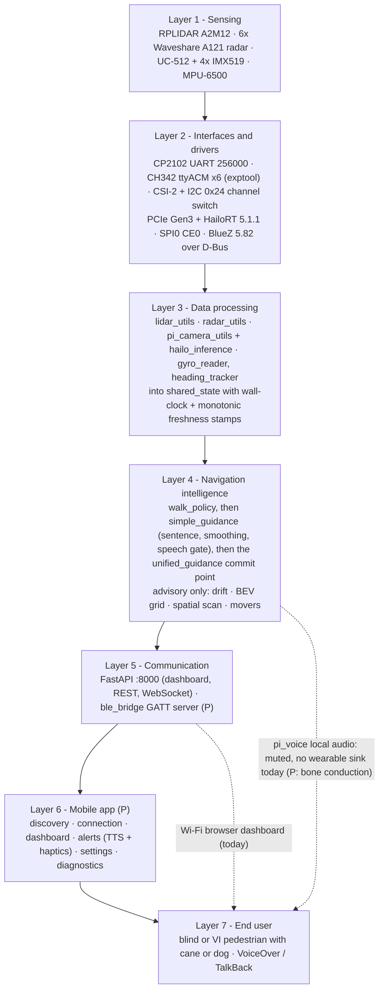

The per-module data flow is in [03 §2](03-perception-and-navigation-pipeline.md), and the BLE process layout is in [04 §8.1](04-bluetooth-communication-architecture.md).

## 2. Component diagram (processes and threads)

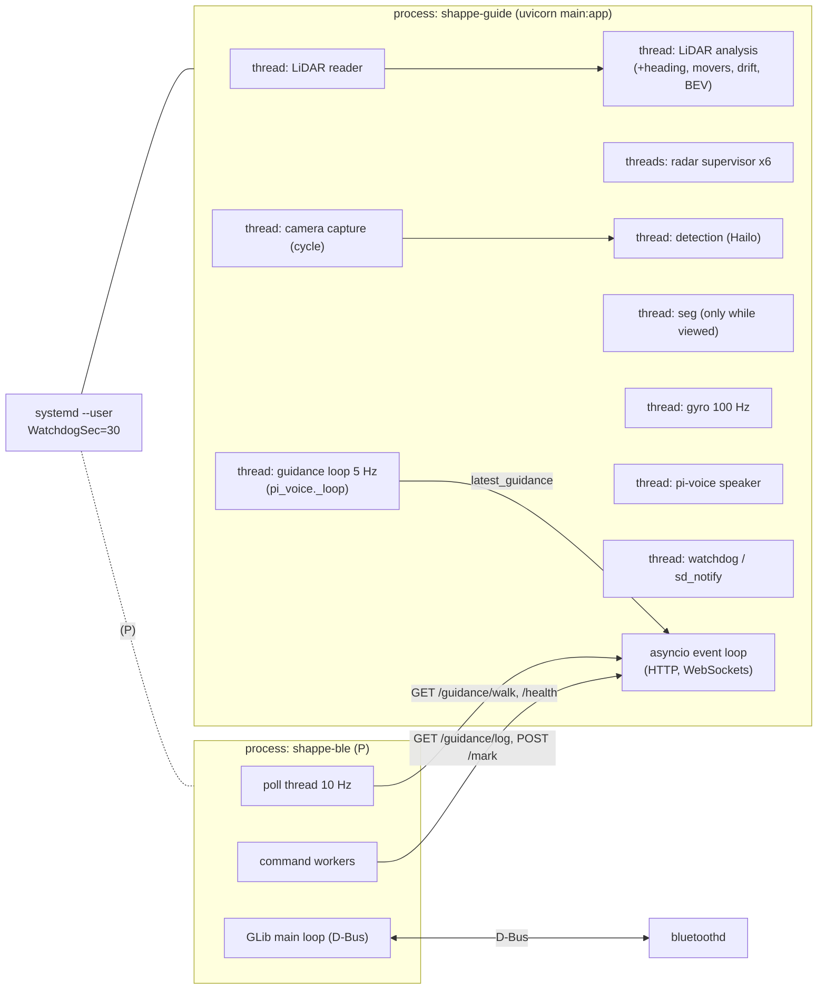

## 3. Communication flows

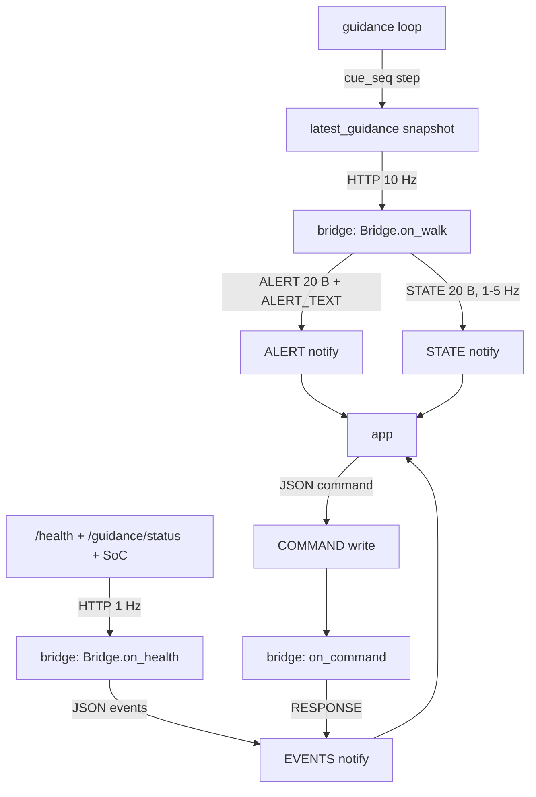

## 4. Sequence diagrams

### 4.1 Hardware boot and initialisation

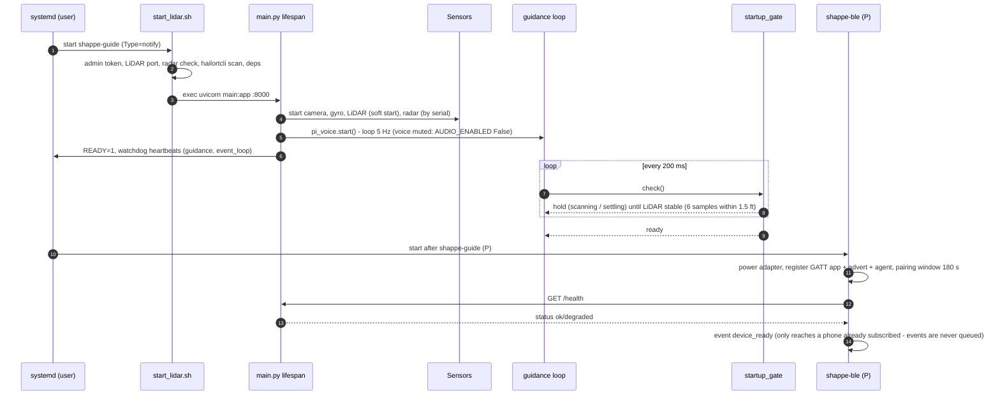

### 4.2 Bluetooth discovery and pairing (P)

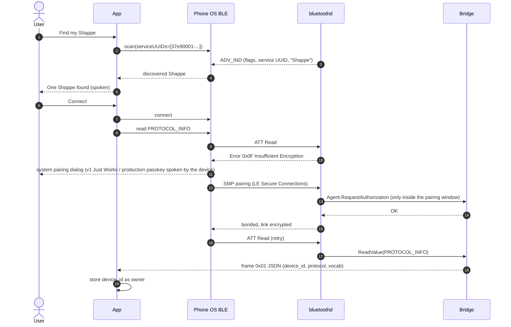

### 4.3 First successful connection (handshake)

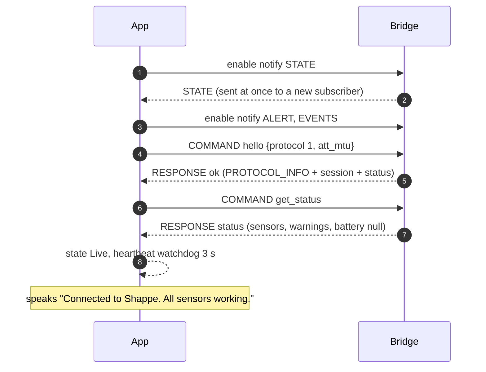

### 4.4 Starting a navigation session

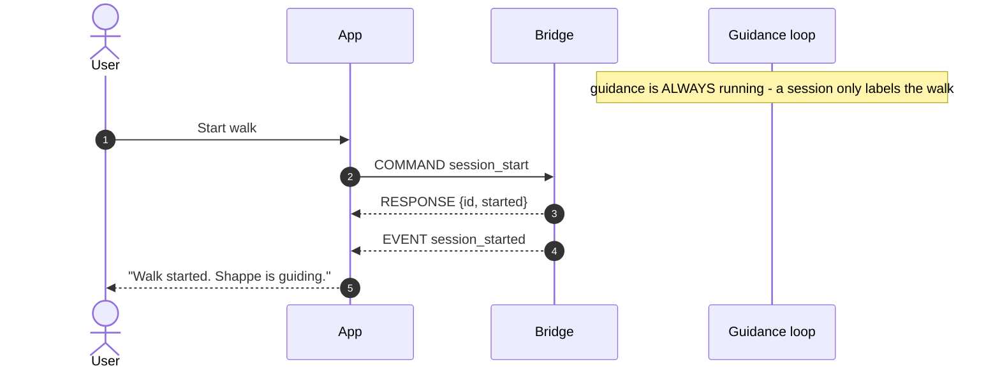

### 4.5 Camera obstacle detection

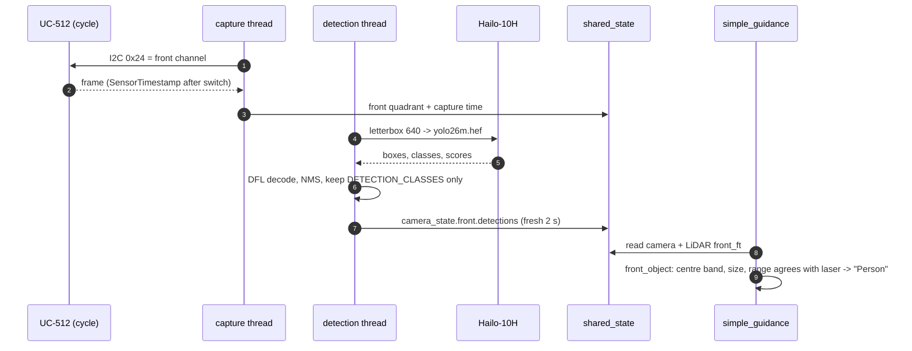

### 4.6 LiDAR obstacle detection

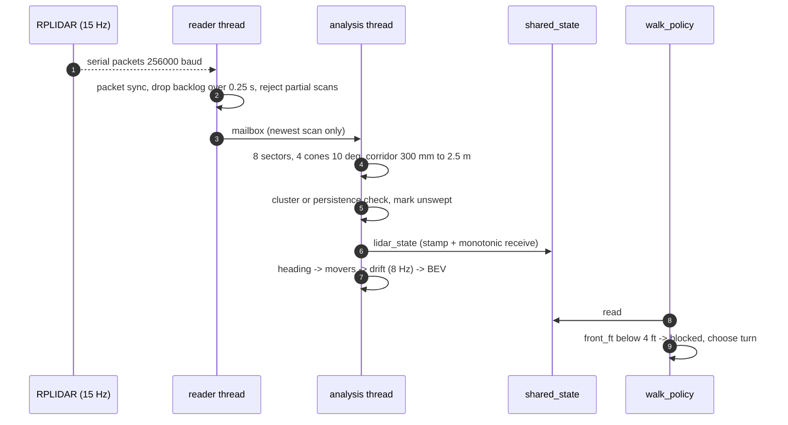

### 4.7 Radar data processing

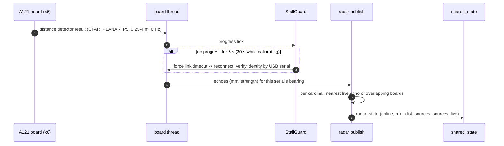

### 4.8 Sensor fusion and hazard assessment

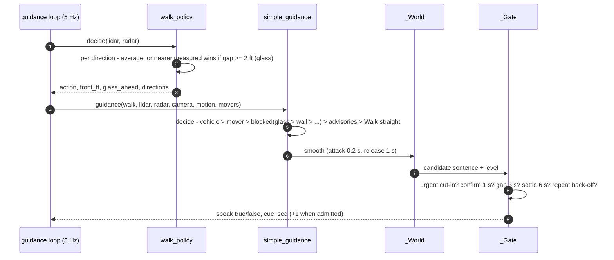

### 4.9 Hazard notification delivery

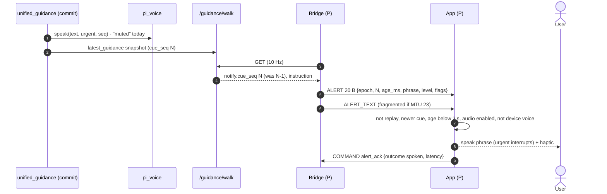

### 4.10 Mobile-to-hardware command

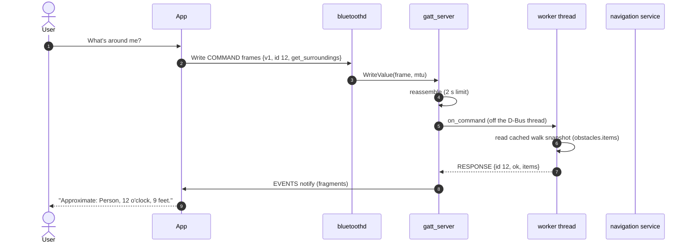

### 4.11 Bluetooth disconnection

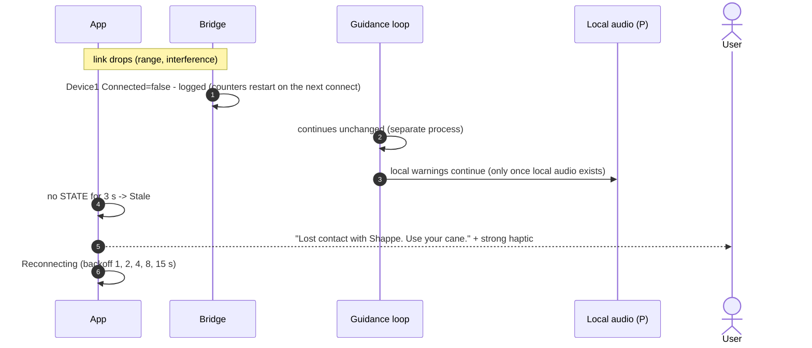

### 4.12 Reconnection

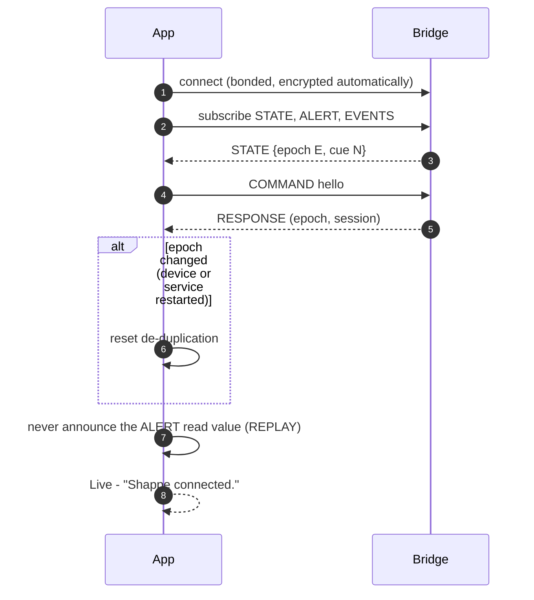

### 4.13 Low-battery warning

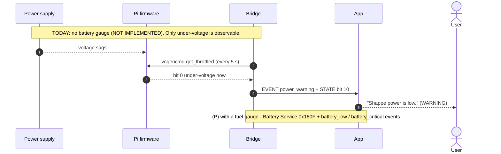

### 4.14 Sensor failure

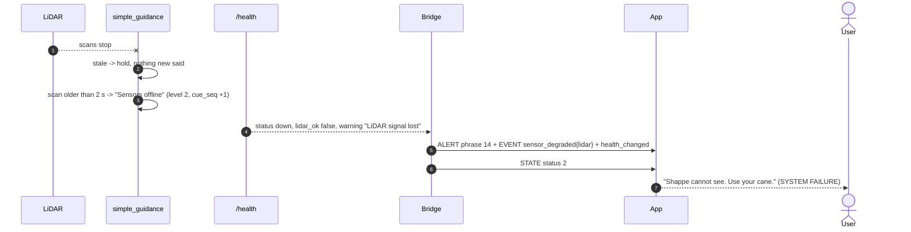

### 4.15 Hardware / service restart

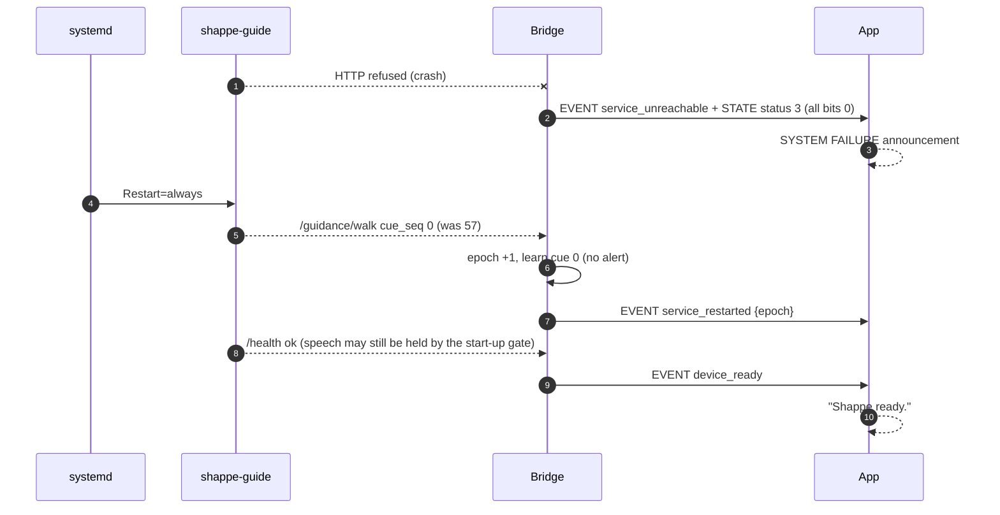

### 4.16 Session termination

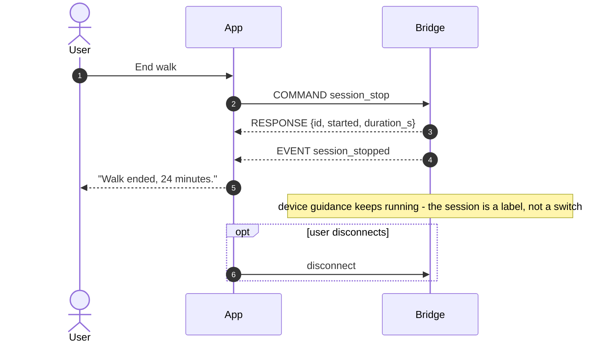
