<a id="doc-00-index"></a>

# Shappe Guide: Engineering Documentation Package

**An AI-assisted obstacle-warning wearable for blind and visually impaired pedestrians, and the Bluetooth companion app to be built for it.**

| | |
|---|---|
| Prepared | 2026-10-09, from the code in `~/Documents/lidar` (HEAD `e209c48` plus the uncommitted working tree) and read-only checks on the device |
| Audience | The hardware/AI team and the mobile application developer |
| Single PDF | [`MASTER.pdf`](MASTER.pdf) (generated from these files by [`build_master.py`](build_master.py); also [`MASTER.md`](MASTER.md) and [`MASTER.html`](MASTER.html)) |
| Status labels | **CONFIRMED**: seen in code or on the device · **HW-VERIFIED**: manufacturer documentation · **PROPOSED**: recommended design, not in the product · **NOT IMPLEMENTED**: needed and missing · **NEEDS VALIDATION**: must be measured or tested on hardware |

## Documents

| # | Document | What it answers |
|---|---|---|
| 01 | [Project Overview and Purpose](#doc-01-project-overview) | What it is, why, for whom, what works today and what doesn't |
| 02 | [Complete Hardware Architecture](#doc-02-hardware-architecture) | Every component (15 questions each), field of view, power, thermal, conflicts, performance budget |
| 03 | [AI Perception and Navigation Pipeline](#doc-03-perception-and-navigation-pipeline) | The actual algorithms, from laser point to spoken sentence; latency; calibration |
| 04 | [Bluetooth Communication Architecture](#doc-04-bluetooth-communication-architecture) | Why BLE, roles, GATT, protocol rationale, security, privacy, **Pi implementation guide** |
| 05 | [Mobile Developer Integration Guide](#doc-05-mobile-developer-integration-guide) | **Start here if you build the app.** 25 questions answered, pseudocode, mock device |
| 06 | [Interface Control Document](#doc-06-interface-control-document) | The exact contract: UUIDs, bytes, JSON, enums, errors, state machine, traceability |
| 07 | [User Journeys and Accessibility Design](#doc-07-user-journeys-and-accessibility) | Scenarios A–E, alert model, screen-by-screen spec, background and audio behaviour |
| 08 | [Safety, Reliability and Failure Management](#doc-08-safety-reliability-failure-management) | Hazards, FMEA, degraded modes, the critical local-audio gap, privacy, standards scope |
| 09 | [Roadmap and Integration Checklist](#doc-09-roadmap-and-integration-checklist) | 12 phases, ownership, test plan with pass criteria, risks, open decisions |
| 10 | [Architecture and Sequence Diagrams](#doc-10-architecture-and-sequence-diagrams) | Layered, component and communication diagrams, plus 16 sequence diagrams |
| — | [References](#doc-references) | Every external source, with access dates and contradictions |
| — | [SHAPPE_GUIDE_AUDIT.md](SHAPPE_GUIDE_AUDIT.md) | The 2026-09-29 safety audit (pre-existing) |

**Machine-readable contract and prototype code** ([`../ble_bridge/`](../ble_bridge/README.md), PROTOTYPE):
- `contract/schema_v1.json`: JSON Schema;
- `contract/vocab_v1.json`: 300-phrase registry (revision 3);
- `contract/test_vectors.json`: 16 golden vectors (75 frames);
- the reference bridge and a mock device;
- 34 desk tests (all pass).

---

## Executive summary

**The device exists and works in code. The phone link does not exist yet, and the device cannot currently make any sound.**

- **Built (CONFIRMED):**
  - **Sensing:** a Raspberry Pi 5 fuses a 360° RPLIDAR A2M12 (15 Hz), six 60 GHz Acconeer A121 radars (for glass), and four IMX519 cameras read in turn through an Arducam UC-512, with YOLO on a Hailo-10H.
  - **Decisions:** it decides several times a second on **one sentence from a closed vocabulary of 300**. A speech gate (urgency levels 0–3, confirmation, minimum gaps, repeat back-off) decides when to say it, and a counter `cue_seq` marks each announcement.
  - **Safety rules:** LiDAR is the geometry backbone; radar overrides only for glass; cameras name things but never clear a path; stale or simulated data never produces guidance; nothing ever says it is safe to cross.
- **Not built:**
  - **Bluetooth:** none in the product (NOT IMPLEMENTED).
  - **Audio:** the device is **muted** (`AUDIO_ENABLED = False`), and its only audio output is HDMI, which the voice refuses. **With no phone, the device warns nobody. This is the most important gap.**
  - **Other hardware:** no battery gauge, no haptics, no pairing button.
  - **Detection gaps:** drop-offs (stairs, kerbs) and head-height obstacles are not detected.
- **Designed and prototyped (PROPOSED):**
  - **Architecture:** a BLE GATT service in a **separate bridge process** that reads the existing loopback API, so a Bluetooth fault cannot affect guidance.
  - **Protocol:** 20-byte ALERT and STATE records that fit the smallest BLE packet, JSON events and commands, an append-only phrase registry, `(epoch, cue_seq)` de-duplication, and a 2 s freshness rule.
  - **Prototype status:** desk-tested and BlueZ-checked, but **not yet run over the air** (the adapter is rfkill-blocked on purpose).
- **Recommendation:**
  1. Fit wired bone-conduction audio on the device first.
  2. Freeze ICD v1 so the mobile developer can start immediately against the test vectors and the `--mock` device.
  3. Bring BLE up over the air under supervision.
  4. Measure latency end to end.
  5. Validate in stages: bench, controlled hall, then supervised field tests.

---

## The ten closing items

### 1. Complete project architecture

There are seven layers:
1. **Sensing:** LiDAR, 6 × radar, 4 × camera, IMU.
2. **Interfaces:** CP2102 UART, CH342 ttyACM, CSI-2 with I²C channel switching, PCIe/HailoRT, SPI, BlueZ.
3. **Processing:** reader and analysis threads → `shared_state` with freshness stamps.
4. **Intelligence:** `walk_policy` → `simple_guidance` (sentence → smoothing → gate) → `unified_guidance` commit point → `latest_guidance` snapshot.
5. **Communication:** FastAPI :8000 today; `ble_bridge` (P).
6. **App (P).**
7. **User.**

See [10 §1–3](#doc-10-architecture-and-sequence-diagrams) and [03 §2](#doc-03-perception-and-navigation-pipeline).

### 2. Hardware-to-mobile communication architecture

- **Roles:** the Pi is the BLE peripheral and GATT server; the phone is the central.
- **Bridge process:** polls `/guidance/walk` at 10 Hz and `/health` at 1 Hz, then notifies ALERT on each `cue_seq` step, STATE at 1–5 Hz (the heartbeat), and EVENTS (JSON).
- **Commands:** the phone writes JSON commands; responses arrive on EVENTS.
- **Security:** encrypted characteristics; v1 uses Just Works (lab only); production uses a spoken passkey plus a button.

See [04](#doc-04-bluetooth-communication-architecture).

### 3. Detailed user journey

1. Power on.
2. Spoken onboarding with a safety statement.
3. Find the device by service UUID.
4. OS pairing dialog.
5. "Connected to Shappe. All sensors working."
6. "Start walk".
7. During the walk, device sentences (spoken by the device or relayed by the phone exactly once).
8. On link loss: "Lost contact with Shappe. Use your cane."
9. Automatic reconnect.
10. "End walk".

Scenarios A–E are in [07](#doc-07-user-journeys-and-accessibility).

### 4. Final BLE interface specification

The service is `37e90001-0882-43f6-ae9b-b733c720c46d`:

| Characteristic | UUID | Properties |
|---|---|---|
| PROTOCOL_INFO | `…0002` | read |
| ALERT | `…0003` | read/notify |
| STATE | `…0004` | read/notify |
| COMMAND | `…0005` | write |
| EVENTS | `…0006` | notify |

It also exposes Device Information `0x180A`.

The wire format:
- a 6-byte frame header;
- 14-byte records;
- 11 error codes, 12 commands and 14 events;
- normative app rules A1–A10.

See [06](#doc-06-interface-control-document) and `ble_bridge/contract/`.

### 5. Mobile application requirements

Modules:
- discovery;
- connection and reconnection (a state machine with a 3 s stale timer);
- dashboard;
- live alerts (A1–A10, five categories);
- accessibility settings;
- session controls;
- diagnostics;
- privacy.

Requirements:
- **Platform:** iOS `bluetooth-central` with an audio session in `.voicePrompt` mode; Android `connectedDevice` foreground service with `USAGE_ASSISTANCE_NAVIGATION_GUIDANCE`.
- **Accessibility:** VoiceOver and TalkBack throughout; targets 44 pt / 48 dp.
- **Behaviour:** no time limits; no app-invented guidance.

See [05](#doc-05-mobile-developer-integration-guide) and [07](#doc-07-user-journeys-and-accessibility).

### 6. Hardware and frontend responsibilities

| Party | Owns |
|---|---|
| Hardware/AI | Sensors, AI, fusion, events, GATT server, health, **local alerts** |
| Mobile | Permissions, pairing UX, decoding, TTS, haptics, accessibility, lifecycle |
| Shared | Protocol, alert mapping, security, latency and user tests |

See [09 §3](#doc-09-roadmap-and-integration-checklist).

### 7. End-to-end integration checklist

There are 17 checkable items across the device side, the phone side and joint tests. See [09 §4](#doc-09-roadmap-and-integration-checklist).

### 8. Implementation priorities

1. Local audio.
2. Hardware measurements: camera HFOV, radar bearings, LiDAR RPM.
3. Freeze the ICD, then the decoder and fake transport.
4. Bridge over the air: mock first, then live.
5. End-to-end alerts with latency measurement.
6. Accessibility and audio sessions.
7. Production pairing, privacy and LAN lockdown.
8. Battery gauge and haptics.

### 9. Major technical risks

- The silent device (no local audio).
- iOS background and speech limits.
- The iOS pairing trigger on ATT error 0x0F.
- The assumed camera HFOV (70° in the code vs ~57° derived).
- Unproven head-on glass detection.
- Drop-off and overhead blind spots.
- 2.4 GHz coexistence.
- An uncommitted working tree with no test suite in this checkout.

See [09 §7](#doc-09-roadmap-and-integration-checklist) and [08 §6](#doc-08-safety-reliability-failure-management).

### 10. Recommended development approach

1. The device owns safety; the phone is a companion.
2. Keep BLE out of process, and allow no command that can change guidance.
3. Freeze a small, versioned, test-vector-backed protocol now and develop app and hardware in parallel.
4. Measure before claiming anything; validate in stages under supervision.

---

## What this package did *not* do

- **The navigation service:** not started. It spins the LiDAR and opens every sensor, so it needs supervision.
- **Bluetooth:** the adapter was **not** unblocked and nothing was advertised. Only read-only `--check` ran.
- **Existing files:** no production file was modified, and nothing was committed. New files: `docs/01–10`, `docs/README.md`, `docs/references.md`, `docs/build_master.py`, `docs/MASTER.*` and `ble_bridge/`.
- **Device measurements:** quoted from the README (2026-09-25) or from read-only commands run on 2026-10-09. Everything else that needs hardware is marked NEEDS VALIDATION.


<div class="pagebreak"></div>

<a id="doc-01-project-overview"></a>

# 01 — Project Overview and Purpose

**Shappe Guide: an AI-assisted obstacle-warning wearable for blind and visually impaired pedestrians**

| | |
|---|---|
| Audience | Everyone on the project: the hardware/AI team and the mobile developer |
| Source of truth | The code in this repository (`~/Documents/lidar`, HEAD `e209c48` plus uncommitted work), inspected 2026-10-09 |
| Status labels | **CONFIRMED** = seen in the code or on the device · **HW-VERIFIED** = manufacturer documentation · **PROPOSED** = recommended, not built · **NOT IMPLEMENTED** = needed, missing · **NEEDS VALIDATION** = must be tested on hardware |

---

## 1. What the project is

### Level 1: simple explanation

The user wears a small computer, a Raspberry Pi 5, with sensors pointing in every direction:
- a spinning laser (LiDAR) that measures distance all the way round;
- four cameras that recognise what things are (a person, a car, a pole);
- six small radars that catch glass, which the laser sees straight through;
- a motion sensor (gyro).

Several times a second the device decides on **one short sentence** from a fixed list, for example "Walk straight", "Wall ahead", "Blocked by glass", "Person in front, turn left" or "Vehicle approaching, move right". It is built to say a sentence only when that sentence is new and matters, never to talk over itself, and to say nothing rather than guess.

The mobile app (to be built) will connect to the device over Bluetooth. It shows the device's state, speaks or vibrates its warnings when the device cannot, and lets the user check health and settings, all without needing to look at the screen.

### Level 2: engineering summary

| Layer | What exists today | Status |
|---|---|---|
| Sensing | RPLIDAR A2M12 (360°, 15 Hz at 900 RPM); Arducam UC-512 CamArray with 4 × IMX519, read one camera at a time (`CAMERA_CYCLE`); 6 × Waveshare A121 60 GHz radar boards on a USB hub; MPU-6500 IMU on SPI | CONFIRMED |
| AI | YOLO detector (`model/yolo26m.hef`, COCO-80) and segmentation (`model/best.hef`) on a Hailo-10H (Raspberry Pi AI HAT+ 2) through HailoRT 5.1.1 | CONFIRMED |
| Fusion and decision | LiDAR geometry, with radar overriding it only for glass. Cameras give identity only. `walk_policy` → `simple_guidance` (smoothing, then the speech gate) decides one sentence from a closed vocabulary of 300 sentences | CONFIRMED |
| Output | One commit point (`unified_guidance`) hands the sentence to `pi_voice` (espeak-ng) and to a web dashboard (FastAPI on port 8000) that can speak it in a phone browser | CONFIRMED |
| **Sound today** | **`AUDIO_ENABLED = False`. Nothing speaks, Pi or phone.** The only audio sink on the Pi is HDMI, which the voice refuses | CONFIRMED, see §6 |
| Bluetooth | **No Bluetooth code in the product.** The Pi 5 radio exists but is rfkill soft-blocked. A BLE bridge prototype has been written for these documents (`ble_bridge/`) | NOT IMPLEMENTED in product; PROPOSED prototype, desk-tested |
| Battery, haptics, buttons | None in the code or on the device | NOT IMPLEMENTED |

## 2. Why the project is needed

A blind pedestrian's main tools leave real gaps:

- **White cane.** It gives reliable, immediate contact information about the ground about one stride ahead. It cannot sense anything above waist height (a truck mirror, a branch), anything beyond its tip, or anything moving towards the user.
- **Guide dog.** It is excellent but scarce and expensive, and not suitable for everyone.
- **Phone navigation apps (GPS).** These say *where* to go but not *what is in the way*. GPS accuracy is metres, not the centimetres that matter at a door.
- **Glass.** Glass doors and walls are a classic hazard: vision-based aids and laser scanners can both miss them.

This project targets the band **between the cane tip and about 4 m**, all the way round the user. It warns about things the cane cannot reach in time: walls and glass the user is closing on, people and vehicles approaching, and objects in the walking line. It also gives a steering hint ("turn slightly left").

## 3. Who benefits

- **Primary user.** A blind or severely visually impaired adult pedestrian who already travels independently with a cane or guide dog and has orientation and mobility (O&M) training. The device **adds** information; it does not replace those skills.
- **Secondary users.** O&M instructors and field testers. The dashboard, speech log and "mark" commands exist for them today.
- **Developers.** The hardware/AI team and the mobile developer.

## 4. What the user experiences (the design intent)

The design in the code, CONFIRMED in `utils/simple_guidance.py`:

1. **One voice and a closed vocabulary.** Every sentence comes from a fixed list (`ALLOWED`: 300 sentences built from about 20 templates and the object words). Nothing free-form is ever spoken.
2. **Say it once.** A sentence is announced when it changes. A "blocked" situation repeats after 30 s, then 60 s, then 120 s at most.
3. **Urgency levels 0–3:**
   - 0: "Walk straight".
   - 1: advisories, for example "Wall ahead" or "Person ahead".
   - 2: blocked or turn, for example "Blocked by glass" or "Person in front, turn left".
   - 3: vehicle approaching.
   A more urgent sentence is spoken as soon as the current one ends, and a vehicle warning does not wait. Urgent sentences (blocked, vehicle, mover) also stop whatever the device voice is saying.
4. **Silence beats guessing.** With no LiDAR the device says "Sensors offline". With stale data it holds and says nothing new. At a road crossing it **withholds** "Walk straight" for 5 s after the last traffic light was seen, and **never** says it is safe to cross.

## 5. Core capabilities: confirmed vs not

| Capability | Status | Notes |
|---|---|---|
| Distance to walls and objects all round, in a horizontal plane | CONFIRMED | LiDAR, 8 × 45° sectors, 4 × 10° cones plus a body-width corridor |
| "Blocked" when anything is within 4 ft (~1.2 m) ahead, with a turn suggestion | CONFIRMED | `WALK_BLOCK_FT = 4.0` |
| Glass ahead or beside, via radar disagreeing with laser | CONFIRMED in code; NEEDS VALIDATION in the field | README: "head-on flat glass is still unproven" |
| Naming objects (person, car, bus, bicycle, dog, pole …) | CONFIRMED (cycle mode: up to 2 cameras with new frames per pass, front first) | COCO-80 model; the classes are filtered to `DETECTION_CLASSES` |
| Vehicle approaching (camera box growth) | CONFIRMED in code; NEEDS VALIDATION | Front camera only |
| Moving people and vehicles from LiDAR (`lidar_movers`) | CONFIRMED in code, **silent trial** | `LIDAR_MOVERS_SPEAK = False`: logged as "would say" |
| Drift and veer warnings | CONFIRMED in code, near-wall/drift sentences only | Collision-course drift is computed but not spoken |
| Overhead, low or drop-off hazards (stairs down, kerbs, potholes) | **NOT IMPLEMENTED** | A 2D LiDAR sees one plane; the COCO model has no stairs or pothole classes |
| Safe-to-cross decisions | **Deliberately not implemented** | Traffic-light colour is never read |
| Battery level, thermal alerts to the user | NOT IMPLEMENTED | The BLE prototype reads SoC temperature and throttle flags |
| Bluetooth companion app | NOT IMPLEMENTED; PROPOSED in docs 04–07 | Prototype bridge in `ble_bridge/` |

## 6. Realistic limitations (read before any field use)

- **The device is currently silent.** `AUDIO_ENABLED = False` (`config.py`) turns off the Pi voice and the dashboard's browser speech. Even with it on, the Pi has **no wearable audio output**: `wpctl` shows only the HDMI sink, which `pi_voice` refuses. Until a local audio device is fitted, the device cannot warn anyone by itself. This is the most important architectural gap; see [08 §4](#doc-08-safety-reliability-failure-management).
- **The device is not validated.** The README and the 2026-09-29 audit (`docs/SHAPPE_GUIDE_AUDIT.md`) list physical validation as pending:
  - glass detection head-on;
  - heading and drift on real walks;
  - mover warnings;
  - camera field of view.
- **Coverage gaps:**
  - one LiDAR plane (no overhead or kerb detection);
  - cameras cover four directions with gaps between them (each lens is ~57–67° wide; see [02 §4](#doc-02-hardware-architecture));
  - radar reaches 0.25–4.0 m.
- **This is not a certified medical or assistive device.** It must not be presented as one, or as a replacement for the cane, guide dog, O&M training or the user's own judgement.

## 7. Non-goals for the first Bluetooth integration

- No video or raw sensor streaming over Bluetooth.
- No phone-side obstacle detection.
- No route navigation or GPS.
- No remote changes to safety thresholds.

These are discussed as future options in [09 §8](#doc-09-roadmap-and-integration-checklist).

## 8. How to read this documentation set

| Doc | For |
|---|---|
| [02 Hardware](#doc-02-hardware-architecture) | What each part is, how it connects, power, heat, and limits |
| [03 Perception and navigation](#doc-03-perception-and-navigation-pipeline) | Exactly how a measurement becomes a sentence |
| [04 Bluetooth architecture](#doc-04-bluetooth-communication-architecture) | Why BLE, the GATT design, security, and the Pi-side implementation |
| [05 Mobile developer guide](#doc-05-mobile-developer-integration-guide) | **Start here if you are building the app** |
| [06 ICD](#doc-06-interface-control-document) | The exact contract: bytes, JSON, UUIDs, rules |
| [07 Journeys and accessibility](#doc-07-user-journeys-and-accessibility) | How a blind user uses it, and a screen-by-screen spec |
| [08 Safety](#doc-08-safety-reliability-failure-management) | Hazards, FMEA, degraded modes, privacy |
| [09 Roadmap](#doc-09-roadmap-and-integration-checklist) | Phases, owners, tests, checklist, open questions |
| [10 Diagrams](#doc-10-architecture-and-sequence-diagrams) | All Mermaid architecture and sequence diagrams |
| [References](#doc-references) | Every external source, with access dates |


<div class="pagebreak"></div>

<a id="doc-02-hardware-architecture"></a>

# 02 — Complete Hardware Architecture

Status labels: **CONFIRMED** (code, or observed on this Pi on 2026-10-09) · **HW-VERIFIED** (manufacturer documentation; source IDs `[Sx]` are in [references.md](#doc-references)) · **DER** (derived by arithmetic from cited values) · **PROPOSED** · **NOT IMPLEMENTED** · **NEEDS VALIDATION**.

> Values marked HW-VERIFIED are **manufacturer specifications, not system measurements**. A datasheet range is the best case for the part on its own, not what the worn device achieves.

---

## 1. Block diagram

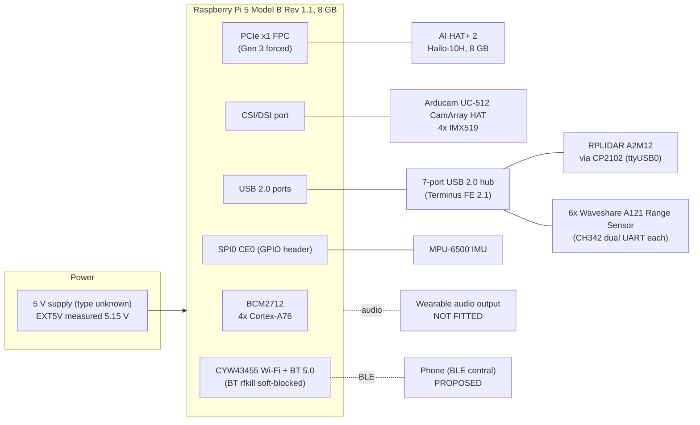

## 2. What is physically attached (observed 2026-10-09, CONFIRMED)

| Item | Evidence on the device |
|---|---|
| Board | `/proc/device-tree/model` = "Raspberry Pi 5 Model B Rev 1.1"; 7.9 GiB RAM; 4 cores; Debian 13 (trixie); kernel `6.18.39+rpt-rpi-2712` |
| AI accelerator | `/dev/hailo0`; packages `h10-hailort 5.1.1`, `hailo-h10-all 5.1.1`, `hailo-tappas-core 5.1.0`; `config.txt` has `dtparam=pciex1`, `pciex1_gen=3`, `kernel=kernel_hailo.img` |
| Cameras | `config.txt`: `dtoverlay=imx519,cam1` **and** `dtoverlay=imx519,cam0` (two CSI ports configured); I2C buses `/dev/i2c-{1,4,6,10,11,13,14}` |
| LiDAR | `10c4:ea60` Silicon Labs CP2102 → `/dev/ttyUSB0` (`config.LIDAR_PORT`, 256000 baud) |
| Radar | 6 × `1a86:55d2` QinHeng "USB Dual_Serial" (CH342); each gives two ttyACM interfaces (`-if00`, `-if02`); serials `5AEC021929`, `…934`, `…938`, `…975`, `5AEC022220`, `…273` |
| USB hub | `1a40:0201` Terminus FE 2.1 7-port hub. **Every sensor is on USB 2.0 bus 001**; the USB 3 buses are empty |
| Other USB | `0eef:0005` D-WAV (an eGalax/Waveshare touchscreen) on bus 003. Not used by the app |
| IMU | `/dev/spidev0.0` (SPI0 CE0), `dtparam=spi=on` |
| Bluetooth | `hci0` 98:FE:54:02:09:5B, alias "Shappe", BlueZ 5.82; **Powered: no, PowerState: off-blocked** (`rfkill`: soft blocked) |
| Audio | PipeWire 1.4.2; **the only sink is "Built-in Audio Digital Stereo (HDMI)"**; espeak-ng 1.52.0 installed |
| Thermals (idle, app stopped) | 58.7 °C, `get_throttled=0x0`, EXT5V 5.146 V |

---

## 3. Components

Each component answers the 15 standard questions in the same order: what · why · purpose · how it works · output · connection · data path · capability · limits · power and heat · software · compatibility · failure detection · used in code? · send to app?

### 3.1 Raspberry Pi 5 (main computer)

**Level 1:** the device's brain. It runs every sensor reader, the AI and the decision logic, and will run the Bluetooth link.

| # | Answer |
|---|---|
| What | BCM2712, 4 × Cortex-A76 at 2.4 GHz, 512 KB L2 per core, 2 MB L3 [S21]. This unit has 8 GB RAM (CONFIRMED) |
| Why | It has the only Raspberry Pi PCIe connector the AI HAT+ 2 needs, two 4-lane MIPI camera/display connectors [S21], and enough CPU for LiDAR and radar processing in Python |
| How data reaches software | Linux devices: `/dev/ttyUSB0` (LiDAR), `/dev/ttyACM*` (radar), libcamera/Picamera2 (cameras), `/dev/hailo0` (NPU), `/dev/spidev0.0` (IMU) |
| Power | 5 V 5 A (25 W), or 5 V 3 A with a 600 mA USB peripheral limit; the USB limit is 1.6 A with a 5 A supply [S22]. Bare-board active current is about 800 mA; peak about 12 W [S22, S23]. The official 27 W PSU gives 5.1 V 5 A [S24] |
| Thermal | Arm cores throttle progressively from 80 to 85 °C; at 85 °C both Arm and GPU throttle [S22]. The Active Cooler fan runs at 30 % from 50 °C up to 100 % at 75 °C [S22]. Whether this unit has an Active Cooler fitted is NEEDS VALIDATION |
| RTC | On board, but it needs an external battery cell [S22]. Without one the wall clock may be wrong after a cold boot with no network. **The protocol therefore never relies on wall-clock time for freshness** (see [06 §5](#doc-06-interface-control-document)) |
| Failure detection | systemd watchdog (`deploy/shappe-guide.service`, `WatchdogSec=30`, heartbeats `guidance` and `event_loop`), CONFIRMED. `/health` endpoint, CONFIRMED. SoC temperature and throttle flags are read by `tools/walk_logger.py` (CONFIRMED) and by the BLE prototype (PROPOSED) |
| In code? | Yes: everything |
| Send to app | Uptime, SoC temperature, throttle and under-voltage flags, software versions (PROPOSED, in STATE and events) |

### 3.2 Raspberry Pi AI HAT+ 2 (Hailo-10H NPU)

**Level 1:** a dedicated AI chip that recognises objects in camera pictures fast enough, with little load on the CPU.

| # | Answer |
|---|---|
| What | Hailo-10H, 40 TOPS (INT4) [S26, S27]; Hailo rates the chip 40 TOPS INT4 / 20 TOPS INT8 at about 2.5 W typical, chip only [S31]. 8 GB on-board RAM [S27]. HAT+ form factor; ships with a 16 mm stacking header [S26] |
| Why | Real-time YOLO detection on four camera directions is impractical on the CPU. Detection is about 90 ms per pass on the NPU (measured, README 2026-09-25) |
| How it works | Models are compiled offline by the Hailo Dataflow Compiler into **HEF** files and run by **HailoRT** [S28, S32]. This repo ships `model/yolo26m.hef` (COCO-80 detector) and `model/best.hef` (segmentation, classes person/path/tactile per `model/metadata.yaml`) |
| Output | Bounding boxes, class and confidence (detection); a per-pixel class map (segmentation, debug view only) |
| Connection | PCIe x1. Gen 3 is forced (`pciex1_gen=3`); Raspberry Pi says the Pi 5 "isn't certified for Gen 3.0 … might be unstable", but applies Gen 3 automatically for the AI HATs [S22, S28] |
| Data path | `utils/hailo_device.py` (one shared `VDevice`) → `hailo_inference.py` (letterbox to 640, DFL decode, per-class NMS, `DETECTION_CLASSES` filter) → `pi_camera_utils` detection thread → `shared_state` camera store |
| Limits | Only models compiled for the Hailo-10H with a matching HailoRT 5.x run. **Not every model or layer can run on the NPU**; unsupported operations must run on the CPU or be redesigned. `hailo-h10-all` cannot co-exist with `hailo-all` (Hailo-8 stack) [S28]. It uses the Pi 5's only PCIe connector, so NVMe needs a PCIe switch [S33] |
| Power and heat | Whole-board draw NOT FOUND in official docs; chip 2.5 W typical [S31]. The heatsink is "optional" but advised under sustained load [S26]. Ambient 0–50 °C [S26] |
| Software | `hailo-h10-all 5.1.1`, `python3-h10-hailort 5.1.1` (CONFIRMED installed) |
| Failure detection | `hailo_ok` in `/health` and `get_system_health()` (CONFIRMED); `_FailStreak` with 5 s reset, retry back-off `(2, 5, 10, 30) s` (`HAILO_RETRY_BACKOFF_S`) |
| In code? | Yes |
| Send to app | `hailo_ok` (STATE health bit 4) |

### 3.3 Arducam UC-512 CamArray with 4 × Sony IMX519

**Level 1:** four cameras, one per direction, on one adapter board that feeds a single camera port. The app looks at one camera at a time, very quickly in turn.

| # | Answer |
|---|---|
| What | The "UC-512 Camarray HAT" in Arducam kit B0388 "16MP IMX519 Autofocus Synchronized Quad-Camera Kit" [S1]. IMX519: 4656 × 3496, 1.22 µm pixels, 1/2.53″, rolling shutter, 2-lane CSI-2 [S4] |
| How it works | The HAT merges up to four sensors into **one** CSI-2 stream (2 lanes at 1 Gbps/lane) [S1]. Modes [S2]: `0x00` 4-in-1 (2 × 2 mosaic, 1/4 resolution each); `0x01`/`0x11` dual; `0x02/0x12/0x22/0x32` single camera 0/1/2/3. The mode is selected with `i2cset -y <bus> 0x24 0x24 <val>` |
| Synchronisation | In 4-in-1 mode, cameras 0+1 are synchronised, 2+3 are synchronised, and 2/3 are **one frame behind** 0/1 [S1]. Exposure, gain, white balance and focus are **shared by all four** [S2] |
| How the app uses it | **`CAMERA_CYCLE = True` (CONFIRMED, uncommitted):** the board is switched between single-camera channels live (I2C bus 11 per `config.py`; Arducam documents buses 4/6 for a Pi 5, see below). Each frame is credited to a camera only when its `SensorTimestamp` falls after the switch. The schedule (`_schedule`) is front ×2, right, front ×2, left, front ×2, back: **6 front frames per cycle against 1 for each other camera** (2 : 1 against the other cameras combined). Empty channels are never visited, because switching to one stops the stream for good. Channel map `CAMERA_HAT_CHANNEL = {right: 0, front: 1, left: 2, back: 3}` (measured 2026-10-08). The 4-in-1 mosaic is still supported (`CAMERA_CYCLE = False`) but was seen to **corrupt the picture** on this unit; see project memory and the README "Known limits" |
| Output | 1920 × 1080 RGB888 per frame (`CAMERA_WIDTH/HEIGHT`). Each frame is stored as a direction quadrant with its own capture time |
| Frame rate | README: ~24 fps front, ~6 fps each other camera with three cameras present (cycle mode). Arducam's quad-mode figures disagree with each other: 1080p30 [S1] vs 1080p60 [S3]. **NEEDS VALIDATION** on this unit |
| Field of view | See §4. The effective HFOV at 1920 × 1080 is likely **~57°** (DER), not the 70° the code assumes (`SIMPLE_CAMERA_HFOV_DEG = 70.0  # ASSUMED`) |
| Limits | One shared auto-exposure (a bright view darkens the others) [S2]. No frame buffer on the HAT [S6]. In cycle mode, cameras are **not** simultaneous: the back camera's picture may be ~0.3 s older than the front's (NEEDS VALIDATION). Low light, glare and rain degrade detection. Camera loss went silent before 2026-10-07; it now raises `/health` warnings (cameras missing or corrupted; since 2026-10-09 also a black or blurred picture per camera), the voice says "Camera off" when the front camera cannot see, and a stream with no frame for 15 s is closed and reopened |
| Discrepancy | The code uses I2C bus 11, but Arducam documents bus 6 (cam0) or 4 (cam1) for a Pi 5 [S2]. Bus numbering depends on the kernel and overlay; the code value was measured on this unit. `config.txt` enables IMX519 on **both** CSI ports. Which port the app's default `Picamera2()` opens must be checked with `rpicam-hello --list-cameras` (NEEDS VALIDATION) |
| Power | HAT power NOT FOUND in vendor docs |
| Failure detection | Corrupt-frame detector (`CAMERA_CORRUPT_PCT`) with restart and front-only fallback; `camera_ok`; warnings "Camera feed lost", "No camera connected: …" (CONFIRMED) |
| In code? | Yes. `utils/pi_camera_utils.py` (capture, cycle, detection and seg threads) |
| Send to app | `camera_ok` (STATE bit 3), and the camera warnings in `health_changed`. **Never images.** |

### 3.4 SLAMTEC RPLIDAR A2M12

**Level 1:** a laser on a spinning head that measures the distance to everything around the user, in one flat slice at its mounting height, 15 times a second.

| # | Answer |
|---|---|
| Specs [S9] | Range 12 m (white) / 10 m (black), minimum 0.2 m; 16 kHz sampling; 10 Hz typical, 5–15 Hz adjustable; 0.225° at 10 Hz; UART 3.3 V TTL **256000 8N1**; 785 nm laser, **IEC 60825 Class 1**; 190 g; 0–40 °C; Ø76 × 41 mm |
| Project settings | `LIDAR_RPM = 900` (15 Hz, top of range); `LIDAR_MAX_DISTANCE = 12000` mm; this unit's full-PWM speed was measured at 1380 RPM (`LIDAR_MAX_RPM`) |
| Data path | CP2102 USB-UART → `/dev/ttyUSB0` → `lidar_utils._ScanStream`: its own packet-sync parser, backlog dropping (`LIDAR_MAX_BACKLOG_S = 0.25`), and rejection of partial scans (gap > 20°) → a single-slot mailbox → the analysis thread → `shared_state` lidar store |
| Output | About 260 points per scan (angle, distance, quality) → 8 sectors, 4 cones and a corridor, BEV grid, heading, movers |
| Power [S9] | 5 V (4.9–5.2 V); **inrush up to 2.5 A**, start-up up to 1.5 A, running 450 mA typical / 600 mA max. The code soft-starts the motor (`_open_without_motor`, PWM ramp) and re-asserts PWM every second (CONFIRMED) |
| Limits | One horizontal plane (overhead and kerb hazards are invisible). Sunlight: "outdoor … without direct sunlight" [S9]. Glass and mirrors give missing points [S11]. Dark surfaces have shorter range. A sweep takes ~67 ms, during which the user moves; this is not corrected (README; under 10 cm at walking pace) |
| Failure detection | `lidar_ok`; freshness (`LIDAR_STALE_S = 1.0`); "Sensors offline" spoken once the newest scan is older than 2 s (`SIMPLE_LIDAR_FRESH_S`). `SIMPLE_OFFLINE_S = 3` covers a different case: no range reading ahead for 3 s; `startup_gate` reports `lidar_absent` after 20 s; simulation is **opt-in only** and is flagged "SIMULATED — do not navigate" (CONFIRMED) |
| Send to app | `lidar_ok` (bit 1), the front clearance in ALERT (`front_ft`), and the surroundings list on request |

### 3.5 Waveshare A121 Range Sensor × 6 (Acconeer A121, 60 GHz)

**Level 1:** six small radars that see glass and other things the laser passes through, in six directions, out to about 4 m.

| # | Answer |
|---|---|
| What | Waveshare "A121 Range Sensor", SKU 33777 [S18]: STM32L431 MCU, USB-C through a **WCH CH342 dual UART**. SERIAL-A carries the Exploration Tool server; SERIAL-B carries the UART firmware. 5 V, 80 mA max [S18]. Flashed by choosing "XM125" in the Exploration Tool [S18]. It is firmware-compatible with Acconeer's XM125 but is not the XM125 module itself (DER from [S13]) |
| Sensor [S12] | Acconeer A121: 57–64 GHz pulsed coherent radar; EIRP 11.4 dBm; HPBW **E-plane 53°, H-plane 65°** (simulated); up to 23 m depending on the object; distance accuracy 2.7–5.1 mm std; radial resolution 30 mm (P1) to 222 mm (P5). It can see through plastic or glass covers |
| Mode used | Exploration Tool **distance detector** (acconeer-exptool 7.18.2, CONFIRMED): CFAR threshold, `RADAR_REFLECTOR_SHAPE = "PLANAR"` (on trial since 2026-10-05), `RADAR_PROFILE = 5` (passed as `max_profile`, an upper limit), range `RADAR_START_MM 250` to `RADAR_END_MM 4000`, update rate 6 Hz. The detector outputs **distances and strengths only; no velocity, no classification** [S14] |
| Geometry | Bearings 30/90/150/210/270/330° per board **serial**, never by USB port (`RADAR_BEARINGS`; optional overlay `radar_bearings.json`, absent today). With a 65° beam that gives about 5° of overlap. Six boards map onto four guidance directions (`cardinal_sources`, half-angle = beam/2 + 22.5°) |
| Data path | Discovery probes ttyACM for `get_system_info`, excluding the LiDAR → one supervisor thread per board (`_run_board`/`_stream_board`) → `_StallGuard` forces a reconnect when no progress (5 s streaming, 30 s calibrating) → `_publish` → per-direction nearest echo with sources → `shared_state` radar store |
| Limits | Range 0.25–4 m as configured. The 222 mm resolution at P5 merges close echoes. A beam sees whatever is in its cone (floor, cane, own body); the code requires a measured board and grazing tests before calling something glass. Head-on flat glass is **unproven** (README, NEEDS VALIDATION). Waveshare's "horizontal 53°" vs Acconeer's H-plane 65° depends on board orientation [S18 vs S12] |
| Power | Board 80 mA max [S18]. A121 itself ~74.5 mA at 1.8 V while measuring at P1 (DER [S12]) |
| Failure detection | Per-board online/stale (`RADAR_STALE_S = 1.5`); `radar_ok`, `radar_down` list, "Radar half-covered/delayed/offline" warnings; front-glass coverage (`front_glass_coverage`) produces the spoken "Glass sensor off/on" (CONFIRMED) |
| Send to app | `radar_ok` (bit 2), `front_glass_ok` (bit 5), and the `radar_down` list in `get_status` |

### 3.6 TDK InvenSense MPU-6500 IMU

| # | Answer |
|---|---|
| What [S35] | 6-axis IMU: gyro ±250…2000 °/s, accelerometer ±2…16 g, SPI 1 MHz (20 MHz for sensor reads), 3.4 mA. TDK lists it as not recommended for new designs [S36] |
| Use | `gyro_reader.py` at 100 Hz: yaw integral, bias correction against the LiDAR, step and cadence detection, tilt (CONFIRMED) |
| **Gating** | `GYRO_MOUNTING_CONFIRMED = False` and `GYRO_GAIT_CONFIRMED = False`: the gyro **reports only**. It does not steer heading, and stride learning is off (CONFIRMED) |
| Send to app | Nothing in v1 |

### 3.7 Bluetooth radio (Infineon CYW43455 on the Pi 5)

| # | Answer |
|---|---|
| What | Dual-band 802.11ac Wi-Fi plus **Bluetooth 5.0 with BLE**, connected over SDIO [S23] |
| State on this Pi | BlueZ 5.82, adapter `hci0`, roles central + peripheral, 5 advertising instances (`ble_bridge.gatt_server --check`, CONFIRMED). **Soft-blocked by rfkill** |
| Coexistence | Wi-Fi and Bluetooth share 2.4 GHz on one chip. Whether they share one antenna is not stated in Raspberry Pi docs (NOT FOUND). Running BLE alongside the Wi-Fi dashboard, or a Bluetooth audio headset, is **NEEDS VALIDATION** |
| USB 3 noise | USB 3.0 can raise the 2.4 GHz noise floor by ~20 dB [S34]. Today every device is on USB 2.0, so the risk is low. Keep it in mind if a USB 3 device is added |
| In code? | **No.** The prototype is in `ble_bridge/` (PROPOSED) |

### 3.8 Audio output: **missing (critical gap)**

| | |
|---|---|
| Code | `utils/pi_voice.py` speaks with `espeak-ng -s 170 -v en-us` through the default PipeWire sink. It refuses `hdmi`, `dummy` and `null` sinks (a person cannot hear them on a wearable) (CONFIRMED) |
| Device | Only an HDMI sink exists (CONFIRMED). `AUDIO_ENABLED = False` (CONFIRMED) |
| Consequence | **The device has no audible output of its own today.** The README's intended earpiece ("an earpiece when one is paired") is not present |
| Options (PROPOSED, see [08 §4](#doc-08-safety-reliability-failure-management)) | (a) a USB audio adapter plus a wired **bone-conduction** headset, which leaves the ears open to traffic sound; this is recommended. (b) A Bluetooth A2DP headset paired to the Pi; it shares the radio with BLE (NEEDS VALIDATION) and adds A2DP latency. (c) An I²S DAC with a small speaker, which is not private and is quiet outdoors |
| Haptics | NOT IMPLEMENTED (no motor, no driver). PROPOSED: an I²C haptic driver plus an LRA/ERM motor on the GPIO header (the header passes through the AI HAT+ 2 stacking header) |

### 3.10 Arducam ToF depth camera (planned, not bought)

| | |
|---|---|
| What | Arducam ToF camera: 240 × 180 distances per frame, 940 nm, up to 4 m, about 30 fps, CSI-2. Lens about 70° diagonal (58.5° × 45.6° on the 4:3 sensor) (NEEDS VALIDATION) |
| Port | The Pi 5's CAM0 (the UC-512 is on CAM1): `/boot/firmware/config.txt` needs `dtoverlay=arducam-pivariety,cam0` there instead of `dtoverlay=imx519,cam0`. SDK: `pip install ArducamDepthCamera` |
| Mount | Just below the front camera, aimed about 20° further down ("aimed apart" in the 3D design), rigid against it: its depth is placed on the camera's picture by a bench calibration (`tools/tof_calibrate.py`) |
| Interference | None expected: the IMX519's IR-cut filter blocks 940 nm |
| In code? | Yes, off: `TOF_ENABLED = False`, `TOF_USE_DISTANCE = False` (`utils/tof_camera.py`, `utils/depth_fusion.py`, `routers/tof_router.py`; see [03 §3.5](#doc-03-perception-and-navigation-pipeline)) |

### 3.9 USB hub

A Terminus FE 2.1 7-port **USB 2.0** hub carries the LiDAR and all six radar boards (CONFIRMED). Whether it is self-powered is NEEDS VALIDATION. The worst-case steady draw through it is about 0.6 A (LiDAR) + 6 × 0.08 A (radars) ≈ **1.1 A** (DER), which is within the Pi's 1.6 A USB budget only with a 5 A supply. The LiDAR's **2.5 A inrush** is why the motor is soft-started.

---

## 4. Field of view and blind spots

| Sensor | Coverage | Basis |
|---|---|---|
| LiDAR | 360° in **one horizontal plane** at its mounting height; 0.2–12 m | [S9], CONFIRMED config |
| Radar | 6 × ~65° (H-plane) beams at 30/90/150/210/270/330°, 0.25–4.0 m; ~5° overlaps | [S12], CONFIRMED config |
| Cameras | 4 directions (front/right/back/left). Lens 67°H × 53°V by pinhole at full sensor width (DER [S4, S5]; Arducam also publishes 66° × 49.5° [S1]). At 1920 × 1080 the IMX519 mode is a **binned crop**, which narrows the effective HFOV to about **57°** (DER: 1920 × 2 × 1.22 µm over f = 4.28 mm) | NEEDS VALIDATION |
| Implication | 4 × ~57° ≈ 228° of camera coverage, so roughly **four ~33° wedges between cameras with no identity information**. LiDAR and radar still range those wedges | DER, NEEDS VALIDATION |

**Never claim 360° vision.** The code itself flags its HFOV value as "ASSUMED, not measured", and project notes from 2026-10-08 suspect it is ~10° too wide.

Vertical blind spots, from the single LiDAR plane:
- overhead obstacles (branches, signs, truck mirrors);
- low obstacles below the plane;
- **drop-offs** (stairs down, kerbs, platform edges).

The segmentation model (path and tactile classes) exists but is debug-view only. **None of these hazards is warned about today** (NOT IMPLEMENTED).

## 5. Power budget and battery

| Load | Typical | Max / peak | Source |
|---|---|---|---|
| Pi 5 board | ~0.8 A at 5 V active | ~12 W peak | [S22, S23] |
| Hailo-10H chip | 2.5 W | NOT FOUND (board) | [S31] |
| RPLIDAR A2M12 | 0.45 A at 5 V | 0.6 A run, 2.5 A inrush | [S9] |
| 6 × A121 board | — | 6 × 0.08 A = 0.48 A | [S18] |
| UC-512 + 4 × IMX519 | NOT FOUND | NOT FOUND | — |
| MPU-6500 | 3.4 mA | — | [S35] |
| **Rough total** | **~12–20 W** under load (DER; NEEDS VALIDATION with a USB-C power meter) | | |

- **Battery: NOT IMPLEMENTED.** No battery, fuel gauge or UPS HAT exists in the code or on the device; EXT5V reads 5.15 V. A wearable needs a battery that can deliver 5 V at 5 A (a USB-PD source the Pi recognises as 5 A, or `PSU_MAX_CURRENT=5000` [S22]).
- **Battery reporting:** only possible once a gauge (I²C fuel gauge or UPS HAT) is added. Until then the BLE protocol reports battery as `null`, and the Battery Service 0x180F is **not** exposed (it must not show a fake value).
- **Lithium packs:** they must meet UN 38.3 and IEC 62133-2 for transport and safety (see [08 §9](#doc-08-safety-reliability-failure-management)).
- **Runtime estimate (DER):** a 20,000 mAh / 74 Wh pack at ~15 W average gives roughly 4 h after conversion losses. NEEDS VALIDATION.

## 6. Thermal

- **Pi 5:** throttles at 80–85 °C [S22]. It measured 58.7 °C idle with the app stopped (CONFIRMED). The full-load temperature with the NPU, LiDAR analysis and camera cycling, worn under clothing in summer, is **NEEDS VALIDATION**.
- **AI HAT+ 2:** ambient limit 0–50 °C [S26]. A body-worn enclosure in sun can exceed that, so the enclosure needs ventilation and a test.
- **What the device does today when hot:** nothing. Throttling slows detection, which shows up as a "detection stalled" warning. The BLE prototype adds `thermal_warning` (SoC ≥ 80 °C or throttle bits) and `power_warning` (under-voltage) events (PROPOSED).

## 7. Shared-resource conflicts

| Resource | Conflict | Status |
|---|---|---|
| PCIe | The only connector is used by the AI HAT+ 2, so there is no NVMe without a PCIe switch [S33]. Gen 3 is uncertified [S22] | CONFIRMED / NEEDS VALIDATION (stability over long runs) |
| GPIO header | The AI HAT+ 2 sits on it through a 16 mm stacking header [S26]. The MPU-6500 uses SPI0 CE0 through the passthrough. A haptic driver would also go here | NEEDS VALIDATION (mechanical stack with the UC-512 HAT) |
| CSI | The UC-512 needs one port; both ports have an IMX519 overlay in `config.txt`. The planned ToF takes CAM0, replacing that port's IMX519 overlay (§3.10) | NEEDS VALIDATION (which port the app opens) |
| NPU time | Detection and segmentation share one NPU through HailoRT's scheduler; segmentation runs only while its view is open (`SEG_ALWAYS = False`) | CONFIRMED |
| USB 2.0 bandwidth | LiDAR (~3,900 points/s over USB, `LIDAR_MEAS_RATE_HZ`; the sensor itself samples at 16 kHz [S9]) and six radars share one USB 2.0 hub. Fine for data rates; the current budget is the constraint (§3.9) | CONFIRMED / DER |
| 2.4 GHz radio | Wi-Fi (dashboard), BLE (app) and an optional A2DP headset all share the CYW43455 | NEEDS VALIDATION |
| Mechanical | LiDAR scan plane height and clearance, which nothing worn may block; camera aiming; the radar faces must stay uncovered | NEEDS VALIDATION |
| EMC | The 60 GHz radar does not overlap 2.4 GHz. LiDAR motor noise on the 5 V rail: the datasheet asks for ≤ 50 mV ripple [S9] | NEEDS VALIDATION |

## 8. Performance and resource budget

| Quantity | Value | Kind |
|---|---|---|
| Camera capture | 30 fps (mosaic); ~24 fps front / ~6 fps others (cycle) | README measurement 2026-09-25 / README estimate |
| Front detection | 11 /s, median 106 ms old | Measured (README) |
| Detection pass | ~90 ms (79 ms NPU), 2 quadrants | Measured (README) |
| LiDAR | **README says ~23 scans/s**, but `LIDAR_RPM = 900` implies 15 Hz. The measurement probably predates the RPM change | **NEEDS VALIDATION** (re-measure) |
| Radar | 6 Hz per board, configured | CONFIRMED config |
| Guidance decision | ~6 ms per poll; loop at 5 Hz (`PI_VOICE_TICK_HZ`) | Measured (README) / CONFIRMED |
| BLE bridge | 10 Hz poll of `/guidance/walk`, 1 Hz `/health`; STATE ≤ 5 Hz and ≥ 1 Hz | PROPOSED |
| BLE traffic | At most ~5 STATE (20 B) + rare ALERT (20 B + text) + ~1 EVENT per second: **< 1 kB/s**, well within BLE | DER |
| RAM | 2.5 GiB used of 7.9 GiB with the app **stopped** | CONFIRMED (snapshot) |

**How to measure the open items:**
- `tools/walk_logger.py` logs temperature, throttling and markers to CSV during walks.
- `/camera/stats` reports `camera_fps` per camera.
- `/lidar/reader` reports scan rate.
- `hailo_stats` and `tools/hailo_monitor.py` report NPU use.
- A USB-C inline power meter measures power over a 30 min walk.
- The latency method is in [03 §9](#doc-03-perception-and-navigation-pipeline).

## 9. Mounting considerations (all NEEDS VALIDATION)

- The LiDAR must have an unobstructed 360° plane (arms, bag straps and a cane handle all intrude). The code drops returns nearer than 300 mm for mover tracking (`LIDAR_MOVERS_MIN_RANGE_MM`), which is "the wearer's own arm or cane".
- The radar faces must be uncovered or behind thin plastic. Each board's bearing must be **measured** and recorded by serial (`/radar/test`, `POST /radar/calibrate`).
- The camera channel map was measured on 2026-10-08. If the cameras are re-plugged it must be re-measured (`CAMERA_HAT_CHANNEL`).
- The IMU mounting must be confirmed before `GYRO_MOUNTING_CONFIRMED` can be set to True.


<div class="pagebreak"></div>

<a id="doc-03-perception-and-navigation-pipeline"></a>

# 03 — AI Perception and Navigation Pipeline

How a laser return, a radar echo or a camera box becomes one spoken sentence. Everything here is **CONFIRMED** from the code unless it is labelled otherwise. File references are relative to the repository root.

---

## 1. The safety model (the rules the code is built on)

**Level 1:** each sensor is trusted only for what it is good at. The laser measures *where* things are. The cameras say *what* they are. The radar exists to catch *glass*. The gyro says how fast the user is *turning*. When information is missing or old, the device stays quiet rather than guess.

**Level 2.** These rules are stated in the README "safety model" and enforced in code:

| Rule | Where |
|---|---|
| LiDAR is the geometry backbone. With a stale scan (> 1 s) the device holds and says nothing new. Once the newest scan is older than 2 s (`SIMPLE_LIDAR_FRESH_S`) it says "Sensors offline". `SIMPLE_OFFLINE_S` (3 s) covers a separate case: no range reading ahead | `simple_guidance.guidance`, `_World.offline` |
| Cameras give **identity only** and never decide whether a path is clear. A camera distance is only a check against the laser | `front_object` (`_range_matches`), `sensor_fusion.detection_distance` |
| Radar **only overrides for glass**. LiDAR and radar are averaged unless they disagree by ≥ `WALK_GLASS_GAP_FT` (2 ft); then the **nearer measured** reading wins | `walk_policy.fuse`, `_is_glass` |
| A sensor that is alive but sees nothing means "clear to its own range" (LiDAR 40 ft, radar 13.1 ft). A dead or stale sensor means "no information", never "clear" | `walk_policy.read_direction` |
| Simulated data is never evidence; it is flagged "SIMULATED — do not navigate" | `sensor_fusion.get_system_health`, simulation opt-in flags |
| Feet are the one user-facing unit. Millimetres are converted at the edges: `walk_policy._mm_to_ft` (decisions), `sensor_fusion.mm_to_ft` (hazard list) and `MM_PER_FT` inside `simple_guidance` | `walk_policy` |
| Advisory layers (drift, BEV grid, movers, spatial scan) **can never stop the user or clear a direction** | README, `bev_grid`, `spatial_scan` |
| One speaker and one commit point: only `unified_guidance.get_unified_guidance` calls `pi_voice.speak` | `unified_guidance.py` |
| Nothing ever says it is safe to cross a road | `traffic_light_detection.py` (colour is always UNKNOWN) |

## 2. Data flow at a glance

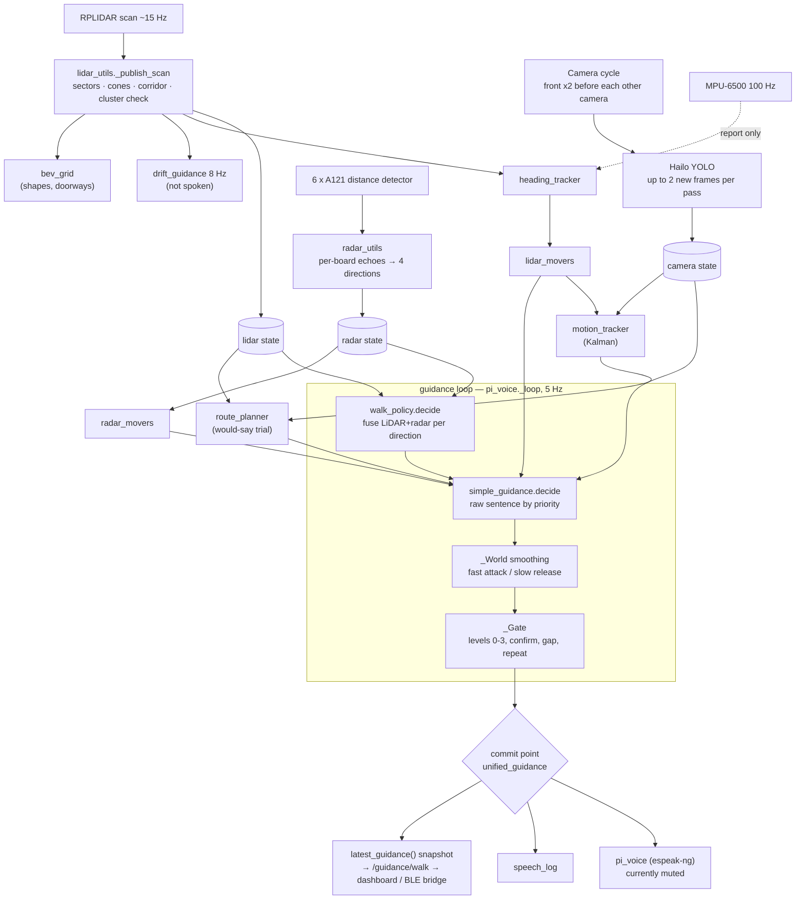

## 3. Sensor processing

### 3.1 LiDAR (`utils/lidar_utils.py`)

1. **Read.** A reader thread does bulk serial reads with its own packet-sync parser. It drops backlog older than 0.25 s and rejects partial scans (an angular gap over 20°). Each complete scan goes into a single-slot mailbox, so the analysis thread always works on the newest scan and never on a queue of old ones.
2. **Sectors.** Eight 45° sectors (front, front_right … front_left) hold the minimum distance. They are used for threat awareness and the hazard list.
3. **Cones and corridor.** Four 10° cones (`GUIDANCE_CONE_DEG`) centred on front/right/back/left are used for steering. The **body corridor** is a 300 mm half-width strip straight ahead out to 2.5 m (`GUIDANCE_CORRIDOR_*`), which catches a post that is outside the narrow cone but in the user's path.
4. **Cluster confirmation.** A return counts only if it is part of a cluster (`_cluster_min`) or was also seen in the previous scan (`_persists`). A single stray reflection is ignored.
5. **Unswept marking.** An angle the scan did not cover is marked unknown, not clear.
6. **Downstream on each scan:** heading → movers (`lidar_movers`, then the Kalman `motion_tracker`) → drift (rate-limited to 8 Hz) → BEV grid → WebSocket broadcast.

### 3.2 Radar (`utils/radar_utils.py`, `radar_calibration.py`)

1. Each of the six boards runs the Acconeer **distance detector** through the Exploration Tool:
   - CFAR threshold;
   - `PLANAR` reflector shape (on trial since 2026-10-05);
   - profiles up to 5 (`max_profile`);
   - 0.25–4.0 m;
   - 6 Hz.

   The detector returns **distances and strengths only**, with no velocity or class [S14].
2. Boards are identified by **USB serial** and given a measured bearing. A board with no measured bearing gets a provisional `portN` key and is not used as a direction.
3. **Six to four.** Each guidance direction takes the nearest live echo from the boards whose beams overlap it (`cardinal_sources`: half-angle = 65/2 + 22.5°).
4. **Per-board glass judgement:**
   - `walk_policy._single_board_glass_ft` with a grazing-angle test;
   - the door-in-wall rule (`_centred_echo`, `_matches_ahead`), so that a pane in a doorway is not dismissed as the wall around it;
   - radar is trusted inside the cone only within `RADAR_CONE_TRUST_MM` (~1.1 ft).
5. **Stall guard.** If no progress is made (5 s streaming, 30 s calibrating), the link is forced to reconnect.

### 3.3 Cameras and AI (`utils/pi_camera_utils.py`, `hailo_inference.py`)

1. **Capture.** In cycle mode the board shows one camera at a time. Each frame is attributed by its sensor timestamp after the switch. The schedule is front ×2, right, front ×2, left, front ×2, back: 6 front frames per cycle against 1 for each other camera.
2. **Detection.** In cycle mode, each pass takes up to 2 cameras that have a new, not-yet-detected frame, in the order front, right, left, back; a front camera with no new frame is skipped. (`DETECTION_FRONT_EVERY_PASS`, front every pass plus one in rotation, applies only to the 2 × 2 mosaic mode.) Each detection does:
   - letterbox to 640 with OpenCV;
   - YOLO DFL decode;
   - per-class NMS (`DETECTION_CONF = 0.5`, `DETECTION_IOU = 0.7`).
3. **Class filter.** Only classes in `DETECTION_CLASSES` (the keys of `SIMPLE_NAMED_OBJECTS`) survive. The detector is **COCO-80**, so the classes that can actually fire today are:
   - person; car, truck, bus, motorcycle, bicycle, train;
   - dog, horse, cow, sheep, elephant, bear;
   - potted plant; traffic light / stop sign / parking meter (spoken as "Pole"); fire hydrant; bench.

   Words such as "Stairs", "Pothole", "Bollard" and "Pole" (as a class) are in the vocabulary for a custom model but **cannot fire with the shipped COCO model**.
4. **Freshness.** A camera result older than 2 s (`SIMPLE_CAMERA_FRESH_S`) is ignored.
5. **Segmentation** (path, tactile, person) feeds only a debug view and never the voice.

### 3.4 Distance for camera objects (`sensor_fusion.detection_distance`, uncommitted)

A camera box has no reliable range of its own.
- **Size estimate.** The code estimates range from box height, a typical object height (`SIMPLE_OBJECT_HEIGHT_M`) and the assumed lens HFOV (`SIMPLE_CAMERA_HFOV_DEG = 70`).
- **Laser match.** It then picks the **laser range in the box's bearing** that agrees with the estimate within a ratio of 0.5–1.4. The bearing window is widened to cover a lens HFOV anywhere from 55° to 75° (`DETECTION_DISTANCE_HFOV_DEG`).
- **Seated person.** A wide person box is treated as seated (1.3 m).

**What the label shows:**
- When a laser return fits, the label shows that laser distance (source `lidar`).
- Otherwise (no fitting return, or the LiDAR not current), it shows the camera's own size estimate, marked as an estimate: source `camera` or `camera_cut`, printed on the dashboard as "≈N ft est." or "≤N ft est.".

These label distances feed only `/camera/stats` and `/camera/distances`, which are display-only. **They never decide blocking.**

With the ToF depth camera (§3.5) and `TOF_USE_DISTANCE`, a box the ToF measured takes that distance first (source `tof`); until then its reading is only shown beside the label, as "(ToF N ft)".

### 3.5 Measured distance from the ToF depth camera (`utils/depth_fusion.py`, `utils/tof_camera.py`; added 2026-10-13, uncommitted, off until the sensor is fitted)

The Arducam ToF (240 × 180 distances) is to sit just below the front camera. Both are pinhole cameras with different numbers (focal length in pixels, image centre, distortion, position, aim), so the depth picture is not stretched over the camera's. Each depth pixel is placed with its own distance:
1. `P = d · K_tof⁻¹ · [u, v, 1]`: the point the ToF pixel (u, v) measured at distance d;
2. `P′ = R · P + t`: that point in the camera's frame;
3. `[u′, v′] = K_cam · P′ / Z′`: the camera pixel it lands on (each lens's distortion included).

- **Numbers.** K_tof, K_cam, R and t come from the bench calibration (`tools/tof_calibrate.py` → `calibration/tof_calibration.json`). Until it exists the lenses are taken as ideal and placed as designed, and `/health` says "not calibrated":
  - the ToF: 70° diagonal on its 4:3 sensor, 58.5° × 45.6°;
  - the camera's 960 × 540 front picture: a centre crop of the 66° lens, 56.4° × 33.5°;
  - the ToF 3.8 cm below the camera, aimed 20° further down.
- **Pairing.** Each detection pass uses the ToF frame captured nearest its picture, within 60 ms (`TOF_PAIR_MAX_S`). A frame is placed only when a pass uses it (about 7 ms on the Pi 5).
- **A box's distance** (`DepthFrame.box_depth`):
  - the box is trimmed (15 % each side, 10 % at the top, 20 % at the bottom: the ground at its feet);
  - the depth points inside are grouped where they are no more than 0.3 m apart along the ground;
  - the nearest group holding at least 20 % of them (and 6) is the thing: the person, not the wall behind;
  - it gives the distance along the ground, the straight-line range, the bearing, the point count and the spread;
  - a box the ToF cannot see (above its view, beyond 4 m) gets nothing and keeps the size estimate.
- **Who uses it.** Every front detection carries `depth`. With `TOF_USE_DISTANCE` (False) it replaces the box-size range in:
  - `detection_distance` (source `tof`);
  - the guidance (`simple_guidance._box_range`: the object on the path, the ranged vehicle, steering);
  - the route planner's camera faces;
  - the Kalman tracker (range σ 5 cm + 2 %; boxes the frame cuts off are then usable).

  While False, nothing spoken changes.
- **Routes:** `/tof/status`, `/tof/depth.jpg`, `/tof/overlay.jpg` (the camera's picture with the depth dots drawn on it: the calibration check), and `POST /tof/calibrate/capture` and `/tof/calibrate/reload` (admin token).
- **Desk test** (`tools/tof_fusion_sim.py`, 26 checks; a synthetic street through a ToF with known, distorted lenses, 1° off the design):
  - every dot lands within 0.05 px of its true point;
  - a person 1.9 m ahead of a wall measures 1.88 m (true 1.87); a 12 cm pole at 3 m and a person at 1 m with the head cut off are measured too;
  - nothing at 5 m, or above the ToF's view;
  - the wrong ways are measurably wrong: the depth picture stretched ~275 px off, angles only ~22 px within 1.6 m, the design numbers on that rig ~23 px;
  - the solver, run on rendered checkerboard pictures, places the dots within 0.14 px (median);
  - the wall check tells a reading along the ray from one along the axis.

## 4. The decision: `walk_policy.decide`

**Level 1:** for each of four directions, how far can the user walk, and is that distance glass? If the front is blocked, which way should they turn?

**Level 2:**

| Step | Logic | Constants |
|---|---|---|
| Read direction | LiDAR cone/corridor distance plus radar for the direction, with freshness checks | `LIDAR_STALE_S 1.0`, `RADAR_STALE_S 1.5` |
| Fuse | Average, unless the readings differ by ≥ 2 ft and the nearer one is a real measurement; then the nearer reading is used. The direction is flagged `glass` only when the **radar** is the measured nearer reading by ≥ 2 ft and the laser arc does not corroborate it (`_is_glass`) | `WALK_GLASS_GAP_FT 2.0` |
| Memory | Side directions keep their last measurement for 3 s (`_carry_measured`) | `WALK_MEASURED_MEMORY_S 3.0` |
| Blocked | Front clearance < 4 ft | `WALK_BLOCK_FT 4.0` |
| Turn choice | Order left, right, back. Needs ≥ 2 ft of room and a 1.5 ft margin; 0.8 ft hysteresis; held for 4 s. Ranking: back last, then directions the radar cannot see, then most room (`choose_turn`). The BEV/spatial `preferred_side` is consulted only by `simple_guidance.safer_side`, when walk_policy has not picked left or right | `WALK_MIN_TURN_FT`, `WALK_TURN_MARGIN_FT`, `WALK_TURN_HYSTERESIS_FT`, `WALK_TURN_HOLD_S` |
| Result | `unknown` / `walk_straight` / `caution_forward` / `stop` / `turn_left|right|back`, with `front_ft`, `glass_ahead`, and per-direction `distance_ft`, `lidar_ft`, `radar_ft`, `fusion` | Units: feet |

## 5. The sentence: `simple_guidance`

### 5.1 Raw sentence (`decide` → `_sentence`), highest priority first

1. **Vehicle approaching.** A front-camera vehicle box grows faster than walking alone would explain (`_Vehicles`: Theil-Sen on box size, ego-motion discount, miss distance ≤ 2 m). Sentences: "Vehicle approaching, move left/right", or "Vehicle approaching" when there is no room to step aside. Level 3.
2. **Mover** (LiDAR or radar mover, §6). Spoken **only if `LIDAR_MOVERS_SPEAK`**, which is **False** today, so it is logged as "would say".
3. **Blocked** (front < 4 ft), most specific first:
   - "Blocked by glass" → "Blocked by wall" → "Vehicle in front, be careful";
   - "Near left/right wall" (a wall close beside);
   - drifting;
   - a steer-past sentence ("Person in front, turn left");
   - "X in front";
   - "Turn left/right".
4. **Not blocked:**
   - "Vehicle in front, be careful";
   - "Glass ahead" (pane on the path inside 12 ft);
   - "Near left/right wall, move right/left" (inside 4 ft);
   - "Glass on left/right, move right/left";
   - "Drifting toward left/right wall, turn slightly right/left" (closing ≥ 0.2 ft/s inside 5 ft, converging within 20 ft);
   - "Wall ahead" (inside 12 ft);
   - steer-past;
   - "X ahead";
   - "Walk straight".

The object word X comes from the front camera only when the box sits in the central band, is big enough, and its size-estimated range **agrees with the laser's front range** (`front_object`).

### 5.2 Smoothing (`_World`, `_Hold`)

- Each hazard flag turns **on fast and off slowly**: attack 0.2 s (`SIMPLE_ALERT_CONFIRM_S`), release 1.0 s (`SIMPLE_CLEAR_CONFIRM_S`). Single-poll dropouts are tolerated.
- Object and glass identities are held 3 s after they are last seen (`SIMPLE_OBJECT_RELEASE_S`, `SIMPLE_GLASS_RELEASE_S`).

### 5.3 The speech gate (`_Gate`)

| Rule | Value |
|---|---|
| Urgency levels | 0 walk straight · 1 advisory · 2 blocked/turn/mover · 3 vehicle approaching (`_LEVEL`) |
| A more urgent sentence | Said as soon as the current sentence's airtime ends; a level-3 vehicle warning does not wait. Separately, any **urgent** sentence (rule `blocked`, `vehicle_approaching` or `mover_approaching`, i.e. levels 2 and 3) makes `pi_voice` stop the utterance that is playing |
| A calmer or equal sentence | Must hold for 1 s (`SIMPLE_CONFIRM_S`) and wait ≥ 3 s after the last (`SIMPLE_MIN_GAP_S`) |
| Same episode, changed wording | Must settle for 6 s (`SIMPLE_SETTLE_S`) |
| Repeats of the same blocked sentence | 30 s, doubling to a 120 s cap (`SIMPLE_REPEAT_S`, `SIMPLE_REPEAT_MAX_S`) |
| Withheld | "Walk straight" while unconfirmed, at a crossing (5 s after a front-camera traffic light), or during the start-up hold |
| Each admission | Increments **`cue_seq`**, the only "announce now" signal |

### 5.4 Start-up and status notices

- `startup_gate` keeps the device silent until the LiDAR has settled: it waits up to 15 s for optional sensors, then a 2 s settle, then 6 samples within 1.5 ft.
- "Glass sensor off/on" is spoken when front radar coverage is lost or regained (3 s loss, 10 s recovery confirmation).
- "Camera off/on" is spoken the same way when the front camera can no longer name what is ahead, or can again (`sensor_fusion.front_camera_coverage`: no fresh front detections, or a black picture; 5 s loss, 10 s recovery confirmation, 45 s start-up grace). Like the glass notice it is only said while the path is clear (added 2026-10-09; desk-tested, NEEDS VALIDATION on the device).

## 6. Movers (uncommitted, silent trial)

**`lidar_movers`:**
- **Segmentation.** The scan is split into blobs: a break at 200 mm + 6 %/m, or a 3° gap; at least 3 points; at most 2 m wide.
- **Tracking.** Blobs are followed within a 0.5 m gate. A Theil-Sen velocity is fitted over 1.2 s (≥ 6 samples).
- **User's own motion.** It is estimated by least squares from tracks that are still (≥ 4 tracks, RMS ≤ 0.2 m/s).
- **Mover test.** A track is a mover if its own speed is ≥ 0.4 m/s, confirmed over 3 scans.
- **Closest point of approach.** Horizon 5 s; it is a threat if it passes within 1 m (a Person) or 2 m (a Vehicle, `SIMPLE_VEHICLE_MISS_M`).
- **Modes:** crossing, toward, behind.
- **Word.** "Person" if ≤ 0.9 m wide and < 3 m/s, otherwise "Vehicle". The front camera can override the word within 10°.

**`radar_movers`:**
- It only covers where the LiDAR sees nothing (`lidar_sees`).
- It tracks per-board range: closing ≥ 0.4 m/s after removing the user's walk, confirmed over 2 frames.
- It pauses while the user turns faster than 10 °/s.
- Its word is always "Something".

**`motion_tracker` (Kalman, added 2026-10-13, uncommitted):**
- **Detections.** The clean `lidar_movers` blobs, plus the people and vehicles the front camera names. A camera thing is placed by bearing (where its box sits in the frame) and range (box height against the class's typical height). Its error is an ellipse: 0.1 m + 15 % along the line of sight, 2° across it. Frames older than 0.4 s are not used.
- **The user's own motion.** Each scan, `heading_tracker`'s turn (`scan_yaw_deg`) and step (`scan_fwd_mm`, `scan_right_mm`) are taken off, so every velocity is the thing's own, over the ground. Without odometry, `lidar_movers`' still-things estimate is used. Its residual turn also corrects the heading tracker's own error.
- **Filter.** One constant-velocity Kalman filter per track: position, velocity and their covariance. A person may accelerate 1.2 m/s² any way. A moving vehicle may accelerate 1.5 m/s² along its heading but only 0.4 across it (a car brakes; it does not slide sideways).
- **Association.** A detection joins a track only if all of these hold:
  - it is the most likely track, inside the 99 % Mahalanobis gate (χ² ≤ 9.21);
  - it lies within 1 m of where the track should be (2 m for a vehicle; 1 m more while the track is new; plus twice the detection's own error);
  - it is the same kind of thing (a person-sized blob is never a car).
- **Moving.** All of the following:
  - followed for 0.6 s and 6 sightings;
  - faster than `lidar_movers`' threshold (0.4 m/s, raised 0.07 m/s per metre, plus the doubt in the user's own speed and the slide of a near thing walked past);
  - at least 3σ in its own direction. A camera is least sure along its line of sight, which is exactly where a parked car's wobbling range points.
  - A vehicle must also hold its heading within 20° for 0.8 s and have travelled 1 m in the last second (a track that swapped between two passing cars swings).
- **Warning.** Same as `lidar_movers`: the closest approach passes within 1 m (a Person) or 2 m (a Vehicle) inside 5 s. It is held for 3 scans and reported as crossing, toward or behind. With `MOTION_TRACKER_WARN` it stands in for `lidar_movers`' threat. It is spoken only with `LIDAR_MOVERS_SPEAK`, which is still False.
- **Desk test** (`tools/route_sim.py`, 14 tracker scenes, the rig's scan density and blind arc):
  - **speed error:** median 0.04–0.11 m/s;
  - **warning timing:** a person crossing into the user's way is warned about 3.1 s ahead, and a car seen by the camera 1.7 s ahead;
  - **no false movers:** none in a still room, while walking with or without odometry, past a parked car, or with two cars passing each other.
  - **Cost:** about 1.6 ms per scan on the Pi 5. NEEDS VALIDATION on real walks.

## 6a. The route planner (`utils/route_planner.py`, added 2026-10-13, uncommitted, would-say trial)

The planner looks for the best way through everything sensed, both as it is now and as things move.
- **Points on the ground.**
  - LiDAR returns from 0.3 m out (nearer is the wearer's own arm).
  - Glass where the walk policy puts it: an arc ±30° across the front at the radar's range, or 25–60° on one side for glass beside the user.
  - The near face of each thing the front camera names, at the range its size gives.
  - In each arc the LiDAR cannot see from where it is worn (`LIDAR_BLIND_ARCS_DEG`, currently the rig's back-left 170–290°):
    - the surfaces at its edges are carried on into it;
    - plus the nearest radar echo (`peaks_mm`) the LiDAR cannot account for;
    - 4 m if every echo is accounted for, 0.3 m where no board hears.
  - So no return there is never taken for open space.
- **Lanes.** For each direction from 90° left to 90° right in 5° steps, the planner measures how far a 0.6 m lane stays clear (0.44 m, the user's own width, when nothing wider fits), out to 4.5 m. The best way is the smallest turn giving 2.4 m: straight if that will do, otherwise the way chosen in the last 3 s while it stays clear. If nothing anywhere ahead is 1 m clear, the answer is to turn around.
- **In time.** Moving tracks are left out of the static points and predicted 4 s ahead. The prediction's doubt is one standard deviation, growing 0.1 m/s for people and 0.3 m/s for vehicles, capped at 0.8 m. The planner tries, in order:
  1. walking pace;
  2. half pace;
  3. waiting;
  4. if something is coming at the spot the user stands on, stepping aside where it stays clear longest (0.6 m of room needed).
  A moving thing may bend the way by 35° at most; past that, slowing or waiting beats a swerve toward traffic.
- **Speech (only with `ROUTE_PLANNER_SPEAK`, False):**
  - the blocked turn side, including "Turn around";
  - "Turn slightly left/right" past something no camera names, or the existing "<Object> ahead, turn slightly …" past something it does name;
  - waiting or stepping aside use the existing mover sentences (with `LIDAR_MOVERS_SPEAK`);
  - a vehicle that forces slowing is "Vehicle approaching from …, stop".
  - While False, each would-be sentence is logged as "would say" (`speech_log` source `route-planner`, and the test console).
- **Desk test** (`tools/route_sim.py`, 14 planner scenes through `walk_policy` and `simple_guidance.decide`):
  - straight in the open and in a clear corridor;
  - a slight turn past a post;
  - the open side in a corner, including a wall hidden in the blind arc;
  - turn around in a dead end;
  - never steered into glass;
  - waits for a car crossing as the user gets there, and walks on when it is gone;
  - steers past a person crossing or coming head-on;
  - "Person coming toward you, stop" in a corridor too narrow to pass.
  - **Cost:** about 5 ms per guidance tick with two moving people. NEEDS VALIDATION on real walks before `ROUTE_PLANNER_SPEAK` is turned on.
- **Not ported from the walk simulator:**
  - everything that needs the ToF's view of the ground (not yet bought): kerb and drop barriers, steps and holes, and the 4 m memory of low obstacles. (The camera + depth merge itself is in: §3.5, off.)
  - the camera explaining a radar echo away as not glass, which only matters once the LiDAR sits at shoulder height.

## 7. The hazard list (display, not speech)

`sensor_fusion.build_hazards` builds a ranked list per sector:
- fused range (LiDAR/radar);
- camera identity (if the camera is trusted);
- clock position (from the LiDAR angle);
- BEV shape (wall/pole/body);
- urgency: **danger ≤ 0.8 m, warning ≤ 1.5 m, caution ≤ 2.0 m** (a person or vehicle within 2 m escalates to warning), clear beyond.

It feeds the dashboard's "around you" list and the BLE `get_surroundings` command. **It does not drive speech.**

## 8. Answers to the key questions

| Question | Answer (all CONFIRMED in code) |
|---|---|
| How does it know something is ahead? | The LiDAR front cone (±5°) and body corridor (±300 mm to 2.5 m), cluster-confirmed, give `front_ft`. The front radar boards are fused in for glass |
| How does it estimate distance? | From the laser and radar together. `front_ft` is their **average** when they agree within 2 ft (a radar that hears nothing counts as 13.1 ft, a laser that sees nothing as 40 ft), and the **nearer measured** reading when they disagree. A camera size estimate appears only on display labels when no laser return fits, and never decides blocking |
| Left, centre or right? | LiDAR angle → sector and clock position. Camera boxes are placed in a central band or the left/right of the front frame. Turn choice compares the left and right clearances |
| Nearby vs immediate risk? | Fixed distance bands: < 4 ft = blocked (level 2); 4–12 ft = "… ahead" (level 1). Vehicles use box-growth time-to-contact and miss distance (level 3). Movers use closest approach ≤ 1 m (person) or 2 m (vehicle) within 5 s |
| Camera sees it, LiDAR doesn't? | Not named on the path (the range-agreement check fails) and never "blocked". **Exception:** an approaching vehicle from the camera alone is still warned, even when the LiDAR is offline or stale |
| LiDAR sees it, camera can't classify? | A generic sentence: "Blocked by wall" if it fits a wall surface, otherwise "Turn left/right" when blocked, or nothing extra when not blocked. The hazard list says "obstacle" or the BEV shape ("pole", "wall") |
| How does radar help in bad conditions? | Only for **transparent** obstacles in this design. 60 GHz radar is largely unaffected by darkness, but the code does not use radar for rain, fog or dust (ENV trust is disabled) |
| False-alert reduction | Cluster/persistence check, smoothing (attack/release), 1 s confirmation, per-board glass grazing test, door-in-wall rule, camera-laser range agreement, class filter, simulation never counts |
| Avoiding overload | Closed vocabulary; one sentence at a time; 3 s minimum gap; 6 s settle; repeat back-off 30 → 120 s; "Walk straight" withheld while not confirmed |

### Raw, inferred and validated

| Kind | Examples | Who may act on it |
|---|---|---|
| **Raw measurement** | A LiDAR point (angle, mm), a radar echo (mm, strength), a camera box (class, confidence, pixels) | Internal only |
| **Inferred information** | Fused direction clearance, a glass flag, the hazard list, mover tracks, the BEV shape, drift | Display, logs, `get_surroundings`. **Not authoritative** |
| **Committed instruction** | The gated sentence with a new `cue_seq` | The voice, and the phone **only when `cue_seq` steps** |

The term "validated" is reserved for field-validated behaviour, and **none of the instructions are field-validated yet**.

## 9. Latency

| Stage | Typical / bound | Basis |
|---|---|---|
| LiDAR sweep plus analysis | ~67 ms sweep at 15 Hz + analysis | Config + README |
| Camera to detection | Median 106 ms old (front) | README measurement |
| Guidance loop tick | ≤ 200 ms wait (5 Hz); ~6 ms compute | Config + README |
| Smoothing attack | 0.2 s for a new hazard | Config |
| Gate | 0 s for an urgent cut-in (level 3) or an escalation once airtime ends; 1 s confirmation plus 3 s minimum gap for calm sentences | Config |
| Pi voice start | espeak-ng process start, NEEDS VALIDATION | — |
| BLE bridge poll | ≤ 100 ms (10 Hz) | PROPOSED |
| BLE notification | One connection interval, typically 15–30 ms (iOS rules: ≥ 15 ms) | [QA1931]; NEEDS VALIDATION |
| Phone TTS start | NEEDS VALIDATION (platform-dependent) | — |

**Proposed targets** (engineering proposals, not measurements):
- **Hazard onset → device voice starts:** ≤ 600 ms p95 for level ≥ 2.
- **Hazard onset → phone voice or haptic starts:** ≤ 900 ms p95.
- **Level 3 (vehicle):** ≤ 500 ms device, ≤ 800 ms phone, after the vehicle is confirmed.

**How to measure:**
1. **Device side.** The speech log records admit time and `started`/`completed` delivery events per `cue_seq` (`/guidance/log`). ALERT carries `age_ms` (decision age at send).
2. **Phone side.** The app records the receive time and TTS-start time, and sends `alert_ack{app_latency_ms}`. The bridge keeps the last 50 acks (`get_diagnostics`).
3. **End to end.** Film the walker, an obstacle board and the phone with one camera at ≥ 120 fps. Count frames from the board entering the 4 ft line to audio onset; the audio waveform is visible in the video. Repeat ≥ 20 times per scenario and report the median and p95.

## 10. Calibration and synchronisation

| Item | State |
|---|---|
| Radar bearings | Measured per serial; recorded in `config.RADAR_BEARINGS` or the `radar_bearings.json` overlay (absent today). The hub-port comments are stale (audit NEW-047) |
| Camera channel map | Measured on 2026-10-08 |
| Camera HFOV | **Assumed 70°**; probably ~57° (see [02 §4](#doc-02-hardware-architecture)). NEEDS VALIDATION. It affects every camera range estimate |
| ToF ↔ front camera | Not fitted. Design numbers until `tools/tof_calibrate.py solve` (checkerboard 9 × 6 inner corners, 35 mm, matte; 15–25 views both see); check on `/tof/overlay.jpg`. Whether the SDK reads along each ray: `tools/tof_calibrate.py wall` (`TOF_DEPTH_IS_RADIAL`). Lock the camera's focus. NEEDS VALIDATION |
| LiDAR orientation | `LIDAR_MIRROR = False`, "verified, do not flip" |
| Gyro mounting, stride | Not confirmed (gates off); there is no `stride.json` |
| Time sync | No common clock. Every reading carries a wall-clock stamp **and** a monotonic receive time. A reading is current only if **both** its stamp age and its monotonic receive time are within the limit (`reading_is_current` in `utils/freshness.py`, with 0.5 s tolerance for a future stamp after a clock step). Camera frames carry their own capture time. LiDAR and camera are **not** time-aligned beyond freshness windows |
| Confidence | Detector confidence ≥ 0.5 (`DETECTION_CONF`, applied inside the engine). The later `SIMPLE_VEHICLE_MIN_CONF = 0.45` therefore never comes into play. Laser and radar have no per-reading confidence; trust comes from cluster, persistence and fusion rules |


<div class="pagebreak"></div>

<a id="doc-04-bluetooth-communication-architecture"></a>

# 04 — Bluetooth Communication Architecture

> **Status.**
> - **Product:** there is **no Bluetooth code in the product today** (NOT IMPLEMENTED; a repository search found no `bluetooth`/`gatt`/`bluez`).
> - **Design:** everything below is **PROPOSED**.
> - **Prototype:** a reference implementation exists in [`ble_bridge/`](../ble_bridge/README.md). Its logic is desk-tested (34 tests) and its BlueZ access is checked read-only (`--check`). It has **not** yet run over the air.
> - **Contract:** the exact byte- and field-level contract is in [06 — ICD](#doc-06-interface-control-document).

---

## 1. What the link is for, and what it is not for

**Level 1:** the phone is a companion. It mirrors the device's warnings (spoken or vibrated) when the device cannot speak, shows whether the device is healthy, and lets the user ask "what's around me?". The **device stays responsible for safety**: it senses, decides and (once local audio exists) warns by itself, so a dropped Bluetooth link must never silence a warning.

**Level 2.** Data that crosses the link (all small):

| Direction | Content | Rate |
|---|---|---|
| Device → phone | **ALERT**: an announcement the device's speech gate admitted (phrase id + level + flags + front clearance), plus its text | Rare: ≥ 3 s apart, except escalations |
| Device → phone | **STATE**: the current instruction, health bits and status; it doubles as the heartbeat | 1–5 Hz, 20 bytes |
| Device → phone | **EVENTS**: health changes, sensor loss and recovery, thermal and power, sessions, command responses | Occasional, JSON |
| Phone → device | **COMMAND**: hello, ping, status and surroundings queries, session start/stop, alert acknowledgement, tester mark | User-driven |

**Not on the link:**
- video or images;
- raw LiDAR, radar or IMU data;
- location;
- anything that changes how the device decides. In v1 no command can alter guidance thresholds or silence the device.

## 2. Protocol choice

| Criterion | **BLE (GATT)** | Bluetooth Classic (SPP/RFCOMM) | Wi-Fi (today's dashboard over HTTP) |
|---|---|---|---|
| iOS | ✅ Core Bluetooth, any app | ❌ Third-party apps need MFi for Classic accessories | ✅ but needs a shared network (hotspot) |
| Android | ✅ | ✅ | ✅ |
| Power on phone | Low | Medium | High |
| Latency | One connection interval (≥ 15 ms on iOS [QA1931]) | Low | Low, but depends on the network |
| Payload | 20 B at the default ATT MTU, up to 512 B attribute values [Core ATT §3.2.9]; MTU up to 517 on BlueZ/Android | Stream | Unlimited |
| Background on phone | iOS `bluetooth-central` mode delivers notifications [Apple]; Android needs a foreground service | Android only | Very limited |
| Pairing and encryption | LE Secure Connections (Core 4.2+) | Legacy/SSP | WPA2/3 + HTTP (the dashboard has no TLS) |
| Works with no infrastructure | ✅ | ✅ | ❌ |
| Effort | Medium | Medium (iOS blocked) | Exists today |

**Decision: BLE** with the Pi as the GATT server. Classic is ruled out by iOS. Wi-Fi stays for the existing field-test dashboard (`/`, `/test`), but it needs a shared network and a browser tab in the foreground, so it is not suitable for a walking user.

**Video:** BLE cannot carry useful video; even at full rate it carries kilobytes, not megabytes, per second. Any future "show me the camera" feature for a sighted helper must use Wi-Fi (the existing MJPEG `/camera/stream/{sector}`), and needs its own privacy review ([08 §8](#doc-08-safety-reliability-failure-management)).

## 3. Roles

| Role | Device | Why |
|---|---|---|
| **Peripheral + GATT server** | Raspberry Pi (BlueZ 5.82) | The Pi owns the data and must keep working with no phone. Phones are built to be centrals, and iOS background mode supports a central talking to an accessory [Apple bluetooth-central]. BlueZ supports the peripheral role on this adapter (`Roles: central, peripheral`, CONFIRMED) |
| **Central + GATT client** | Phone app | It scans for the service UUID, connects, subscribes and writes commands |

**Process boundary (key design decision).** The BLE server is a **separate process** (`ble_bridge`, its own systemd unit) that reads the navigation service's existing loopback API:
- `GET /guidance/walk`: the guidance loop's snapshot, never re-running the pipeline;
- `GET /health`;
- `GET /guidance/status`;
- `GET /guidance/log`;
- `POST /guidance/mark`.

The consequences:
1. A BLE crash, stall or BlueZ restart **cannot** affect the guidance loop or its watchdog.
2. There are **no changes** to production code for v1.
3. The same bridge can serve a mock source for app development.

The cost is ≤ 100 ms of polling delay (10 Hz poll vs the 5 Hz loop). An in-process hook can remove that later if measurements show it matters.

## 4. GATT design (summary; exact table in [06 §3](#doc-06-interface-control-document))

| Service | Characteristic | UUID | Properties | Purpose |
|---|---|---|---|---|
| Device Information **0x180A** (SIG) | Manufacturer 0x2A29, Model 0x2A24, Hardware Rev 0x2A27, Firmware Rev 0x2A26, Software Rev 0x2A28 | SIG 16-bit | read | Identity and versions. **Serial Number 0x2A25 is deliberately omitted**, because a stable serial readable without pairing would make the device trackable |
| Battery **0x180F** (SIG) | Battery Level 0x2A19 | SIG 16-bit | — | **NOT IMPLEMENTED; not exposed** until a fuel gauge exists. It must never report a fake value |
| **Shappe Navigation** (custom) | — | `37e90001-0882-43f6-ae9b-b733c720c46d` | primary | All application data |
| | PROTOCOL_INFO | `37e90002-…` | encrypted read | Versions, capabilities, limits, device id, vocabulary revision |
| | ALERT | `37e90003-…` | encrypted read + notify | Announcements (binary record) + text |
| | STATE | `37e90004-…` | encrypted read + notify | Current instruction + health; **1 Hz heartbeat** |
| | COMMAND | `37e90005-…` | encrypted write (with response) | JSON commands |
| | EVENTS | `37e90006-…` | encrypted notify | JSON events and command responses |

The UUID base `37e9xxxx-0882-43f6-ae9b-b733c720c46d` was randomly generated on 2026-10-09 for this project. The 16-bit field `xxxx` distinguishes the attributes. It is **application-specific**, not a SIG-assigned number.

**Why so few characteristics:**
- Each subscription and each notification queue is a place for an app bug. Health is carried as bits in STATE and as events, rather than as a separate characteristic.
- Responses share EVENTS with events and are matched by `id`.

**Notifications, not indications.**
- An indication's confirmation is **ATT-level only**: it proves the phone's Bluetooth stack received the bytes, *not* that the user heard anything [Core ATT §3.4.7].
- Indications allow one outstanding PDU and add a round trip per alert.
- Delivery is instead made observable with the optional `alert_ack` command, which reports what the app actually did (spoken, haptic, shown, suppressed or expired). **The device never waits for it.**

## 5. Message protocol (design rationale)

| Option | Pros | Cons | Use |
|---|---|---|---|
| JSON everywhere | Readable, built into every platform | 150–600 B per message, so it fragments at the default MTU | — |
| CBOR | Compact, schema-free | Needs a library on each platform; harder to debug in nRF Connect | Not chosen |
| **Fixed binary for the hot path + JSON for the rest** | ALERT/STATE are **20 bytes** and fit the smallest ATT MTU with no negotiation or fragmentation. JSON stays readable where size doesn't matter | Two decoders, both small | **Chosen** |

- **Frame header (6 bytes) on every value:** version, type, per-characteristic sequence number, fragment index/count. Fragmentation applies only to JSON and ALERT_TEXT.
- **ALERT and STATE records (14 bytes):** they carry
  - **epoch**: incremented when the bridge or the navigation service restarts, so counters can reset safely;
  - **cue_seq**: the device's own announcement counter;
  - **age_ms**: the decision's age when sent, so freshness is checkable without clock sync;
  - **phrase_id**: an index into the append-only phrase registry `ble_bridge/contract/vocab_v1.json`, 300 sentences, revision 3, sha `690108ffa2ae7139`;
  - level, flags/status, and front clearance or health bits.
- **Text is also sent** (ALERT_TEXT), so an app with an older phrase registry still speaks correctly.

**Why phrase ids:** the app can localise ("Glass ahead" → another language), choose a haptic pattern per phrase, and avoid string matching. The registry is generated from `utils/simple_guidance.ALLOWED` and checked by a test. Ids are never reused.

## 6. Security

### 6.1 Threats considered

1. **Eavesdropping.** Alerts reveal where a disabled person is and what is around them.
2. **Spoofing a device** to feed false "Walk straight" messages to the phone.
3. **Unauthorised commands.**
4. **Tracking** by the static address or a serial number.
5. **Denial of service** (jamming, connection hogging).

### 6.2 Controls

| Control | v1 prototype (`ble_bridge`) | Production (PROPOSED) |
|---|---|---|
| Link encryption | All custom characteristics use BlueZ `encrypt-read` / `encrypt-notify` / `encrypt-write`, so an unencrypted access gets ATT **Insufficient Encryption (0x0F)** [BlueZ gatt-server.c] | `encrypt-authenticated-*`, which needs a MITM-protected bond and returns ATT 0x05 |
| Pairing method | **LE Secure Connections "Just Works"** (agent `NoInputNoOutput`). Encrypted, but **no MITM protection** [Core SMP]. Acceptable for a supervised lab only | **Passkey Entry, device = DisplayOnly.** The Pi's own voice speaks the 6-digit passkey into the user's earpiece and the user types it into the phone's system pairing dialog (accessible with VoiceOver/TalkBack). This needs the local audio output from [08 §4](#doc-08-safety-reliability-failure-management) |
| Pairing window | Pairable only for 180 s after the bridge starts (`--pair-window`); the agent rejects requests after that | Opened by a **physical button** on the device, NOT IMPLEMENTED (no button exists). Spoken "Pairing open" / "Pairing closed" |
| Owner model | One bonded phone expected; a warning is printed if more than one connects | One owner phone. A second phone needs the button and the owner's consent. Factory reset clears all bonds |
| Command authority | **No v1 command can change guidance or silence the device**, so encryption is sufficient | Any future settings command requires an authenticated bond **and** an application-layer ownership proof (HMAC challenge with a per-device secret set at claim time), with replay protection by nonce |
| Privacy (address) | BlueZ default `Privacy=off` (static public address) | `Privacy=device` in `/etc/bluetooth/main.conf`, so the Pi uses resolvable private addresses; bonded phones resolve them with the IRK [BlueZ main.conf] |
| Identity | `device_id` is a random 16-hex id stored on the device (`~/.local/state/shappe-ble/state.json`), sent only after encryption (in PROTOCOL_INFO). **No MAC or serial is used for identity** | Same. The app pins the bonded peripheral and checks `device_id` on every connect |
| Spoof resistance | The phone accepts a device only after an encrypted bond, and the mock device always identifies itself (`Shappe-M`, `mock: true`, simulated bit) | Plus authenticated pairing |

### 6.3 Key storage and reset

- **Device bonds:** stored by BlueZ in `/var/lib/bluetooth/<adapter>/<phone>/info` (LongTermKey, IRK, …) [BlueZ settings-storage]. A factory reset (PROPOSED) runs `bluetoothctl remove <addr>` for every bonded device and clears the state file.
- **Phone bonds:** iOS and Android keep them in the system. The app cannot read them, and on iOS it cannot start pairing itself: pairing starts automatically when a protected attribute is accessed [Apple ADG via Nordic].
- **Recovery:** if either side loses the bond, the user removes the device in phone Settings → Bluetooth and re-pairs during a pairing window. BlueZ's default `JustWorksRepairing=never` refuses a silent re-pair over an existing bond, which is the safe default; the device-side bond must also be removed. The app must explain this with spoken, step-by-step instructions ([07 §5](#doc-07-user-journeys-and-accessibility)).

### 6.4 Known risks to test (NEEDS VALIDATION)

1. **iOS pairing trigger.** Apple's guidance says to reject with **Insufficient Authentication (0x05)** to trigger pairing. BlueZ `encrypt-*` returns **Insufficient Encryption (0x0F)**. Field reports suggest iOS also pairs on 0x0F, but this must be confirmed on current iPhones. If it fails, switch to `encrypt-authenticated-*`, which returns 0x05 but requires passkey pairing.
2. **Android bonding.** The app should call `createBond()` before subscribing, and again on GATT_INSUFFICIENT_AUTHENTICATION/ENCRYPTION, rather than relying on implicit pairing.
3. **Just Works is open to a man-in-the-middle during the pairing window.** Mitigations: the short window, physical presence, and future passkey pairing.

## 7. Privacy and data handling (CONFIRMED current state + PROPOSED rules)

| Data | Today (CONFIRMED) | Over BLE (PROPOSED rule) |
|---|---|---|
| Camera images | Processed on the device. MJPEG streams are served on the LAN at `/camera/*` with no authentication (the security model relies on Host/Origin checks, not login). **No image recording code was found** | **Never sent** |
| Audio recording | None (no microphone in the code) | None |
| Location / GPS | None | None |
| Speech log | In memory (`SPEECH_LOG_TO_FILE = False`); a file only for field tests | The last ≤ 20 lines on request (`get_speech_log`), only over an encrypted link |
| Detected people | Class, box and distance in memory; nothing identifies a person | Only object class and distance in `get_surroundings` |
| Diagnostics | — | Counters, last acks, versions. No user data |
| Phone side | — | Store preferences locally. Diagnostic logs are opt-in, kept 7 days by default, deletable from Settings, and never uploaded without explicit consent |

The **LAN dashboard** exposes the cameras to anyone on the same network who can reach port 8000. That is outside BLE, but must be addressed before any public use (see [08 §8](#doc-08-safety-reliability-failure-management)).

---

## 8. Raspberry Pi BLE implementation guide

### 8.1 Architecture

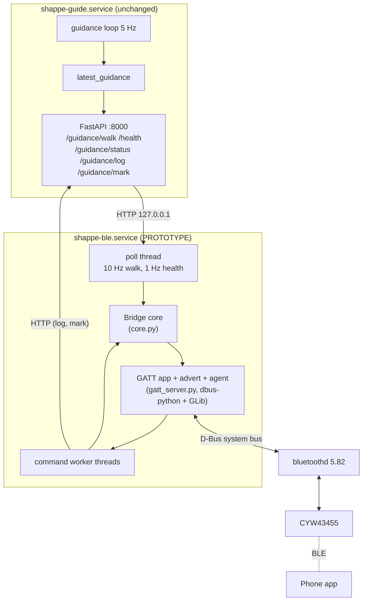

### 8.2 Dependencies (CONFIRMED present; nothing new to install)

| Need | On this Pi |
|---|---|
| BlueZ with the D-Bus GATT and advertising APIs | `bluez 5.82-1.1+rpt2`, `bluetooth.service` active |
| D-Bus bindings | `dbus-python 1.4.0` and PyGObject (`gi`) in the system Python; the venv uses `--system-site-packages`, so they are visible |
| Permissions | The BlueZ D-Bus policy lets any user send to `org.bluez`, and lets bluetoothd call back into `GattCharacteristic1`, `LEAdvertisement1` and `Agent1` (`/usr/share/dbus-1/system.d/bluetooth.conf`). Confirmed in practice by `--check` running as the `shappe` user |
| Tests | `jsonschema 4.19.2` (system) for the schema test |

### 8.3 Files (complete, in [`ble_bridge/`](../ble_bridge/))

| File | Role |
|---|---|
| `protocol.py` | Wire format: UUIDs, frame header, fragmentation/reassembly, ALERT/STATE/ALERT_TEXT codecs, JSON helpers, sequence arithmetic |
| `core.py` | **Event-to-BLE adapter, command handler and connection state**: `on_walk` (cue-step → ALERT), `on_health` (transitions → events), `on_unreachable`, `tick` (heartbeat), `on_command` (12 commands, rate limit 10/s), epoch/device-id persistence |
| `sources.py` | `HttpSource` (loopback HTTP, 0.5 s timeout), `read_system()` (SoC temperature, `vcgencmd get_throttled`), `MockSource` with scenarios `sidewalk`, `glass_door`, `sensor_failure`, `service_crash`, `thermal` |
| `gatt_server.py` | **GATT server, advertising, pairing agent, connection manager**: `Application`/`Service`/`Characteristic` D-Bus objects, `Advertisement` (peripheral, service UUID, name), `Agent` (NoInputNoOutput, window-gated), device `PropertiesChanged` tracking, long reads (offset), notification by `PropertiesChanged(Value)`, `--check` |
| `shappe-ble.service` | systemd **user** unit (not installed) |
| `test_ble_bridge.py` | 34 desk tests (protocol, registry sync, bridge, commands, scenarios, schema) |
| `contract/` | `vocab_v1.json`, `schema_v1.json`, `test_vectors.json` (16 golden vectors, 75 frames) |

### 8.4 Bring-up procedure (supervised; nobody wearing the device)

```bash
cd ~/Documents/lidar
venv/bin/python -m unittest ble_bridge.test_ble_bridge -v      # 1. desk tests: expect 34 OK
venv/bin/python -m ble_bridge.gatt_server --check              # 2. read-only adapter check
sudo rfkill unblock bluetooth                                  # 3. the adapter is soft-blocked today (the bridge powers it on at start)
venv/bin/python -m ble_bridge.gatt_server --mock sidewalk      # 4. mock first: advertises "Shappe-M"
#    phone: nRF Connect (Android) or LightBlue (iOS) → scan → "Shappe-M" → connect → pair (Just Works)
#    → read PROTOCOL_INFO → subscribe ALERT, STATE, EVENTS → watch the scenario loop every 30 s
sudo btmon                                                     # 5. (other terminal) HCI trace: MTU, security, notifications
venv/bin/python -m ble_bridge.gatt_server                      # 6. live, with shappe-guide running
```

**Do not start `shappe-guide` (the navigation service) unsupervised.** It spins the LiDAR motor and opens every sensor.

### 8.5 Configuration (PROPOSED for production, not applied)

`/etc/bluetooth/main.conf`:

| Key | Value | Why |
|---|---|---|
| `[General] ControllerMode` | `le` | No Classic profiles needed. **Do not set this** if an A2DP headset will be paired to the Pi |
| `[General] Privacy` | `device` | Resolvable private addresses, so the device cannot be tracked |
| `[General] JustWorksRepairing` | `never` | Default; refuses silent re-pairing |
| `[General] SecureConnections` | `on` (or `only` after testing old phones) | LE Secure Connections |
| `[GATT] ExchangeMTU` | 517 (default) | Larger MTU when the phone asks |
| `[General] Name` | `Shappe` | Matches the advertisement |

Also:
- rfkill: make the unblock persistent (`systemd-rfkill` remembers state).
- Adapter auto-power: BlueZ `[Policy] AutoEnable=true` (default).

### 8.6 Startup, recovery and supervision

| Situation | Behaviour |
|---|---|
| Boot | `shappe-ble.service` (user unit) starts after `shappe-guide.service`, with `Restart=always`, `RestartSec=3`, `Nice=5` (lower priority than guidance) |
| Navigation service down | Polls fail → `service_unreachable` event, STATE `status=unreachable` with all health bits 0. The bridge keeps advertising so the phone can tell the user |
| Navigation service restarts | `cue_seq` goes backwards → the bridge bumps `epoch` and sends `service_restarted`. The first post-restart snapshot is only learned |
| Bridge restarts | A new epoch (persisted), so the phone resets its de-duplication. The phone reconnects automatically |
| bluetoothd restarts | The bridge's registrations vanish with it. The bridge watches the `org.bluez` bus name: when bluetoothd leaves, it exits non-zero and systemd (`Restart=always`) starts a fresh bridge that registers again (PROTOTYPE). A registration refused at start-up also exits non-zero |
| Adapter blocked | `--check` and start-up print `rfkill unblock` guidance; the unit retries |

### 8.7 Verification commands

```bash
bluetoothctl show                       # Powered: yes, Roles, advertising features
busctl tree org.bluez                   # /org/bluez/hci0 present
busctl introspect org.bluez /org/bluez/hci0 org.bluez.LEAdvertisingManager1
bluetoothctl devices Bonded             # who is bonded (BlueZ >= 5.65 syntax)
sudo btmon                              # live HCI: ATT MTU exchange, encryption, notifications
journalctl --user -u shappe-ble -f      # bridge log
venv/bin/python -m ble_bridge.make_vocab --check   # phrase registry still matches the device
```

### 8.8 Prototype vs production

| | Prototype (exists) | Production (to build) |
|---|---|---|
| Pairing | Just Works, timed window | Passkey spoken by the device; button-opened window |
| Multi-phone | Warn only | Enforce one owner; second phone by consent |
| Notifications | `PropertiesChanged` (one D-Bus call per frame) | `AcquireNotify` file-descriptor path for lower overhead, if measurements need it |
| MTU knowledge | From `hello.att_mtu` or the write `mtu` option | Plus `AcquireNotify` MTU |
| Polling | 10 Hz HTTP | Optional in-process publisher hook in `unified_guidance` (removes ≤ 100 ms) |
| bluetoothd restart | systemd restart | In-process re-registration |
| Tests | Desk only | Over-the-air test suite against iOS and Android reference phones ([09 §5](#doc-09-roadmap-and-integration-checklist)) |


<div class="pagebreak"></div>

<a id="doc-05-mobile-developer-integration-guide"></a>

# 05 — Mobile Developer Integration Guide: AI Assistive Navigation Hardware

**For:** the developer building the companion app (framework not yet chosen).
**You need no hardware to start.** Use the mock device and test vectors (§20).

Status labels: **CONFIRMED** (exists in the device code) · **PROPOSED** (designed here; the prototype is in `ble_bridge/`) · **NOT IMPLEMENTED** · **NEEDS VALIDATION**.

---

## 1. What is this hardware project?

A wearable Raspberry Pi 5 with a spinning laser scanner (LiDAR), four cameras with an AI accelerator, six 60 GHz radars and a gyro. It continuously works out what is around a blind pedestrian and chooses **one short sentence** from a fixed list of 300 ("Walk straight", "Blocked by glass", "Person in front, turn left", "Vehicle approaching, move right"). It is designed to speak only when something new matters. See [01](#doc-01-project-overview).

## 2. Why was it developed?

To warn about what a cane cannot reach in time: glass, walls being closed on, people and vehicles approaching, and objects in the walking line, out to about 4 m all round. It **adds to** the cane and guide dog; it does not replace them.

## 3. Who is the user?

A blind or severely visually impaired adult who already travels with a cane or dog. The user uses VoiceOver or TalkBack, often has the phone in a pocket while walking, and needs to keep at least one ear on traffic sounds. Design for **zero screen interaction while walking**. See [07](#doc-07-user-journeys-and-accessibility).

## 4. How does the hardware work?

Sensors → fusion → one decision every 200 ms → a speech gate that decides *if* the sentence should be said. When the gate says yes, a counter called **`cue_seq` goes up by one**. That counter step is the only "announce now" signal anywhere in the system. The existing web dashboard already follows this rule, and so must your app. Details in [03](#doc-03-perception-and-navigation-pipeline).

## 5. What sensors are present, and what is each for?

| Sensor | Purpose | What your app sees |
|---|---|---|
| LiDAR | Distances all round (one horizontal plane) | `lidar_ok`; front clearance in feet |
| 4 cameras + Hailo NPU | What things are (person, car, bicycle …) | `camera_ok`, `hailo_ok`; object words inside sentences |
| 6 radars | Glass the laser can't see | `radar_ok`, `front_glass_ok`; "Glass ahead" |
| Gyro | Turning (report only today) | nothing |

## 6. What information does the device generate?

Raw points, echoes and boxes stay **on the device**. What it produces for others:
- the committed sentence (with level and urgency);
- a ranked hazard list;
- health and warnings;
- the speech log.

## 7. Which data reaches the app?

Only compact facts ([06](#doc-06-interface-control-document)):
- **ALERT:** a 20-byte record when the device announces something, plus the sentence text.
- **STATE:** a 20-byte record with the current sentence and health bits, at 1–5 Hz. It is also the heartbeat.
- **EVENTS:** JSON for health changes, sensor loss, thermal, sessions and command responses.
- **On request:** status, "what's around me", the current sentence and the speech log.

**No images, audio or location** ever cross the link.

## 8. How does Bluetooth communication work?

BLE. The Pi is the peripheral and GATT server; your app is the central and client. There is one custom service with five characteristics, plus the standard Device Information service. The device pushes ALERT, STATE and EVENTS by notification. The app writes JSON commands to COMMAND and gets JSON responses on EVENTS, matched by `id`. Why BLE: [04 §2](#doc-04-bluetooth-communication-architecture).

## 9. How does the app discover the hardware?

Scan **by service UUID `37e90001-0882-43f6-ae9b-b733c720c46d`**. The advertised name `Shappe` (or `Shappe-M`) is only a hint. Never rely on the name or MAC address; iOS doesn't expose the MAC anyway.

- **iOS 18+:** strongly consider **AccessorySetupKit**. It gives a system picker without the Bluetooth permission prompt, and from iOS 26 only ASK-set-up accessories get state-restoration relaunch in some cases (Apple TN3115).
- **Android 12+:** consider **CompanionDeviceManager** association. It gives background start rights, and scanning without location permission.

## 10. How does the user connect securely?

1. The device opens a **pairing window** (v1: 180 s after the bridge starts; PROPOSED: a physical button).
2. The app connects and reads PROTOCOL_INFO.
3. The device answers "Insufficient Encryption", and the OS shows its own pairing dialog. On Android, call `createBond()` first.
4. v1 uses **Just Works** (no code). Production (PROPOSED) uses a **6-digit passkey spoken by the device into the user's earpiece**, typed into the OS dialog.
5. After bonding, the app records `device_id` from PROTOCOL_INFO. On later connections it checks the same `device_id`.

Details and caveats (the iOS 0x0F vs 0x05 question): [04 §6](#doc-04-bluetooth-communication-architecture).

## 11. What BLE services and characteristics exist?

| Name | UUID | Props | Content |
|---|---|---|---|
| Device Information | `0x180A` | read | Manufacturer, Model, HW/FW/SW revisions |
| Shappe Navigation | `37e90001-0882-43f6-ae9b-b733c720c46d` | service | — |
| PROTOCOL_INFO | `37e90002-…` | read (encrypted) | JSON: versions, limits, commands, `device_id`, `mock` |
| ALERT | `37e90003-…` | read + notify (encrypted) | ALERT record + ALERT_TEXT |
| STATE | `37e90004-…` | read + notify (encrypted) | STATE record (heartbeat ≥ 1 Hz) |
| COMMAND | `37e90005-…` | write with response (encrypted) | JSON commands |
| EVENTS | `37e90006-…` | notify (encrypted) | JSON events and responses |

There is **no Battery Service**: the device has no battery gauge (NOT IMPLEMENTED). Show "Battery: not available".

## 12. What messages does the hardware send?

ALERT, ALERT_TEXT, STATE, EVENT and RESPONSE. All formats, enums and examples are in [06 §4–§6](#doc-06-interface-control-document).

## 13. What commands can the app send?

`hello`, `ping`, `get_status`, `get_current`, `get_surroundings`, `get_speech_log`, `get_diagnostics`, `session_start`, `session_stop`, `alert_ack`, `mark`. `set_device_settings` always returns `NOT_SUPPORTED` in v1. **No command can change how the device guides or silence it.** That is deliberate.

## 14. How should messages be decoded?

```
on notification(characteristic, bytes):
    frame = parseHeader(bytes)          # 6 bytes: ver, type, seq(u16 LE), fragIndex, fragCount
    if frame.version != 1: reportIncompatible(); return
    msg = reassembler[characteristic].feed(frame, nowMonotonic())   # null until complete
    if msg == null: return
    switch msg.type:
        0x10 ALERT       -> rec = unpackRecord(msg.payload)   # <H I H H b B H  (14 bytes, little-endian)
                            alerts.onAlert(rec, receivedAt = nowMonotonic())
        0x11 ALERT_TEXT  -> epoch = u16(0); cue = u32(2); text = utf8(payload[6..])
                            alerts.onText(epoch, cue, text)
        0x20 STATE       -> state.onState(unpackRecord(msg.payload))
        0x30 RESPONSE    -> pending.resolve(json.id, json)
        0x31 EVENT       -> events.on(json.event, json.data)
        default          -> ignore                      # forward compatibility
```

Validate your decoder against **every vector** in `ble_bridge/contract/test_vectors.json`; it is a CI test you should copy into your project.

## 15. How should the app handle warnings?

Follow **[06 §8 rules A1–A10](#doc-06-interface-control-document)** exactly. In short:

```
onAlert(rec, receivedAt):
    if rec.replay: return                                                    # A1: never announce a read copy
    if not cueNewer(rec.epoch, rec.cue, last.epoch, last.cue): ack(rec, "duplicate"); return   # A2
    last = (rec.epoch, rec.cue)
    age = rec.ageMs + (nowMonotonic() - receivedAt)
    if rec.loopStale or rec.ageMs == 0xFFFF or age > info.limits.alert_max_age_ms:             # A3
        display(rec); ack(rec, "expired"); return
    if not rec.audioEnabled: display(rec); maybeSilentHaptic(rec); ack(rec, "shown"); return
    if rec.deviceVoice:      display(rec); maybeHaptic(rec);       ack(rec, "haptic"/"shown"); return
    text = registry.text(rec.phraseId) ?? awaitAlertText(rec, timeout=300 ms)
    if text == null: ack(rec, "suppressed"); return
    speech.say(text, interrupt = rec.urgent or rec.level >= 2)   # newest wins; never queue a backlog
    haptic.pattern(rec.level, registry.side(rec.phraseId))
    ack(rec, "spoken", latency = now - receivedAt + rec.ageMs)
```

**The device is currently configured with `AUDIO_ENABLED = False`**, so every alert arrives with `audio_enabled = 0`, and **your app must stay silent**. This mirrors the dashboard. The hardware team will switch it on when field tests resume. Handle both states.

## 16. How should the app support blind users?

See [07](#doc-07-user-journeys-and-accessibility). The essentials:
- every function is reachable with VoiceOver/TalkBack in a fixed, short focus order;
- 44 pt / 48 dp minimum targets;
- no time limits;
- spoken onboarding;
- haptic patterns that complement speech;
- no information conveyed only visually;
- and the app never talks over the screen reader or a phone call.

## 17. How should reconnection work?

Use the state machine in [06 §9](#doc-06-interface-control-document):
- **Stale** after 3 s with no STATE: announce "Lost contact with Shappe. Use your cane."
- **Reconnect** with back-off 1/2/4/8/15 s.
- **Re-subscribe** after every reconnect, then `hello`.
- **Epoch.** A new `epoch` means the device restarted: reset the alert de-duplication.
- **Platform reconnect paths:**
  - iOS: `connect()` never times out [Apple], so you can leave a pending connect to the bonded peripheral; use state restoration.
  - Android: `connectGatt(autoConnect=true)` inside a `connectedDevice` foreground service.

## 18. What should happen if the hardware fails?

| Signal | Meaning | App says (CAUTION / WARNING / SYSTEM FAILURE per [07 §6](#doc-07-user-journeys-and-accessibility)) |
|---|---|---|
| STATE status 3 / `service_unreachable` | The navigation software stopped | SYSTEM FAILURE: "Shappe guidance stopped. Use your cane." |
| STATE status 2 / `sensor_degraded: lidar` (+ ALERT phrase 14 "Sensors offline") | LiDAR lost: no geometry | SYSTEM FAILURE: "Shappe cannot see. Use your cane." |
| `guidance_stalled` / STATE bit `guiding` = 0 | The guidance loop itself stopped ticking | SYSTEM FAILURE: "Shappe guidance stopped. Use your cane." |
| `sensor_degraded: radar` / `front_glass` | Glass detection reduced | CAUTION: "Glass detection off." |
| `sensor_degraded: camera` / `hailo` | No object names | CAUTION: "Object names off." |
| `thermal_warning` | SoC hot or throttling | WARNING: "Shappe is overheating." |
| `power_warning` | Under-voltage | WARNING: "Shappe power is low." |
| No STATE for 3 s | Link lost | WARNING: "Lost contact with Shappe. Use your cane." |
| `simulated_input` bit | Not real data | Persistent banner and spoken "Demo mode — not real" on connect |

## 19. How should the app behave while walking, locked or in the background?

| Platform | What works | Requirements |
|---|---|---|
| iOS | Notifications are delivered in the background with the `bluetooth-central` background mode. Wakes are short (about 10 s per event, per Apple's guide). Speaking needs an active audio session | Background modes `bluetooth-central` (+ `audio` only if you truly play audio, which is App Review 2.5.4). `AVAudioSession` category `.playback`, options `.duckOthers` + `.interruptSpokenAudioAndMixWithOthers`, mode `.voicePrompt` (Apple's guidance for navigation prompts). Use state restoration (`CBCentralManagerOptionRestoreIdentifierKey`). **No relaunch after the user force-quits** (TN3115) |
| Android | A connection may continue in the background, but is closed if the process is killed | Foreground service of type `connectedDevice` with its mandatory notification (API 34+). Permissions `BLUETOOTH_SCAN` (`neverForLocation`) and `BLUETOOTH_CONNECT`. TTS with `AudioAttributes.USAGE_ASSISTANCE_NAVIGATION_GUIDANCE` + `CONTENT_TYPE_SPEECH`, focus `AUDIOFOCUS_GAIN_TRANSIENT_MAY_DUCK`. On Android 15 audio focus needs the top app **or a foreground service**. Background haptics are limited to "attentional" usages |

**Do not promise unlimited background operation.** Test locked-phone behaviour on real devices ([09 §5](#doc-09-roadmap-and-integration-checklist)).

## 20. How can development start without hardware?

Four levels, cheapest first:

1. **Decoder unit tests.** Feed `ble_bridge/contract/test_vectors.json` into your decoder. No Bluetooth at all.
2. **Fake transport.** Implement your BLE layer behind an interface (`DeviceLink`). Write a `FakeDeviceLink` that replays the vectors and scripted sequences with timing. Build the whole UI against it, including the iOS Simulator, which has no Bluetooth.
3. **Mock peripheral over real BLE.** Any Linux machine with BlueZ ≥ 5.6x (or the Pi itself) runs:
   ```bash
   python3 -m ble_bridge.gatt_server --mock sidewalk   # or glass_door, sensor_failure, service_crash, thermal
   ```
   It serves the **same GATT table and code path** as the real device, from a scripted 30 s scenario loop, and advertises `Shappe-M` (a legacy advertisement fits at most 8 name bytes; read Device Information Model Number, `Shappe Guide MOCK`, to label it before pairing). Add `--mock-audio off` to test the `audio_enabled = 0` path (the device's current setting), and `--mock-device-voice` to test the "device already spoke it" path. Needed packages: `bluez`, `python3-dbus`, `python3-gi`.
4. **Generic tools.** nRF Connect for Mobile (Android: GATT server and advertiser) or LightBlue (virtual peripherals) for ad-hoc tests. On macOS or Windows, a port of the mock to `bless` is possible but **not implemented**.

## 21. What mock BLE simulator is needed?

The `--mock` mode above, PROPOSED and **implemented as a prototype**. Its scenarios:

| Scenario | What happens (30 s loop) |
|---|---|
| `sidewalk` | Walk straight → Person ahead → Person in front, turn left (urgent) → Walk straight → Pole ahead, turn slightly right → Vehicle approaching, move right (level 3) → Walk straight |
| `glass_door` | Glass ahead → Blocked by glass → Turn right → Walk straight |
| `sensor_failure` | Radar lost (degraded, glass off) → "Glass sensor off" → LiDAR lost (down, "Sensors offline") → recovered |
| `service_crash` | Navigation service unreachable for 6 s → restarts with `cue_seq` reset → `service_restarted`, new epoch → ready |
| `thermal` | SoC 82.5 °C, throttling → `thermal_warning` → back to normal |

**Differences from the real device:**
- the mock has perfect timing and no real sensor noise;
- `audio_enabled = 1` unless started with `--mock-audio off`;
- `device_voice` is off unless started with `--mock-device-voice`;
- `simulated_input` is always set;
- it never sends `power_warning` unless scripted;
- RF behaviour (range, interference, MTU) depends on the machine it runs on.

## 22. How can the integration be tested?

See [09 §5](#doc-09-roadmap-and-integration-checklist). Key tests:
- decoder vs vectors;
- de-duplication across reconnects (`service_crash`);
- stale-alert drop (delay the transport by 2.5 s);
- a locked phone for 30 min;
- a phone call during an alert;
- TalkBack/VoiceOver running during alerts;
- `alert_ack` latency p95.

## 23. Which hardware capabilities are already implemented?

| Capability | Status |
|---|---|
| Sensing, fusion, closed-vocabulary decisions, speech gate, health reporting | CONFIRMED |
| Local voice (espeak-ng) | CONFIRMED in code, but **muted** (`AUDIO_ENABLED=False`) and **no wearable audio hardware** |
| Web dashboard over Wi-Fi (phone browser) | CONFIRMED |
| BLE service, mock device, protocol | PROPOSED; prototype desk-tested, not yet over the air |

## 24. Which features still need development?

- Device side:
  - over-the-air bring-up of the BLE bridge;
  - authenticated pairing with a spoken passkey;
  - a pairing button;
  - local audio hardware;
  - a battery and gauge, then Battery Service and `battery_*` events;
  - haptics;
  - multi-phone policy.
- App side: everything.

See [09](#doc-09-roadmap-and-integration-checklist).

## 25. What are the exact API and protocol contracts?

- [06 — ICD](#doc-06-interface-control-document) (normative);
- [`schema_v1.json`](../ble_bridge/contract/schema_v1.json);
- [`vocab_v1.json`](../ble_bridge/contract/vocab_v1.json);
- [`test_vectors.json`](../ble_bridge/contract/test_vectors.json).

---

## 26. Sample pseudocode (portable)

```
const SERVICE   = "37e90001-0882-43f6-ae9b-b733c720c46d"
const INFO      = "37e90002-0882-43f6-ae9b-b733c720c46d"
const ALERT     = "37e90003-0882-43f6-ae9b-b733c720c46d"
const STATE     = "37e90004-0882-43f6-ae9b-b733c720c46d"
const COMMAND   = "37e90005-0882-43f6-ae9b-b733c720c46d"
const EVENTS    = "37e90006-0882-43f6-ae9b-b733c720c46d"

# --- scan ---
scanForPeripherals(serviceUUIDs=[SERVICE])          # iOS background scans REQUIRE the filter
onDiscovered(p, adv): if bondedDeviceKnown and p.id == bonded.id: connect(p) else offerInPicker(p)

# --- connect, secure, discover ---
connect(p):
    link = await p.connect()
    if android: await link.requestMtu(517); if not bonded: await link.createBond()
    await link.discoverServices([SERVICE, "180A"])
    info = decodeJson(await link.read(INFO))          # triggers pairing if not yet bonded
    if info.protocol != 1: state = Incompatible; say("Shappe needs an app update"); return
    if bonded.deviceId and info.device_id != bonded.deviceId: say("This is not your Shappe"); disconnect(); return
    if info.mock: banner("Demo device — not real")
    for c in [STATE, ALERT, EVENTS]: await link.subscribe(c, onNotification)   # serialise on Android
    hello = await command("hello", {protocol: 1, app: "ShappeApp", app_version: VERSION, att_mtu: link.mtu})
    state = Live; startHeartbeatWatchdog(3000 ms)

# --- commands ---
command(name, args = {}):
    id = nextId++
    bytes = json({v: 1, id, cmd: name, args})
    for frame in fragment(0x40, bytes, seq = cmdSeq++, mtu = link.mtu): await link.write(COMMAND, frame, withResponse = true)
    return await pending.wait(id, timeout = 3 s)    # resolved by a 0x30 RESPONSE on EVENTS

# --- heartbeat ---
onState(rec): lastStateAt = now(); dashboard.update(rec); if rec.status >= 2: systemAlert(rec.status)
watchdog every 500 ms: if now() - lastStateAt > 3000 ms and state == Live: state = Stale; warn("Lost contact with Shappe. Use your cane.")

# --- disconnect / reconnect ---
onDisconnected(reason): state = Reconnecting; reassemblers.clear(); pending.failAll("disconnected")
    if userInitiated: state = Idle; return
    retry with backoff [1, 2, 4, 8, 15, 15, …] s: connect(bonded.peripheral)
userDisconnect(): if session: await command("session_stop"); link.cancel(); state = Idle
```

**Platform notes (framework still to be decided):**
- **Native iOS (Core Bluetooth):** subscribe with `setNotifyValue(true, for:)`. MTU via `maximumWriteValueLength(for: .withoutResponse)` + 3 (the `.withResponse` value is the 512-byte attribute limit, not the MTU). Speech: `AVSpeechSynthesizer`, with `prefersAssistiveTechnologySettings` so VoiceOver's voice and rate apply. VoiceOver announcements via `UIAccessibility.post(.announcement)` (iOS 17+: priority attributes).
- **Native Android:** use one serial GATT operation queue (Android has no internal queue). Handle status 133 with a retry after `close()`. Notifications need both `setCharacteristicNotification` and the CCCD write. Speech: `TextToSpeech` with `setAudioAttributes`.
- **Flutter:** `flutter_reactive_ble` (BSD-3) or `flutter_blue_plus` (**commercial licence needed for for-profit use**, per its v1.6 licence).
- **React Native:** `react-native-ble-plx` (licence metadata conflicts: Apache-2.0 repo vs MIT on npm; check before use) or `react-native-ble-manager` (Apache-2.0, New Architecture only from RN 0.76).
- **Kotlin Multiplatform:** Kable (Apache-2.0).

Choosing the stack is an open decision ([09 §9](#doc-09-roadmap-and-integration-checklist)). Speech and audio-session handling are the hardest parts in any cross-platform stack; plan for native modules there.

## 27. State to keep in the app

| State | Persist? | Notes |
|---|---|---|
| Bonded device: platform id, `device_id`, name | Yes | Never the MAC on iOS (unavailable) |
| Last handled `(epoch, cue_seq)` | No | Reset when the connection's epoch changes |
| Phrase registry revision embedded in the app | Built in | Plus a fallback to ALERT_TEXT |
| User preferences (voice, rate, haptics, verbosity) | Yes, locally | Not sent to the device in v1 |
| Diagnostic log | Opt-in, 7-day default | Never uploaded without consent |


<div class="pagebreak"></div>

<a id="doc-06-interface-control-document"></a>

# 06 — Interface Control Document (ICD): Shappe BLE Protocol v1

| | |
|---|---|
| Status | **PROPOSED v1.0-draft** (2026-10-09). Reference implementation: `ble_bridge/protocol.py` + `ble_bridge/core.py`, desk-tested; **not yet tested over the air** |
| Normative artefacts | This document; [`ble_bridge/contract/schema_v1.json`](../ble_bridge/contract/schema_v1.json) (JSON Schema 2020-12); [`vocab_v1.json`](../ble_bridge/contract/vocab_v1.json) (phrase registry rev 3, sha `690108ffa2ae7139`, 300 phrases); [`test_vectors.json`](../ble_bridge/contract/test_vectors.json) (16 golden vectors) |
| Conformance | An implementation conforms if it decodes every `frames_hex` in `test_vectors.json` to its `expect`, and obeys the MUST rules in §8 |
| Keywords | MUST / SHOULD / MAY as in RFC 2119 |

If this document and `protocol.py` disagree, that is a bug; raise it. Do not pick one silently.

---

## 1. Roles and transport

| Item | Value |
|---|---|
| Device role | BLE **peripheral** and GATT **server** (Raspberry Pi 5, BlueZ 5.82) |
| App role | BLE **central** and GATT **client** |
| Advertising | Legacy advertising, connectable. AD = Flags + Complete List of 128-bit Service UUIDs (`37e90001-0882-43f6-ae9b-b733c720c46d`) + Local Name. `Shappe` (6 B) gives 29 B; the mock's `Shappe-M` (8 B) gives exactly 31 B. **A name over 8 bytes does not fit** a legacy advertisement and is shortened by BlueZ. To label a mock before pairing, read Device Information Model Number (`Shappe Guide MOCK`), which needs no pairing |
| Discovery filter | Apps MUST scan by **service UUID**, not by name. A name is a hint, never an identity |
| Connections | v1 supports **one** connected central. Behaviour with two is undefined |
| ATT MTU | Default 23 MUST work. Apps SHOULD request a larger MTU (Android `requestMtu(517)`; iOS negotiates automatically) and report the result in `hello.att_mtu` |
| Security | All custom characteristics need an **encrypted** link (bonded) in v1. Production will need an authenticated (MITM) bond. See [04 §6](#doc-04-bluetooth-communication-architecture) |

## 2. Units and conventions

| Quantity | Unit / form |
|---|---|
| Distance | **feet** (the device's one user-facing unit). Binary fields carry **tenths of a foot** (`front_dft`) |
| Age / latency | milliseconds, measured on the **device's monotonic clock** |
| Time stamps (`ts`) | ISO 8601 UTC with milliseconds, e.g. `2026-10-09T10:30:00.123Z`, from the device's wall clock. **It may be wrong** (the Pi has no RTC battery). Use it for logs only; use `uptime_ms` and `age_ms` for ordering and freshness |
| Integers in binary | Little-endian, unsigned unless noted (`level` is signed int8) |
| Text | UTF-8 |
| Booleans in JSON | `true`/`false` |
| Unknown | Binary: the sentinel noted per field. JSON: `null` |

## 3. GATT table

| Service | Characteristic | UUID | Direction | Properties / BlueZ flags (v1) | Max size | Purpose |
|---|---|---|---|---|---|---|
| **Device Information** (SIG) | — | `0x180A` | — | primary | — | Standard identity |
| | Manufacturer Name | `0x2A29` | D→A | read | ≤ 180 B UTF-8 | "Shappe project (prototype)" |
| | Model Number | `0x2A24` | D→A | read | ≤ 180 B | "Shappe Guide (Raspberry Pi 5)" or "Shappe Guide MOCK" |
| | Hardware Revision | `0x2A27` | D→A | read | ≤ 180 B | e.g. "Raspberry Pi 5 Model B Rev 1.1" |
| | Firmware Revision | `0x2A26` | D→A | read | ≤ 180 B | Linux kernel release |
| | Software Revision | `0x2A28` | D→A | read | ≤ 180 B | `guide <git sha>[+dirty]; ble-bridge 0.1; protocol 1` |
| **Battery** (SIG) | Battery Level | `0x180F` / `0x2A19` | — | **not exposed** | — | **NOT IMPLEMENTED** (no gauge). Reserved |
| **Shappe Navigation** | — | `37e90001-0882-43f6-ae9b-b733c720c46d` | — | primary | — | Application service |
| | PROTOCOL_INFO | `37e90002-0882-43f6-ae9b-b733c720c46d` | D→A | `encrypt-read` | 1 frame, ≤ ~480 B (GATT long read; model and software strings are left to Device Information and the `hello` result so it always fits 512 B) | Versions, capabilities, limits (§6.1) |
| | ALERT | `37e90003-0882-43f6-ae9b-b733c720c46d` | D→A | `encrypt-read`, `encrypt-notify` | 20 B (ALERT); ALERT_TEXT fragmented | Announcements (§5.2, §5.3) |
| | STATE | `37e90004-0882-43f6-ae9b-b733c720c46d` | D→A | `encrypt-read`, `encrypt-notify` | 20 B | Current state + heartbeat (§5.4) |
| | COMMAND | `37e90005-0882-43f6-ae9b-b733c720c46d` | A→D | `encrypt-write` (write **with** response) | frames of ≤ MTU−3 B; message ≤ 4096 B | JSON commands (§6.2) |
| | EVENTS | `37e90006-0882-43f6-ae9b-b733c720c46d` | D→A | `encrypt-notify` | fragmented; message ≤ 4096 B | JSON responses and events (§6.3, §6.4) |

- The CCCD (`0x2902`) of each notify characteristic is created by BlueZ. Apps enable notifications the platform way (Android: `setCharacteristicNotification` **and** writing `ENABLE_NOTIFICATION_VALUE` to `0x2902`).
- An access before encryption gets ATT error **0x0F Insufficient Encryption**, which SHOULD trigger pairing (see [04 §6.4](#doc-04-bluetooth-communication-architecture) for the iOS caveat).

## 4. Frame format (all custom characteristics)

```
offset size field        notes
0      1    version      = 1 (PROTOCOL_VERSION). Other value -> PROTOCOL_MISMATCH
1      1    type         see §4.1
2      2    seq          uint16 LE. Per characteristic, per connection, starts at 0 with the first
                         notification of each new connection, +1 per MESSAGE actually notified
                         (not per fragment; nothing is numbered while unsubscribed), wraps 65535 -> 0.
                         Read values always carry seq 0.
4      1    frag_index   0 .. frag_count-1
5      1    frag_count   1 .. 255
6      ..   payload      this fragment's bytes
```

- **Fragment payload size** = `min(ATT_MTU, 517) − 3 − 6`: 14 B at MTU 23, 176 B at MTU 185, 508 B at MTU 517.
- **Reassembly.** Concatenate the payloads of fragments 0…count−1 that share `type` and `seq`, in order. A gap, a new `index 0` before completion, an index/count mismatch, or more than **2 s** between first and last fragment MUST discard the partial message (and MAY log it). Messages are at most **4096 B** after reassembly.
- **Loss detection.** On a healthy link, notifications arrive in order and are not lost (ATT is reliable within a connection). A `seq` gap on a characteristic means a bug or a reconnect; log it as `link_gap`.

### 4.1 Message types

| Type | Name | Encoding | Characteristic | Fragmented |
|---|---|---|---|---|
| `0x01` | PROTOCOL_INFO | JSON | PROTOCOL_INFO (read) | No (long read) |
| `0x10` | ALERT | binary record (14 B) | ALERT | **Never** |
| `0x11` | ALERT_TEXT | `epoch u16, cue_seq u32, UTF-8 text` | ALERT | Yes |
| `0x20` | STATE | binary record (14 B) | STATE | **Never** |
| `0x30` | RESPONSE | JSON | EVENTS | Yes |
| `0x31` | EVENT | JSON | EVENTS | Yes |
| `0x40` | COMMAND | JSON | COMMAND (write) | Yes |

Receivers MUST ignore unknown types (forward compatibility).

## 5. Binary records

### 5.1 Common layout (ALERT and STATE): 14 bytes

```
offset size type   ALERT field                      STATE field
0      2    u16    epoch                            epoch
2      4    u32    cue_seq (this announcement)      cue_seq (latest known)
6      2    u16    age_ms                           age_ms
8      2    u16    phrase_id                        phrase_id (current instruction)
10     1    i8     level (-1..3)                    level (-1..3)
11     1    u8     flags                            status
12     2    u16    front_dft (tenths of a foot)     health_bits
```

| Field | Meaning |
|---|---|
| `epoch` | Incremented whenever the counter source may have restarted: at every bridge start (persisted), and whenever the navigation service's `cue_seq` goes backwards. **A different epoch means "new counter": reset de-duplication.** |
| `cue_seq` | The device's announcement counter (`notify.cue_seq`). It increments exactly when the device's speech gate admits a sentence |
| `age_ms` | How old the decision was when sent: ALERT: the guidance loop's snapshot age at the poll (`loop.age_s`); STATE: that age plus the time since the poll. `0xFFFF` = unknown; it saturates at `0xFFFE` |
| `phrase_id` | Id in the phrase registry (§7). `0` = no sentence; `0xFFFF` = not in the registry (use ALERT_TEXT) |
| `level` | 0 walk straight · 1 advisory · 2 blocked/turn/mover · 3 vehicle approaching · −1 none |
| `front_dft` | Fused front clearance (`path.front_ft` × 10). `0xFFFF` = unknown. **It is the clearance straight ahead, not necessarily the distance to the named object** |

### 5.2 ALERT flags (byte 11)

| Bit | Mask | Name | Meaning |
|---|---|---|---|
| 0 | `0x01` | ANNOUNCE | The device admitted this sentence for announcement (always 1 in v1) |
| 1 | `0x02` | URGENT | The device classed it urgent (blocked, vehicle approaching or mover) |
| 2 | `0x04` | DEVICE_VOICE | The Pi's own voice accepted this cue (`pi_voice.usable` and `accepted_seq == cue_seq`). **The app MUST NOT speak it again** |
| 3 | `0x08` | AUDIO_ENABLED | The device's `AUDIO_ENABLED`. **0 = no device, Pi or phone, may make sound** (the current setting) |
| 4 | `0x10` | REPLAY | A read-value copy of an old alert. **Never announce** |
| 5 | `0x20` | LOOP_STALE | The guidance loop was not updating when this was sent. Do not announce; show a warning |
| 6–7 | — | reserved | Ignore |

### 5.3 ALERT_TEXT (type 0x11)

`epoch u16 | cue_seq u32 | text (UTF-8, ≤ 200 B)`. It is sent immediately after the ALERT with the same `(epoch, cue_seq)`. The text is the exact sentence the device announced.

### 5.4 STATE status (byte 11) and health bits (bytes 12–13)

| status | Name | Meaning |
|---|---|---|
| 0 | ok | `/health` ok: guiding, all sensors OK |
| 1 | degraded | Guiding with LiDAR, but some other sensor is not OK (see bits and warnings) |
| 2 | down | Not guiding, or LiDAR not OK |
| 3 | unreachable | The bridge cannot reach the navigation service (crashed or restarting). All health bits are 0 |

| Bit | Mask | Name | Source |
|---|---|---|---|
| 0 | `0x0001` | guiding | `/health.guiding` and the loop is not stale |
| 1 | `0x0002` | lidar_ok | `/health.sensors.lidar_ok` |
| 2 | `0x0004` | radar_ok | `/health.sensors.radar_ok` |
| 3 | `0x0008` | camera_ok | `/health.sensors.camera_ok` |
| 4 | `0x0010` | hailo_ok | `/health.sensors.hailo_ok` |
| 5 | `0x0020` | front_glass_ok | `/guidance/status.front_glass_ok` |
| 6 | `0x0040` | audio_enabled | `notify.pi_voice.audio_enabled` |
| 7 | `0x0080` | device_voice_usable | `notify.pi_voice.usable` |
| 8 | `0x0100` | simulated_input | A `SIMULATED` warning, or a mock device. **Nothing reported is real** |
| 9 | `0x0200` | thermal_warn | SoC ≥ 80 °C, or throttle/cap/soft-limit active now |
| 10 | `0x0400` | undervoltage | `vcgencmd get_throttled` bit 0 |
| 11 | `0x0800` | loop_stale | `latest_guidance().loop.stale` |
| 12–15 | — | reserved | Ignore |

**Heartbeat.** STATE is notified when its content changes (at most every 200 ms) and **at least every 1000 ms**. An app that receives no STATE for **3000 ms** MUST treat the link as stale (§9).

### 5.5 Worked example: urgent "Blocked by glass" (from `test_vectors.json`)

```
01 10 0000 00 01 | 0300 2a000000 6e00 0500 02 0b 2400
ver=1 type=ALERT seq=0 frag 0/1 | epoch=3 cue=42 age=110ms phrase=5 level=2
flags=0x0b (ANNOUNCE|URGENT|AUDIO_ENABLED) front=36 -> 3.6 ft
then ALERT_TEXT at MTU 23 (2 fragments):
01 11 0100 00 02 0300 2a000000 426c6f636b656420      "Blocked "
01 11 0100 01 02 627920676c617373                      "by glass"
```

The human-readable form of the same event, for logs and debugging:

```json
{"kind": "alert", "epoch": 3, "cue_seq": 42, "age_ms": 110, "phrase_id": 5,
 "text": "Blocked by glass", "level": 2, "urgent": true, "device_voice": false,
 "audio_enabled": true, "replay": false, "loop_stale": false, "front_ft": 3.6}
```

## 6. JSON messages

All JSON messages are compact UTF-8 objects, validated by `schema_v1.json`. Receivers MUST ignore unknown fields.

### 6.1 PROTOCOL_INFO (read; the `hello` result adds `model`, `software`, `session`, `status`, `att_mtu`)

```json
{"v":1,"protocol":1,"min_protocol":1,"device_id":"0123456789abcdef","mock":false,
 "vocab":{"version":1,"revision":3,"sha":"690108ffa2ae7139"},"epoch":3,"units":{"distance":"ft"},
 "limits":{"max_message_bytes":4096,"alert_max_age_ms":2000,"heartbeat_ms":1000},
 "commands":["alert_ack","get_current","get_diagnostics","get_speech_log","get_status",
             "get_surroundings","hello","mark","ping","session_start","session_stop","set_device_settings"]}
```

### 6.2 COMMAND (app → device)

Envelope: `{"v":1,"id":<uint32>,"cmd":"<name>","args":{…}}`. The `id` is chosen by the app and echoed in the RESPONSE. It SHOULD increment per command.

| cmd | args | result (`ok:true`) | Notes |
|---|---|---|---|
| `hello` | `protocol` (1), `app`, `app_version`, `att_mtu` (23–517) | PROTOCOL_INFO + `model`, `software`, `session`, `status`, `att_mtu` | **Send first after subscribing.** Sets the fragment size |
| `ping` | `t` (app ms) | `t`, `uptime_ms` | Round-trip time |
| `get_status` | — | `status`, `unreachable_reason`, `guiding`, `sensors{lidar,radar,camera,hailo}`, `front_glass_ok`, `radar_down[]`, `warnings[]`, `loop{running,last_ok_age_s,error}`, `voice{audio_enabled,usable,output,error}`, `system{soc_c,throttled}`, `battery:null` | `battery` is always `null` in v1 |
| `get_current` | — | `instruction`, `phrase_id`, `action`, `rule`, `side`, `obstacle`, `front_ft`, `glass_ahead`, `reason`, `age_s`, `stale` | "What's the device saying now?" May be unspoken |
| `get_surroundings` | — | `level`, `summary`, `items[≤6]{object, clock, sector, distance_ft, urgency, source, shape}`, `age_s`, `stale` | The hazard list ([03 §7](#doc-03-perception-and-navigation-pipeline)). **Inferred, not authoritative** |
| `get_speech_log` | `limit` 1–20 | `entries[]{time, source, level, text, cue_seq, via, outcome}` | From `/guidance/log` |
| `get_diagnostics` | — | `stats{…}`, `epoch`, `last_cue`, `att_mtu`, `walk_age_s`, `acks[≤5]` | |
| `session_start` | — | `{id, started}` + event `session_started` | Idempotent: returns the running session |
| `session_stop` | — | `{id, started, duration_s}` + event `session_stopped` | `BAD_ARGS` if none is running. **Does not stop device guidance** |
| `alert_ack` | `epoch`, `cue_seq`, `outcome` ∈ spoken/haptic/shown/suppressed/expired/duplicate, `app_latency_ms` | `{}` | Diagnostic only. The device never waits for it |
| `mark` | `kind` ∈ right/wrong/missed/note, `note` ≤ 200 | `{ok, kind, last_said}` | Field-test verdict stamped into the device's speech log (`POST /guidance/mark`) |
| `set_device_settings` | any | — | **Always `NOT_SUPPORTED` in v1** |

Commands are rate-limited to **10 per second** (excess: `BUSY`).

### 6.3 RESPONSE (device → app, on EVENTS)

```json
{"v":1,"id":7,"ok":true,"result":{ … }}
{"v":1,"id":8,"ok":false,"error":{"code":"NOT_SUPPORTED","message":"device settings cannot be changed over Bluetooth in v1"}}
{"v":1,"id":null,"ok":false,"error":{"code":"BAD_FRAME","message":"fragment 2/5 of seq 4 out of order"}}
```

| Error code | When |
|---|---|
| `BAD_FRAME` | Header invalid, a fragment out of order, or a non-COMMAND type written |
| `BAD_JSON` | Payload is not a UTF-8 JSON object |
| `PROTOCOL_MISMATCH` | `v` ≠ 1, or `hello.protocol` ≠ 1 |
| `UNKNOWN_COMMAND` | `cmd` not in PROTOCOL_INFO.commands |
| `BAD_ARGS` | Argument missing, wrong type or out of range |
| `NOT_SUPPORTED` | Known but not available in this version |
| `NOT_AUTHORIZED` | Reserved (v2 ownership proof) |
| `TOO_LARGE` | Message > 4096 B or > 255 fragments |
| `BUSY` | More than 10 commands/s |
| `DEVICE_UNAVAILABLE` | The navigation service did not answer (log, mark) |
| `INTERNAL` | Unexpected bridge error (message included) |

### 6.4 EVENT (device → app, on EVENTS)

Envelope: `{"v":1,"event":"<name>","ts":"…Z","uptime_ms":<int>,"session_id":<str|null>,"data":{…}}`

| event | data | Trigger (source) | App action (§8) |
|---|---|---|---|
| `device_ready` | `{status, guiding, sensors{}, warnings[]}` | `/health` status becomes ok/degraded: after start, after unreachable, or after a `down` status recovers. `/health` does not wait for the start-up gate, so device speech may still be held for a few seconds | Announce "Shappe ready" (+ "degraded: …") |
| `health_changed` | same as above | Status or warnings list changed | Update the dashboard; announce new warnings at CAUTION |
| `sensor_degraded` / `sensor_recovered` | `{sensor: lidar\|radar\|camera\|hailo\|front_glass}` | An `*_ok` transition | Announce per the §8 table |
| `guidance_stalled` / `guidance_resumed` | `{reason}` | `/health.guiding` transition: the guidance **loop itself** stopped or resumed ticking. A lost LiDAR is **not** this event (the loop keeps running and says "Sensors offline"); it shows as `sensor_degraded{lidar}` + STATE status 2 | Stalled = SYSTEM FAILURE alert |
| `thermal_warning` / `thermal_ok` | `{soc_c, throttled}` | SoC ≥ 80 °C or throttling (bridge reads it) | WARNING |
| `power_warning` | `{undervoltage:true, soc_c, throttled}` | Under-voltage now (rising edge) | WARNING |
| `service_unreachable` | `{reason}` | Polls fail (rising edge) | SYSTEM FAILURE: "Shappe guidance stopped. Use your cane." |
| `service_restarted` | `{epoch}` | `cue_seq` went backwards | Reset de-duplication (also implied by the epoch) |
| `session_started` / `session_stopped` | `{id, started[, duration_s]}` | Command | Confirm to the user |
| `shutting_down` | `{}` | Bridge stopping (SIGTERM) | Expect disconnect; do not alarm unless it is unexpected |
| *(reserved)* `battery_low`, `battery_critical` | — | **NOT IMPLEMENTED** (no gauge) | — |

Unknown event names MUST be ignored. **Events are not queued or replayed:** one sent while no phone is subscribed is gone, so after every (re)subscription the app MUST read the current state with STATE and `get_status`.

## 7. Phrase registry (`vocab_v1.json`)

- **Generation.** `{"registry":"shappe-phrases","version":1,"revision":3,"sha":"690108ffa2ae7139","phrases":[{id,text,action,level,urgent,side,obstacle,mover[,retired]}…]}` is generated from `utils/simple_guidance.ALLOWED` by `ble_bridge/make_vocab.py`. It is **append-only**: ids are never reused, removed phrases are marked `retired`, and any change bumps `revision`.
- **App use.** The app embeds a revision. If PROTOCOL_INFO's `vocab.sha` differs, the app MUST still handle known ids, and MUST use ALERT_TEXT for unknown ids.
- **`side` semantics** (inherited from `simple_guidance.guidance()`):
  - `turn_*`, `steer_*`, `mover_move_*`: the side to **move** toward.
  - `near_wall_*`, `drift_*`, `glass_beside_*`, `vehicle_approaching_*`: the side the **hazard** is on.

  For example, id 15 "Vehicle approaching, move right" has `side: "left"`: the vehicle comes from the left.
- **Common ids** (rev 2; ids never change between revisions):

| id | text | level | urgent | action |
|---|---|---|---|---|
| 1 | Walk straight | 0 | no | walk_straight |
| 2 | Wall ahead | 1 | no | wall_ahead |
| 3 | Glass ahead | 1 | no | glass_ahead |
| 4 | Blocked by wall | 2 | yes | blocked_wall |
| 5 | Blocked by glass | 2 | yes | blocked_glass |
| 6 / 7 | Turn left / Turn right | 2 | yes | turn_left / turn_right |
| 10 | Near left wall, move right | 1 | no | near_wall_left |
| 14 | Sensors offline | 2 | no | sensors_offline |
| 15 | Vehicle approaching, move right | 3 | yes | vehicle_approaching_left |
| 17 | Vehicle approaching | 3 | yes | vehicle_approaching |
| 18 | Vehicle in front, be careful | 1 | no | vehicle_ahead |
| 19 / 20 | Glass sensor off / on | 1 | no | glass_sensor_off / _on |
| 296 / 297 | Camera off / on | 1 | no | camera_off / camera_on (added in rev 2) |
| 298 / 299 | Turn slightly left / right | 1 | no | steer_left / steer_right: the route planner, past something no camera names (added in rev 3) |
| 300 | Turn around | 2 | yes | turn_around: the route planner, no way 1 m clear anywhere ahead (added in rev 3) |
| 27 | Person coming toward you, move left | 2 | yes | mover_move_left (silent while `LIDAR_MOVERS_SPEAK=False`) |
| 63 | Person ahead | 1 | no | object_ahead |
| 194 | Pole ahead, turn slightly right | 1 | no | steer_right |
| 267 | Person in front, turn left | 2 | yes | steer_left |

## 8. Alert delivery semantics (normative for the app)

**Level 1:** the device decides when to speak. The phone speaks a device announcement **once**, and only if it is new, fresh, not already spoken by the device, and the device allows sound.

| # | Rule |
|---|---|
| A1 | Announce **only** on an ALERT **notification** (type 0x10) with `REPLAY = 0`. Never announce from STATE, reads, PROTOCOL_INFO or `get_current`. **Never announce on a timer or on polls** |
| A2 | De-duplicate by `(epoch, cue_seq)`: handle it only if the epoch differs from the last handled, or `cue_seq` is greater. Otherwise drop it and ack `duplicate` |
| A3 | Freshness: drop (ack `expired`) if `age_ms == 0xFFFF`, or if `age_ms + (local_now − local_receive_time) > limits.alert_max_age_ms` (2000). Also drop if `LOOP_STALE` |
| A4 | If `AUDIO_ENABLED = 0`: make **no sound**; show the text and update the dashboard. Haptics only if the user explicitly enabled "haptics when silent" |
| A5 | If `DEVICE_VOICE = 1`: the device is speaking it, so the app MUST NOT speak it. It MAY vibrate (if enabled) and update the display |
| A6 | Otherwise speak the phrase: from the embedded registry if `phrase_id` is known, else the ALERT_TEXT text. Wait for ALERT_TEXT at most 300 ms, then skip. Do not invent wording |
| A7 | Priority: `URGENT` or `level ≥ 2` interrupts current app speech. Lower levels replace anything queued (newest wins) and never queue behind each other |
| A8 | The app MUST NOT generate guidance of its own ("Walk straight", "Path clear") or repeat device alerts on its own schedule. Repetition is the device's job |
| A9 | Status and system messages (§6.4) use the app's own fixed sentences and the alert levels in [07 §6](#doc-07-user-journeys-and-accessibility), and MUST NOT reuse device phrase wording |
| A10 | After handling, SHOULD send `alert_ack{epoch, cue_seq, outcome, app_latency_ms}` |

## 9. Connection state machine (app)

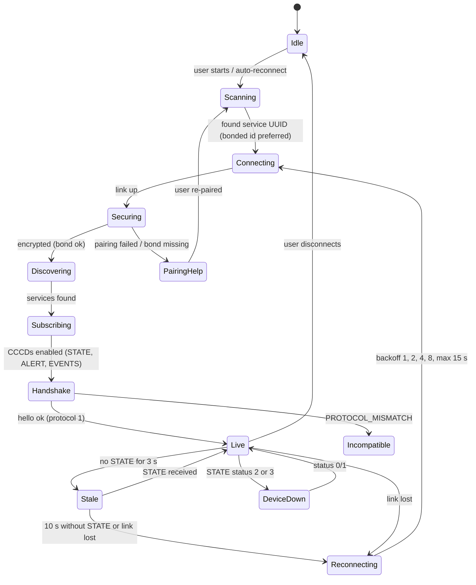

| Event | App MUST |
|---|---|
| Enter `Stale` | Announce at WARNING: "Lost contact with Shappe. Use your cane." Repeat every 30 s while stale, at most 5 times, then every 120 s ([07 §6](#doc-07-user-journeys-and-accessibility)) |
| Enter `Reconnecting` | Keep retrying in the background (where the OS allows). Never stop retrying silently |
| Back to `Live` | Announce "Shappe connected" (INFORMATION). Re-read STATE. **Do not announce the ALERT read value** (`REPLAY`) |
| `DeviceDown` | Announce the SYSTEM FAILURE message for status 2/3 |
| Bond lost | Spoken step-by-step re-pair help ([07 §5](#doc-07-user-journeys-and-accessibility)) |

**Subscription order.** STATE, then ALERT, then EVENTS, then `hello`. Subscriptions are per connection; re-subscribe after every reconnect. Do not rely on bonded CCCD persistence.

## 10. Versioning and compatibility

| Change | Rule |
|---|---|
| Incompatible wire change | Bump `version` (frame byte 0) and `protocol`. Old apps get `PROTOCOL_MISMATCH` and MUST tell the user "Shappe needs an app update" |
| New optional JSON field, event, command or flag bit | Same protocol. Receivers ignore unknowns. Commands are discoverable in PROTOCOL_INFO.commands |
| New message type | Same protocol. Receivers ignore unknown types |
| New phrase | Registry revision++. Old apps use ALERT_TEXT |
| UUIDs | Never change within protocol 1 |

## 11. Traceability: every device message

| Message | 1. Hardware | 2. Software module | 3. Created by | 4. Serialised | 5. Characteristic | 6. App parses | 7. App action | 8. If delayed / lost |
|---|---|---|---|---|---|---|---|---|
| ALERT + ALERT_TEXT | LiDAR, radar, cameras (+ Hailo) | `walk_policy` → `simple_guidance` (gate) → `unified_guidance` commit → `latest_guidance` | `core.Bridge._alert` on a `cue_seq` step | 14 B record + text (§5) | ALERT notify | Decode record; look up phrase; reassemble text | Rules A1–A10 | Older than 2 s: dropped (A3). Lost: the device still speaks locally (when audio exists). The next STATE shows the current instruction, **but it is not announced** |
| STATE | All (via `/health`), Pi SoC | `/health`, `/guidance/status`, `latest_guidance`, `read_system` | `core.Bridge._maybe_state` | 14 B record | STATE notify/read | Decode bits | Dashboard; heartbeat; DeviceDown | 3 s with none → Stale |
| `device_ready` / `health_changed` | All | `sensor_fusion.get_system_health`, `main.health_check` | `core.Bridge.on_health` | JSON | EVENTS | JSON | Announce / update | Superseded by the next STATE bits and `get_status` |
| `sensor_*` | LiDAR / radar / camera / Hailo | same | same | JSON | EVENTS | JSON | Announce (see 07) | STATE bits are authoritative |
| `guidance_*` | — | `pi_voice.loop_status` | same | JSON | EVENTS | JSON | SYSTEM FAILURE / recovered | STATE bit 0 |
| `thermal_*`, `power_warning` | Pi SoC / PSU | `sources.read_system` (bridge) | same | JSON | EVENTS | JSON | WARNING | STATE bits 9–10 |
| `service_unreachable` / `_restarted` | — | bridge poll failure / `cue_seq` reset | `on_unreachable` / `on_walk` | JSON | EVENTS | JSON | SYSTEM FAILURE / reset | STATE status 3 / epoch |
| RESPONSE | — | the handler in `core._COMMANDS` | `on_command` | JSON | EVENTS | JSON, match `id` | Resolve the pending command | App timeout 3 s → retry once, then report |

## 12. Traceability: every app command (reverse path)

| Command | App screen ([07 §7](#doc-07-user-journeys-and-accessibility)) | Serialised | Characteristic | Bridge handler | Device effect | Response / events |
|---|---|---|---|---|---|---|
| `hello` | Connect (automatic) | JSON | COMMAND write | `_cmd_hello` | Sets frame size | PROTOCOL_INFO |
| `ping` | Diagnostics | JSON | COMMAND | `_cmd_ping` | none | `{t, uptime_ms}` |
| `get_status` | Home "Device status", Diagnostics | JSON | COMMAND | `_cmd_get_status` | none | status object |
| `get_current` | Home "What's ahead?" | JSON | COMMAND | `_cmd_get_current` | none | current instruction |
| `get_surroundings` | Home "What's around me?" | JSON | COMMAND | `_cmd_get_surroundings` | none | hazard list |
| `get_speech_log` | Diagnostics | JSON | COMMAND | `_cmd_get_speech_log` → `GET /guidance/log` | none | entries |
| `get_diagnostics` | Diagnostics | JSON | COMMAND | `_cmd_get_diagnostics` | none | stats |
| `session_start` / `session_stop` | Home "Start/End walk" | JSON | COMMAND | `_cmd_session_*` | Bridge session id only. **Guidance is unaffected** | result + event |
| `alert_ack` | automatic | JSON | COMMAND | `_cmd_alert_ack` | Kept in memory (50) | `{}` |
| `mark` | Field-test screen | JSON | COMMAND | `_cmd_mark` → `POST /guidance/mark` | One speech-log line | `{ok, kind, last_said}` |
| `set_device_settings` | (none in v1) | JSON | COMMAND | `_cmd_set_device_settings` | none | `NOT_SUPPORTED` |

## 13. Traceability matrix (code → message → screen)

| Code module | Message / field | App screen |
|---|---|---|
| `utils/simple_guidance.py` (`_Gate`, `ALLOWED`, `_LEVEL`) | ALERT phrase, level, urgent, cue_seq; vocab | Live alerts; Home "last alert" |
| `utils/unified_guidance.py` (`latest_guidance`, `notify`) | ALERT flags (DEVICE_VOICE, AUDIO_ENABLED, LOOP_STALE), STATE phrase/age | Home |
| `utils/walk_policy.py` | ALERT `front_dft`; `get_current.front_ft`, `glass_ahead` | Home "What's ahead?" |
| `utils/sensor_fusion.py` (`build_hazards`, `get_system_health`) | `get_surroundings`; health bits; warnings | "What's around me?"; Device status |
| `main.py` `/health` | STATUS ok/degraded/down; guiding | Home status line; system alerts |
| `utils/pi_voice.py` | device_voice_usable, audio_enabled | Settings › Audio (explains who speaks) |
| `utils/speech_log.py` | `get_speech_log`; `mark` | Diagnostics; Field test |
| `ble_bridge/sources.read_system` | thermal/undervoltage bits and events | Device status; system alerts |
| `ble_bridge/core` (session, epoch, acks) | session events, epoch, diagnostics | Home Start/End; Diagnostics |


<div class="pagebreak"></div>

<a id="doc-07-user-journeys-and-accessibility"></a>

# 07 — User Journeys and Accessibility Design

**For:** the mobile developer and the whole team. The app's users are **blind or severely visually impaired**. The design is non-visual first; the screen is a secondary view for sighted helpers and low-vision users.

Status: the app is **NOT IMPLEMENTED**. Everything about the app here is **PROPOSED**. Device behaviour quoted from code is **CONFIRMED**.

---

## 1. Design principles

| # | Principle | Basis |
|---|---|---|
| P1 | **No screen use while walking.** Everything during a walk comes as speech or haptics. Two on-demand questions ("What's ahead?", "What's around me?") sit first in the focus order, and on iOS the first is bound to VoiceOver's Magic Tap | Field reality; Apple HIG |
| P2 | **The device decides; the app relays.** The app never invents guidance or reassurance (ICD rule A8) | Safety model |
| P3 | **One voice at a time.** If the device's voice is speaking (`DEVICE_VOICE`), the phone stays quiet. The app never talks over a call or a screen-reader announcement in progress unless the alert is CRITICAL | ICD A5, A7 |
| P4 | **Silence when sound is disabled** (`AUDIO_ENABLED = 0`): show and log, no sound | ICD A4; device config today |
| P5 | **Ears stay open.** Recommend bone-conduction or open earphones. Never require noise-cancelling | O&M practice |
| P6 | **No time limits** on any step; no auto-dismissing dialogs | WCAG 2.2 SC 2.2.1 |
| P7 | **Targets ≥ 44 × 44 pt (iOS) / 48 × 48 dp (Android)**; text scales ≥ 200 %; contrast ≥ 4.5:1 (text), ≥ 3:1 (controls) | Apple HIG; Android a11y; WCAG 2.2 SC 1.4.3, 1.4.11, 2.5.8 |
| P8 | **Status messages are announced without moving focus**: Android live regions / pane titles (`announceForAccessibility` is deprecated in API 36); iOS `UIAccessibility.post(.announcement)` (iOS 17+ priority attributes) | WCAG 4.1.3; Android 16 notes; Apple |
| P9 | **Accessible authentication**: no cognitive tests, no visual-only codes; passkeys are spoken | WCAG 2.2 SC 3.3.8 |
| P10 | **Haptics complement audio, never replace it alone**, except in "silent" states | Apple HIG ("Use haptics in addition to audio cues") |
| P11 | **Plain, fixed wording** for app-owned messages, with a "repeat last" action. Distances in **feet**, matching the device | Device unit convention |

## 2. Scenario A: first-time setup

| Step | User | Device (CONFIRMED / PROPOSED) | App (PROPOSED) | User hears |
|---|---|---|---|---|
| 1 | Receives the hardware | — | — | — |
| 2 | Powers it on | systemd starts `shappe-guide`. The start-up gate holds speech until the LiDAR settles (CONFIRMED). `shappe-ble` starts and opens a 180 s pairing window (PROPOSED) | — | Device voice, when audio hardware exists: "Ready." is built by `startup_gate.orient()` but **not spoken today** (CONFIRMED gap). PROPOSED: "Shappe starting" … "Shappe ready" |
| 3 | Opens the app for the first time | — | Welcome screen. VoiceOver/TalkBack reads: purpose, the **safety statement** ("Shappe adds information. Keep using your cane or dog."), and a "Continue" button | The safety statement, read once in full; replayable from Settings |
| 4 | Grants Bluetooth permission | — | Explains why before the OS prompt (iOS `NSBluetoothAlwaysUsageDescription`; Android `BLUETOOTH_SCAN`/`CONNECT`). With AccessorySetupKit (iOS 18+) / CompanionDeviceManager (Android) the system picker replaces most of this | OS prompt via the screen reader |
| 5 | "Find my Shappe" | Advertising the service UUID | Scans by service UUID; lists devices ("Shappe", or "Shappe demo device"), sorted by signal strength | "One Shappe found. Double-tap to connect." |
| 6 | Connects | Encrypted characteristic → pairing request | OS pairing dialog (v1 Just Works: "Pair"; production: a 6-digit code spoken by the device into the earpiece) | "Shappe will say a 6-digit code in your earpiece. Type it in the pairing box." (production) |
| 7 | Pairing completes | Bond stored (BlueZ) | Reads PROTOCOL_INFO; stores `device_id`; subscribes; `hello` | "Connected to Shappe." |
| 8 | Readiness check | `/health` status | `get_status`; reads STATE bits | "Shappe ready. All sensors working." or "Shappe ready with problems: glass detection off." |
| 9 | Status on demand | — | "Device status" reads each sensor in plain words | — |
| 10 | Accessibility settings | — | Voice: system or screen-reader voice; speech rate; haptics on/off and strength; "Walk straight" confirmations on/off | Each change is confirmed by voice |
| 11 | Starts a walk | Guidance runs continuously anyway | `session_start` (labels the session only) | "Walk started. Shappe is guiding." |

## 3. Scenario B: walking on a sidewalk

The device speaks (or the app relays) only the gated sentence. "BLE" means what crosses the link.

| Situation | Relevant sensors | Device processing (CONFIRMED) | BLE | User hears (exact device sentence) |
|---|---|---|---|---|
| Person ahead, 9 ft | LiDAR range; front camera "person"; range agreement | `front_object` names it; level 1 | ALERT phrase 63 | "Person ahead" |
| Person in path, < 4 ft | LiDAR front < `WALK_BLOCK_FT`; camera name; turn choice | Blocked → steer-past sentence; level 2, urgent | ALERT phrase 267 (URGENT) | "Person in front, turn left" |
| Stationary vehicle ahead, user standing still | Camera vehicle class; box not growing | `_Vehicles`: stopped → "be careful", said once | ALERT phrase 18 | "Vehicle in front, be careful" |
| Moving bicycle approaching from the left | Front camera bicycle box growing (bicycle is in `SIMPLE_VEHICLE_CLASSES`); LiDAR mover | Vehicle approach → level 3, cuts in | ALERT phrase 15 (level 3) | "Vehicle approaching, move right" (or "Vehicle approaching" with no room) |
| Pole ahead and slightly right | LiDAR cluster; camera "traffic light/stop sign/parking meter" → word "Pole" (COCO cannot name a plain pole) | Steer past; level 1 | ALERT phrase 194 | "Pole ahead, turn slightly right" (or no name if the camera can't classify: "Turn left/right" once blocked) |
| Wall ahead / near a wall | LiDAR surface fit (`fit_surfaces`) | "Wall ahead" inside 12 ft; near wall inside 4 ft; drift inside 5 ft and closing | ALERT phrases 2 / 10 / drift | "Wall ahead" / "Near left wall, move right" / "Drifting toward left wall, turn slightly right" |
| Glass door ahead | Radar front boards much nearer than LiDAR (≥ 2 ft) | Glass flag; inside 12 ft "Glass ahead", < 4 ft "Blocked by glass" | ALERT phrases 3 / 5 | "Glass ahead" → "Blocked by glass" |
| Roadside obstacle (bin, bench, hydrant) | LiDAR + camera (COCO bench, fire hydrant) | As for the pole | ALERT | "Bench ahead" / "Hydrant ahead, turn slightly right" |
| Parked motorcycle | Camera "motorcycle" → word "Motorbike"; LiDAR | As a named object; vehicle sentences only if moving | ALERT | "Motorbike ahead" / "Motorbike in front, turn right" |
| Narrow path between two objects | Camera boxes plus LiDAR gap (`camera_path`) | Steering between them | ALERT | "Walk between them, slightly left" / "Walk straight between them" |
| Person walking toward the user (LiDAR mover) | LiDAR mover tracks | **Silent trial** (`LIDAR_MOVERS_SPEAK=False`), logged as "would say" | Nothing today | Nothing today; when enabled: "Person coming toward you, move left" |
| Overhead branch, kerb, stairs down | — | **Not detected** (NOT IMPLEMENTED) | Nothing | **Nothing. This is a known hazard; the cane must cover it** |

On-demand ("What's around me?"): `get_surroundings` returns up to 6 hazards. The app reads, for example, "Person, 12 o'clock, 9 feet. Obstacle, 3 o'clock, 4 feet." This is **inferred information**, so it is prefixed once per session with "Approximate:".

## 4. Scenario C: potential road-crossing hazard

| Aspect | Behaviour |
|---|---|
| Detection | The front camera sees a traffic light (COCO `traffic light`). Its **colour is never read** (CONFIRMED). The device sets `at_crossing` and **withholds "Walk straight" for 5 s** after the last sighting (`SIMPLE_CROSSING_HOLD_S`). Vehicles: the camera's approach logic still warns ("Vehicle approaching …") |
| What is NOT done | **The device never says it is safe to cross**, and neither may the app. No signal phase, no gap acceptance, no kerb detection |
| User hears | Vehicle warnings if any; otherwise silence where "Walk straight" would have been |
| App rule | The app MUST NOT add crossing advice. It MAY offer a static reminder from Settings ("Shappe cannot tell when it is safe to cross") |

## 5. Scenario D: Bluetooth disconnects during a walk

| Question | Answer |
|---|---|
| How does the hardware detect it? | BlueZ reports Device1 `Connected=false` and the bridge logs it (PROTOTYPE). Its per-connection counters restart when the next connection begins. The navigation service does not know or care |
| Does local navigation continue? | **Yes.** The guidance loop is in a separate process and does not depend on BLE (CONFIRMED architecture, PROPOSED bridge) |
| Do safety alerts continue? | **On the device: yes, but only once local audio hardware exists and `AUDIO_ENABLED` is on.** Today the device has no audible output, so a lost link means **no warnings at all**. This is a critical gap ([08 §4](#doc-08-safety-reliability-failure-management)) |
| What does the user hear? | From the phone, 3 s after the last STATE: "Lost contact with Shappe. Use your cane." (WARNING, plus a strong haptic). Repeated every 30 s while lost |
| What does the app display? | A persistent banner "Not connected — reconnecting" (live region), the last alert time, and the reconnect attempt count |
| How does reconnection happen? | Automatically: back-off 1, 2, 4, 8, 15 s; re-subscribe; `hello`. A new epoch resets de-duplication. Old alerts are never replayed (REPLAY flag). On success: "Shappe connected." |

**Re-pair help** (bond lost on either side), spoken step by step, each step confirmed with a button:
1. "Open Settings, then Bluetooth."
2. "Find Shappe and choose Forget This Device."
3. "On Shappe, open pairing" (PROPOSED button; in v1 restart the device: pairing is open for 3 minutes).
4. "Come back to this app and choose Find my Shappe."

## 6. Alert model

The app maps device and link signals onto five categories:

| Category | Triggers | Confidence requirement | Audio | Haptic (proposed) | Cooldown / repeat | Expiry | De-duplication | User response |
|---|---|---|---|---|---|---|---|---|
| **INFORMATION** | Device level 0 ("Walk straight"); connected, session started, ready | Device-gated | Speak; never interrupts; may be turned off | None | Device-controlled | 2 s | `(epoch, cue_seq)` | None |
| **CAUTION** | Device level 1 (advisories: "Wall ahead", "Person ahead", "Glass on left …"); `sensor_degraded` for camera, hailo, radar, front_glass | Device-gated | Speak; replaces queued speech; waits for current speech | 1 medium pulse | Device-controlled (≥ 3 s gap, 6 s settle) | 2 s | as above | Be aware |
| **WARNING** | Device level 2 urgent ("Blocked by …", "Turn …", "X in front …", movers); link stale; thermal; power | Device-gated; link stale after 3 s | **Interrupts** app speech; ducks other audio | 2 strong pulses | Device: blocked repeats 30 → 120 s. App-owned warnings: every 30 s while the condition lasts, max 5 times, then every 120 s | 2 s (device); while the condition lasts (app) | as above / by condition | Stop or adjust |
| **CRITICAL** | Device level 3: "Vehicle approaching …" | Device-gated (camera box growth, ≥ 3 frames) | **Interrupts everything** the app controls, including its own speech | 3 long pulses | Device-controlled | 2 s | as above | Act now |
| **SYSTEM FAILURE** | STATE status 2/3; `sensor_degraded: lidar`; `guidance_stalled` (loop stopped); `service_unreachable`; "Sensors offline" (phrase 14) | Device health / bridge | Interrupts non-critical speech | Long-short-long | Every 30 s while it lasts, max 5, then every 120 s | While it lasts | By condition | **Use your cane / stop using the device** |

**Example sentences:**

| Kind | Sentence | Notes |
|---|---|---|
| Device phrase | "Blocked by glass" | Device-owned, closed vocabulary |
| Device phrase | "Person in front, turn left" | Device-owned, closed vocabulary |
| Device phrase | "Vehicle approaching, move right" | Device-owned, closed vocabulary |
| Device phrase | "Sensors offline" | Device-owned, closed vocabulary |
| App-owned | "Lost contact with Shappe. Use your cane." | Fixed wording |
| App-owned | "Shappe guidance stopped. Use your cane." | Fixed wording |
| App-owned | "Glass detection off." | Fixed wording |
| App-owned | "Object names reduced." | Fixed wording (one camera missing) |
| App-owned | "Vehicle warnings off." | Fixed wording (AI engine down) |
| App-owned | "Object names off." | Fixed wording |
| App-owned | "Shappe is overheating." | Fixed wording |
| App-owned | "Shappe power is low." | Fixed wording |
| On request only | "Approximate: Person, 12 o'clock, 9 feet." | From `get_surroundings` |

There are deliberately **no** app phrases such as "Obstacle approximately two meters ahead": distance-bearing sentences are the device's job, and the device works in feet.

**Latency targets** (proposed, measured as in [03 §9](#doc-03-perception-and-navigation-pipeline)):
- CRITICAL: ≤ 800 ms from the device decision to phone audio onset;
- WARNING: ≤ 900 ms p95;
- link-stale detection: 3 s.

## 7. Screen-by-screen specification

Common rules for all screens:
- One heading per screen, announced on arrival (`.screenChanged` / `paneTitle`).
- The focus order is as listed.
- Every control has a label and a hint, and no element is unlabeled.
- Large text is supported, with no truncation.
- No auto-dismiss.
- A "Repeat last alert" action is available everywhere: a list item on Android, and the VoiceOver rotor or a custom action on iOS.

| # | Screen | Focus order (label → action) | Live / announced content |
|---|---|---|---|
| S0 | **Welcome** (first run) | Heading "Welcome to Shappe" → safety statement (static text, full) → "Continue" | — |
| S1 | **Find my Shappe** | Heading → "Search again" → device list (each item: "Shappe, strong signal" / "Shappe demo device — not real") → "Help" | "Searching…", "One Shappe found" (polite) |
| S2 | **Pairing help** | Heading → numbered steps (each a button "Done") → "Try again" | Each step spoken when focused |
| S3 | **Home** (connected) | Status line ("Connected · Guiding · All sensors OK") → **"What's ahead?"** → **"What's around me?"** → "Start walk / End walk" → "Device status" → "Settings" → "Last alert: Blocked by glass, 12 seconds ago" | Status changes (polite); alerts as in §6 (assertive for WARNING and above) |
| S4 | **Device status** | Heading → overall ("Degraded") → LiDAR → Radar (with directions down) → Cameras → AI engine → Glass detection → Temperature → Power → Battery ("Not available on this device") → Software versions → "Read all" | Updates politely |
| S5 | **Settings** | Voice (screen-reader voice / app voice) → Speech rate → Haptics (on/off, strength) → "Haptics when silent" → "Walk straight confirmations" (on/off) → Language (app messages) → "Safety statement" → "Forget this device" → "Privacy and logs" | Each change confirmed |
| S6 | **Diagnostics** | Link state, signal strength, MTU, protocol, vocabulary revision, device id → "Ping device" → last 10 alerts with latency → "Device speech log" → "Share diagnostics" (explicit consent dialog) | — |
| S7 | **Field test** (developer mode, hidden by default) | "Right", "Wrong", "Missed", "Note…" → `mark` | "Marked" |
| S8 | **Update needed** | Message "Shappe needs a newer app" → "Open store" | — |

**User journeys covered:**
- *Opening the app:* S3 if bonded, otherwise S0/S1.
- *Connecting:* S1 → OS dialog → S3.
- *Starting a session:* S3 "Start walk".
- *Receiving an alert:* no screen needed (speech/haptic); S3 shows it.
- *Adjusting settings:* S5.
- *Recovering from disconnection:* automatic, plus the S3 banner and S2 if the bond is lost.
- *Checking the battery:* S4 says "Not available on this device" until a gauge exists.
- *Ending a session:* S3 "End walk" → "Walk ended, 24 minutes."

## 8. Scenario E: sensor and system failures

| Failure | Detection (CONFIRMED unless noted) | Device behaviour | App notification | Degraded mode | User guidance |
|---|---|---|---|---|---|
| One camera fails | Cycle mode never visits a missing channel. `/health` warning "No camera connected: …" or "Camera sees only black: …"; status degraded | Guidance continues; no names from that direction. The front camera: "Camera off" (phrase 296) | `health_changed` → CAUTION "Object names reduced" | LiDAR + radar still range everything | Keep walking with care |
| LiDAR stops | `lidar_ok` false; "Sensors offline" (phrase 14) once the newest scan is older than 2 s; `/health` down | Says "Sensors offline". Camera vehicle warnings still possible | ALERT phrase 14 + STATE status 2 + `sensor_degraded: lidar` → SYSTEM FAILURE (the loop keeps running, so not `guidance_stalled`) | **No geometry: not usable for guidance** | "Shappe cannot see. Use your cane." |
| Radar unavailable | `radar_ok` false / `radar_down`; front coverage lost → "Glass sensor off" | Says "Glass sensor off" (level 1). Glass not detected | `sensor_degraded: radar/front_glass` → CAUTION "Glass detection off" | LiDAR-only; glass doors missed | Extra care near shop fronts and doors |
| AI accelerator fails | `hailo_ok` false; "Detection engine not ready" | No object names or vehicle warnings | `sensor_degraded: hailo` → CAUTION "Object names off" (+ "Vehicle warnings off") | Geometry only | Extra care near roads |
| Navigation app crashes | systemd watchdog (30 s) and `Restart=always`. The bridge sees polls fail | Restarts. Silent until the start-up gate passes | `service_unreachable` → SYSTEM FAILURE; later `service_restarted` + `device_ready` | None while down | "Shappe guidance stopped. Use your cane." … "Shappe ready." |
| Battery critical | **NOT IMPLEMENTED** (no gauge). Only under-voltage via `get_throttled` (PROPOSED in bridge) | Brown-out → reboot or shutdown | `power_warning` (under-voltage) → WARNING | — | "Shappe power is low. Plan to stop." |
| Overheating | SoC ≥ 80 °C or throttle bits (bridge, PROPOSED) | Throttles; detection slows → may report "Object detection stalled" | `thermal_warning` → WARNING | Slower naming | "Shappe is overheating. Move to shade." |

## 9. Background, locked phone and audio conflicts

| Situation | iOS (PROPOSED handling) | Android (PROPOSED handling) |
|---|---|---|
| Phone locked, app in background | `bluetooth-central` delivers notifications. The audio session must be active to speak: category `.playback` + `.duckOthers` + `.interruptSpokenAudioAndMixWithOthers`, mode `.voicePrompt`. **NEEDS VALIDATION** on current iOS | Foreground service `connectedDevice` with an ongoing notification ("Shappe connected — guiding"). TTS keeps working |
| App force-quit by the user | **Not relaunched** for Bluetooth (TN3115). On the next open: "Shappe was disconnected because the app was closed." | The service stops; the CompanionDeviceManager presence callback can restart it |
| Screen reader speaking | Prefer `AVSpeechSynthesizer` with `prefersAssistiveTechnologySettings` (the user's VoiceOver voice and rate). WARNING+ interrupts the app's own speech. VoiceOver announcements (`.announcement`, priority high for CRITICAL) only while in the foreground | TTS with `USAGE_ASSISTANCE_NAVIGATION_GUIDANCE`. TalkBack speech and app TTS can overlap; for WARNING+ use `AUDIOFOCUS_GAIN_TRANSIENT_MAY_DUCK`. **NEEDS VALIDATION** |
| Phone call | The audio session is interrupted by the system; the app cannot speak into a call. Use haptics for WARNING+ | Media is muted during calls (Android 12+). Use haptics for WARNING+ |
| Music / podcast | Ducked during alerts (`.duckOthers`) | Ducked by transient audio focus |
| Other navigation app speaking | Both duck; the newest wins. **NEEDS VALIDATION** | Same |

**This is why the device needs its own audio.** The phone cannot guarantee speech during calls or after a force-quit, or in some background states. The phone is a companion channel, never the only safety channel.


<div class="pagebreak"></div>

<a id="doc-08-safety-reliability-failure-management"></a>

# 08 — Safety, Reliability and Failure Management

> **This is an assistive prototype. It is not validated, certified or cleared as a medical or assistive device.** Nothing here claims compliance with any standard. Standards are listed for *scope and planning* only. No blind participant may depend on behaviour that has not been validated under supervision. The 2026-09-29 audit (`docs/SHAPPE_GUIDE_AUDIT.md` §7) says the same.

Status labels as in [01](#doc-01-project-overview).

---

## 1. Fundamental architecture rules

1. **The device owns safety.**
   - Sensing, hazard assessment and the decision to warn happen on the Raspberry Pi (CONFIRMED).
   - The phone is a **companion**: it relays and displays, and it never decides and never is the only warning channel (PROPOSED rule, ICD §8 A8).
2. **Failure is loud, not silent.** Every loss of a safety function must be announced:
   - "Sensors offline" (CONFIRMED);
   - "Glass sensor off" (CONFIRMED);
   - "Camera off" for the front camera: feed lost, detector stopped or a black picture (CONFIRMED in code 2026-10-09, desk-tested);
   - camera/NPU warnings in `/health` (CONFIRMED in this checkout);
   - link loss on the phone (PROPOSED).
3. **No positive safety claims.** Nothing says "clear", "safe" or "safe to cross". "Walk straight" is only said after confirmation, and is withheld at crossings and when stale (CONFIRMED).
4. **Uncertain means quiet.** Stale or simulated data never produces guidance (CONFIRMED).
5. **The companion link cannot change guidance.** No v1 BLE command alters thresholds or mutes the device (PROPOSED, enforced in the prototype).

## 2. Hazard identification

| ID | Hazard | Situation | Current coverage |
|---|---|---|---|
| H1 | Collision with a wall or large object | Walking into a structure | LiDAR, blocked < 4 ft (CONFIRMED) |
| H2 | Collision with glass | Glass door or wall | Radar/LiDAR disagreement (CONFIRMED in code); **head-on unproven** (NEEDS VALIDATION) |
| H3 | Collision with a thin object (pole, sign post) | Narrow return | LiDAR corridor + cluster rule; thin poles may give 1–2 returns (NEEDS VALIDATION) |
| H4 | Head-height obstacle | Branch, mirror, scaffold | **Not detected** (NOT IMPLEMENTED) |
| H5 | Drop-off | Stairs down, kerb, platform edge, hole | **Not detected** (NOT IMPLEMENTED) |
| H6 | Moving vehicle / bicycle | Driveway, shared path, crossing | Front camera approach (CONFIRMED); LiDAR movers silent (trial) |
| H7 | Moving person | Crowds | LiDAR movers silent; static "Person ahead/in front" (CONFIRMED) |
| H8 | Road crossing | Deciding when to cross | **Deliberately unsupported**; "Walk straight" withheld near a seen traffic light (CONFIRMED) |
| H9 | Wrong instruction | Bad turn advice, wrong side | Turn hysteresis and room check (CONFIRMED); radar bearings must be measured |
| H10 | Missing or late instruction | Latency, gating, link loss | Gate timing (CONFIRMED); **no local audio today** (gap) |
| H11 | Over-alerting and habituation | Too many sentences | Closed vocabulary, gaps, repeat back-off (CONFIRMED) |
| H12 | Masking environmental sound | Earphones blocking traffic sound | PROPOSED: bone-conduction or open audio |
| H13 | Device failure unnoticed | Crash, sensor loss, heat, power | Watchdog, `/health`, spoken offline notices (CONFIRMED); phone events (PROPOSED) |
| H14 | Burns, battery fire, laser | Hardware | LiDAR is Class 1 [S9]; battery NOT IMPLEMENTED (pack selection must follow §9) |
| H15 | Privacy harm | Images of bystanders, location of a vulnerable user | No storage found; LAN streams unauthenticated (§8) |

## 3. Sensor limitations and environmental conditions

| Condition | LiDAR [S9, S11] | Cameras | Radar [S12, S14] | Net effect |
|---|---|---|---|---|
| Strong sunlight | "Outdoor … without direct sunlight", so range and dropouts suffer | Glare; shared auto-exposure darkens other views | Unaffected | Fewer returns. **NEEDS VALIDATION** outdoors |
| Low light / night | Unaffected | Detection degrades | Unaffected | Object names unreliable |
| Rain, wet surfaces | Wet and dark surfaces have shorter range; puddles give specular reflection | Droplets on lenses | Rain clutter possible; the code has no rain handling | NEEDS VALIDATION. `ENV_TRUST_ENABLED=False` (its fog detector misfired) |
| Reflective or transparent | Glass and mirrors give missing or ghost points | May see through glass | **Main purpose** | Covered in front; head-on unproven |
| Crowds | Many movers; heading odometry degrades with a crowd moving with the user (README) | Many boxes | Many echoes | More "blocked"; movers silent |
| Stairs and drop-offs | One plane: invisible below | COCO has no stairs class | Not used | **Not covered** |
| Fast vehicles | 15 Hz scans; movers horizon 5 s | Front only; needs ≥ 3 frames | No velocity in the distance detector | Late or missed for fast side traffic |
| Cold or heat | 0–40 °C operating [S9] | — | −40…85 °C board [S18] | The Pi throttles at 80–85 °C; AI HAT+ 2 ambient ≤ 50 °C [S26] |

## 4. The critical gap: no local alert output

| Fact | Status |
|---|---|
| `AUDIO_ENABLED = False`: no sound anywhere (Pi or browser) | CONFIRMED (config.py) |
| The only audio sink is HDMI; `pi_voice` refuses HDMI sinks on purpose | CONFIRMED (`wpctl status`) |
| There is no haptic motor, buzzer or speaker | CONFIRMED (no code, no hardware) |
| Only the Wi-Fi dashboard can speak today (when audio is enabled) | CONFIRMED |

**Consequence.** If the phone is disconnected, locked, in a call, out of battery or force-quit, **the user receives no warning at all**. That contradicts rule 1.

**Proposed remedy:**

| Option | Pros | Cons | Recommendation |
|---|---|---|---|
| **USB audio adapter + wired bone-conduction headset** | Independent of every radio; leaves the ears open; `pi_voice` works unchanged (a USB sink is "usable") | A cable to the head | **Primary** |
| Bluetooth A2DP headset paired to the Pi | No cable | Shares the CYW43455 with BLE and Wi-Fi (coexistence NEEDS VALIDATION); 100–300 ms A2DP latency (typical, NEEDS VALIDATION); its own battery | Secondary |
| I²S DAC + small speaker | Simple | Not private; inaudible in traffic | Not recommended |
| Haptic driver (I²C) + 2 LRA motors (left/right shoulder) | Directional, silent, works during phone calls | New hardware and code | **Add** as a second channel |

**Acceptance (PROPOSED):**
- A level-2+ instruction is audible on the device within 600 ms p95 with **no phone present**.
- A link loss never mutes the device.
- Verified by the procedure in [03 §9](#doc-03-perception-and-navigation-pipeline).

## 5. Degraded operating modes (CONFIRMED device behaviour + PROPOSED app behaviour)

| Mode | Entered when | Device does | Phone shows / says |
|---|---|---|---|
| Normal | `/health` ok | Full guidance | "All sensors working" |
| No glass detection | Front radar coverage lost | "Glass sensor off"; LiDAR-only | CAUTION "Glass detection off" |
| No object names | Camera or NPU failure, or a black front picture | "Camera off"; geometry-only sentences; no vehicle warnings | CAUTION "Object names off" |
| No geometry | LiDAR lost, or its newest scan older than 2 s | "Sensors offline"; camera vehicle warnings only | SYSTEM FAILURE "Shappe cannot see. Use your cane." |
| Service down | Crash or restart | Silent until restart and the start-up gate | SYSTEM FAILURE "Shappe guidance stopped. Use your cane." |
| Thermal | ≥ 80 °C or throttling | Slower detection | WARNING |
| Link lost | No STATE 3 s | Device unaffected | WARNING "Lost contact with Shappe. Use your cane." |
| Simulated | Simulation flags | Warning "SIMULATED — do not navigate" | Persistent "Demo mode — not real" |

## 6. Preliminary FMEA

Severity (S), occurrence (O) and detectability (D) are 1–5 qualitative estimates **for prioritisation only**. They are not measured. RPN = S × O × D.

| Failure | Possible cause | User impact | Detection | Mitigation (status) | Verification | S | O | D | RPN |
|---|---|---|---|---|---|---|---|---|---|
| No warning delivered (link down, phone silent) | No local audio; phone locked, in a call or force-quit | Collision | Link-stale timer (PROPOSED) | **Fit local audio + haptics** (PROPOSED §4) | No-phone test, §4 acceptance | 5 | 4 | 4 | **80** |
| Drop-off not warned | One-plane LiDAR; no class | Fall | None | Cane remains primary; future depth/downward sensor (PROPOSED [09 §8](#doc-09-roadmap-and-integration-checklist)) | Field test with kerbs | 5 | 3 | 5 | **75** |
| Head-height obstacle not warned | One plane | Head injury | None | As above | Field test | 4 | 3 | 5 | 60 |
| Glass not detected head-on | Specular radar dropout; PLANAR on trial | Collision | Radar health only | Per-board judgement, door-in-wall rule (CONFIRMED); field test | Supervised glass test (audit FT-1.5b) | 5 | 3 | 4 | 60 |
| Vehicle approach missed | Side or rear traffic (front camera only); low light | Collision | None | Movers (silent trial), radar movers; never claim crossing safety | Supervised roadside test, no crossing | 5 | 3 | 4 | 60 |
| Stale alert spoken late on phone | BLE congestion, app suspended | Wrong action | `age_ms` + local age > 2 s → drop (PROPOSED A3) | ICD A3 | Delay-injection test | 4 | 2 | 2 | 16 |
| Duplicate or old alert replayed after reconnect | Reconnect reads | Confusion | REPLAY flag, (epoch, cue) dedupe (PROPOSED) | ICD A1/A2 | `service_crash` scenario | 3 | 3 | 2 | 18 |
| Wrong turn side | Wrong radar bearing; wrong camera channel map | Collision | `/radar/test` | Measured bearings by serial (CONFIRMED); NEW-047 stale notes | Supervised hand test per board | 4 | 2 | 3 | 24 |
| False "blocked" or chatter | Crowds, own cane or arm | Annoyance, ignoring alerts | Speech log, tester marks | Gate, cluster rules, 300 mm mover floor (CONFIRMED) | Recorded walks with `mark` | 3 | 3 | 2 | 18 |
| Navigation service crash | Software fault | Silence | systemd watchdog (CONFIRMED); bridge `service_unreachable` (PROPOSED) | `Restart=always`; phone SYSTEM FAILURE | Kill test | 5 | 2 | 2 | 20 |
| Guidance loop hangs while process alive | Deadlock | Silence | Watchdog withholds pings on a stale heartbeat (CONFIRMED) | Restart | Fault injection | 5 | 1 | 2 | 10 |
| LiDAR stops | USB, motor, power | No geometry | Freshness → "Sensors offline" (CONFIRMED) | Soft start; spoken offline notice | Unplug test (not worn) | 4 | 2 | 1 | 8 |
| NPU fails | Driver, heat | No names | `hailo_ok` (CONFIRMED) | Retry back-off (CONFIRMED) | Fault injection | 3 | 2 | 1 | 6 |
| Overheat throttling | Enclosure, sun | Slow detection | Bridge thermal events (PROPOSED) | Ventilation, heatsink, Active Cooler | 2 h hot-room run | 3 | 3 | 2 | 18 |
| Brown-out | Weak supply, LiDAR inrush | Reboot, silence | Under-voltage bit (PROPOSED) | 5 A supply, soft start (CONFIRMED) | Power meter, cold starts | 4 | 2 | 3 | 24 |
| Battery depleted | No gauge | Sudden shutdown | **None** (NOT IMPLEMENTED) | Fuel gauge + `battery_*` events (PROPOSED) | Endurance test | 4 | 3 | 5 | 60 |
| Spoofed device or MITM | Just Works pairing | False info on phone | `device_id` check (PROPOSED) | Passkey pairing, button window (PROPOSED) | Security test | 4 | 1 | 4 | 16 |
| Bystander privacy breach | LAN MJPEG streams unauthenticated | Privacy | None | Bind streams to localhost or authenticate (PROPOSED §8) | Network scan | 3 | 2 | 3 | 18 |

## 7. Verification of safety behaviour (summary; full plan in [09 §5](#doc-09-roadmap-and-integration-checklist))

- **Desk:**
  - `tools/glass_sim.py`, `tools/movers_sim.py`, `tools/drift_sim.py`, `tools/bev_check.py` (CONFIRMED present);
  - BLE: `ble_bridge/test_ble_bridge.py` (34 tests);
  - real walks replayed: record a walk (`SHAPPE_RECORD_WALK=1` or `POST /guidance/record {"on": true}`), then `tools/walk_replay.py logs/walks/<file>.jsonl.gz` feeds it through the current code and lists every sentence that would now be said differently (added 2026-10-09; desk-tested, 100% replay fidelity on a simulated walk).
  - The repository's own `tests/` suite is **not in this checkout** (gitignored, absent). The audit counted 1075 tests in `~/lidar`; restoring CI is an open audit action.
- **Bench (nobody wearing it):** the audit §8 bench list:
  - LiDAR RPM and points per scan;
  - radar health;
  - NPU recovery;
  - per-board radar direction.
- **Supervised field:** glass head-on, kerbs and stairs (to document the gap), roadside vehicles (never crossing), crowds, sun and rain.

Every session is logged with the speech log and `mark` (marks also go into a walk recording).

## 8. Privacy and data handling

| Topic | Current state (CONFIRMED) | Rule (PROPOSED) |
|---|---|---|
| On-device processing | All perception runs on the Pi | Keep it |
| Raw image retention | No code saves frames to disk. Frames live in memory | Never store frames by default. A field-test capture needs explicit opt-in and consent from bystanders where required |
| Video transmission | MJPEG over HTTP on the LAN (`/camera/video_feed`, `/camera/stream/{sector}`) to anyone who can reach port 8000. Host/Origin checks stop browser attacks, **not** direct access | Bind camera endpoints to localhost, or require the admin token, before any public use. **Never over BLE** |
| Audio recording | None | Keep it |
| Location | None | Keep it. GPS is out of scope for v1 |
| Diagnostic logs | Speech log in memory; a file only when `SPEECH_LOG_TO_FILE`; `walk_logger` CSV for field tests | Field-test logs stored locally, deleted after analysis; no faces or images |
| BLE contents | — | Phrase ids, distances, health. No images, no location. Encrypted link |
| Pairing removal and reset | — | "Forget device" on the phone, plus a device-side factory reset that removes all bonds and the state file |
| Phone app | — | Preferences local; logs opt-in, 7-day retention, user-deletable; no analytics without consent |
| Admin token | `SHAPPE_ADMIN_TOKEN` in `~/.config/shappe-guide.env`, required for calibration, rediscover and stride | Never sent over BLE |

## 9. Standards and regulation (scope only, not a compliance claim)

| Area | Standard / rule | Why it may matter |
|---|---|---|
| Risk management | ISO 14971:2019 | Framework for this FMEA if the device is treated as a medical device |
| Usability | IEC 62366-1:2015+A1:2020 | Use-error analysis for blind users |
| Software lifecycle | IEC 62304:2006+A1:2015 (Ed 2 not yet published) | Software safety classes and process |
| Quality system | ISO 13485:2016 | If commercialised as a medical device |
| Medical device status | EU MDR 2017/745 Art 2(1) ("alleviation of, or compensation for … disability"); US 21 CFR 886.5900 "Electronic vision aid" (Class I, 510(k)-exempt subject to 886.9) | Intended-use wording determines status; **get regulatory advice before any claims** |
| Assistive product classes | ISO 9999:2022 | Classification |
| Electrical safety | IEC 62368-1:2023 | AV/ICT equipment safety |
| Laser | IEC 60825-1:2014 | RPLIDAR is Class 1 [S9]; keep the vendor housing intact |
| Radio | EU RED 2014/53/EU (+ Delegated Reg. 2022/30 cybersecurity, EN 18031-1/-2/-3 applicable from 2025-08-01); ETSI EN 300 328 (2.4 GHz); FCC Part 15 (§15.247) | Bluetooth/Wi-Fi radios; 60 GHz radar modules need their own conformity |
| Batteries | UN 38.3; IEC 62133-2:2017+A1:2021 | Any lithium pack |
| Accessibility of the app | WCAG 2.2; EN 301 549 (V4.1.1, 2026); EU Accessibility Act 2019/882 (applies from 28 Jun 2025) | App and documentation accessibility |
| Human testing | Declaration of Helsinki (rev. Oct 2024); ISO 14155:2026 (if a clinical investigation) | Informed consent in accessible formats; witnessed consent where needed |

## 10. Reliability measures already in the code (CONFIRMED)

- **systemd user service:** `Type=notify`, `WatchdogSec=30`, `Restart=always`, `LimitCORE=0`.
- **Heartbeats:** for "guidance" and "event_loop"; watchdog pings are withheld when a heartbeat is stale.
- **Shutdown backstop:** `os._exit` if shutdown hangs.
- **Freshness everywhere:** wall clock **and** monotonic receive time; 0.5 s clock-step tolerance.
- **Radar resilience:** per-board reconnect loop, stall guard, identity by USB serial.
- **Camera resilience:** corrupt-frame detection with restart and front-only fallback.
- **NPU resilience:** retry back-off; 2 s inference timeout.
- **LiDAR resilience:** motor soft start; PWM re-assert every second; port selected by device path, not enumeration.
- **Web security:**
  - admin token for calibrate, rediscover and stride;
  - cross-site write and WebSocket refusal;
  - Host allow-list against DNS rebinding;
  - anti-framing headers.


<div class="pagebreak"></div>

<a id="doc-09-roadmap-and-integration-checklist"></a>

# 09 — Development Roadmap, Responsibilities, Testing and Integration Checklist

**Principle:** get one reliable, minimal, end-to-end path working first:

> device decision → ALERT over BLE → phone speaks it once, fresh, in the background

Then harden it. Everything else waits.

---

## 1. Where things stand (2026-10-09)

| Area | State |
|---|---|
| Perception, decision, speech gate, health | CONFIRMED in code; physical validation pending (audit §7) |
| Local audio | **Absent** (HDMI only, `AUDIO_ENABLED=False`) |
| BLE protocol + bridge | PROPOSED; prototype `ble_bridge/` desk-tested (34 tests), `--check` passes, **not yet over the air** |
| Mobile app | NOT IMPLEMENTED |
| Battery, haptics, button | NOT IMPLEMENTED |
| Repo hygiene | 17 modified + 3 untracked files from the movers/camera work are uncommitted. `ble_bridge/` and the docs are new and uncommitted. No `tests/` directory in this checkout |

## 2. Phases

| # | Phase | Objective | Prerequisites | Main tasks | Owner | Deliverables | Acceptance criteria | Risks | Depends on |
|---|---|---|---|---|---|---|---|---|---|
| 1 | Research and audit | Know what exists | Repo access | Read every file; inventory the hardware | HW + Mobile | Docs 01–03, 10 | Team agrees the docs match the code | Drift between docs and code | — |
| 2 | Hardware verification | Replace assumptions with measurements | Bench; nobody wearing it | Camera HFOV per camera; LiDAR RPM and points per scan; radar bearings (hand test); camera port check; power draw; 2 h thermal run | HW | Measured table replacing the NEEDS VALIDATION entries in 02 | Every NEEDS VALIDATION value in 02 §3–§8 has a measurement | Motor/brown-out events | 1 |
| 3 | Pipeline documentation | Shared understanding of the decisions | 1 | Review 03 with the code owner | HW | Signed-off 03 | No open "unclear" items | — | 1 |
| 4 | Protocol design | Freeze ICD v1 | 1, 3 | Review 04/06; decide the stack (§9 Q1); review the phrase registry | Shared | ICD v1.0, schema, vectors | Both sides sign off; vectors pass in the mobile decoder | Late protocol changes | 3 |
| 5 | Pi BLE prototype over the air | The bridge serves a phone | rfkill unblock (supervised); 4 | Run `--mock` then live; check MTU, pairing and notifications with nRF Connect/LightBlue and `btmon`; fix issues | HW | Working bridge; `btmon` traces | Mock: all 5 scenarios observed on iOS and Android reference phones. Live: STATE at 1 Hz, ALERT on each cue step | iOS pairing trigger (0x0F); coexistence | 4 |
| 6 | Mobile BLE prototype | App connects, decodes, displays | 4 (vectors) | Scan by UUID; bond; subscribe; decoder; state machine; FakeDeviceLink | Mobile | App build | 16/16 vectors decode; connect, reconnect and dedupe work with the mock | Platform BLE quirks | 4 (can start before 5) |
| 7 | End-to-end events | Real device → phone speech | 5, 6 | Live bridge + app; latency logging; `alert_ack` | Shared | E2E test report | Alert → phone audio ≤ 900 ms p95 (level ≥ 2), measured as in 03 §9; 0 duplicates in 30 min | Polling latency | 5, 6 |
| 8 | Accessibility and alerts | Usable without sight | 7 | Screens S0–S8; alert categories; haptics; audio-session handling | Mobile | Accessible app | §5.3 tests pass with VoiceOver and TalkBack users (consented) | Audio conflicts | 7 |
| 9 | Failure handling and security | Safe failure, secure link | 7 | Stale/epoch tests; production pairing design; Privacy=device; LAN stream lockdown; **local audio hardware** | Shared | Security note; fault-injection report | Every FMEA row (08 §6) has a passing verification or an accepted residual | Passkey UX | 7 |
| 10 | Lab / controlled testing | Measure detection limits | 2, 9 | Glass, poles, people, bicycles in a controlled hall; latency; thermal | HW + Shared | Test report with numbers | §5.4 criteria met or documented | Safety of testers | 9 |
| 11 | Supervised user testing | Real users, safely | 10; ethics approval | Protocol, consent (accessible, witnessed), supervision, stop rules | Shared + O&M instructor | Study report | No unsupervised use. Stop rules respected. Findings logged | Participant safety | 10 |
| 12 | Production readiness | Decide go/no-go | 11 | Regulatory advice; battery; enclosure; manufacturing; support | Shared | Readiness review | Explicit sign-off; **not** implied by passing tests | Regulatory status | 11 |

## 3. Ownership (who does what)

| Work item | Hardware/AI dev | Mobile dev | Shared |
|---|---|---|---|
| Sensor set-up, drivers, calibration, bearings | ✅ | | |
| Camera, AI inference, LiDAR, radar processing, fusion, risk estimation | ✅ | | |
| Event generation (`cue_seq`, health) | ✅ | | |
| BLE GATT server, advertising, pairing agent, command processing | ✅ | | |
| Device health monitoring, thermal/power events | ✅ | | |
| **Local safety alerts (audio + haptic hardware)** | ✅ | | |
| Bluetooth permissions, discovery, pairing UX, secure connection | | ✅ | |
| GATT discovery, subscriptions, decoding, reassembly | | ✅ | |
| Alert presentation, TTS, haptics, audio-session handling | | ✅ | |
| Accessibility (VoiceOver/TalkBack), screens S0–S8 | | ✅ | |
| Reconnection, lifecycle, background behaviour | | ✅ | |
| Mobile testing on reference phones | | ✅ | |
| Protocol definition, schema, vectors, versioning | | | ✅ |
| Alert priority mapping (07 §6) | | | ✅ |
| Security model, pairing method | | | ✅ |
| Integration and latency tests | | | ✅ |
| User acceptance tests (with an O&M professional) | | | ✅ |

**Handoffs:**

| # | From → To | Handoff |
|---|---|---|
| H-1 | HW → Mobile | ICD v1 + `contract/` (done in draft) |
| H-2 | HW → Mobile | `--mock` running on a shared Linux box or Pi (Phase 5) |
| H-3 | Mobile → HW | App build for live tests (Phase 7) |
| H-4 | HW → Mobile | Every phrase registry revision, with its sha |
| H-5 | Both | Change requests to the ICD via a versioned doc PR. **No silent changes** |

## 4. End-to-end integration checklist

**Device side:**
- [ ] `sudo rfkill unblock bluetooth`, persisted; `bluetoothctl show` → Powered yes
- [ ] `venv/bin/python -m unittest ble_bridge.test_ble_bridge` → 34 OK
- [ ] `ble_bridge.make_vocab --check` → up to date
- [ ] Mock advertises `Shappe-M`, visible in nRF Connect / LightBlue; pairing works (Just Works)
- [ ] PROTOCOL_INFO is readable only after pairing (unpaired read → error 0x0F)
- [ ] STATE notifications arrive at ≥ 1 Hz; ALERT on each step that announces a new sentence (a run's first sentence is only learned); EVENTS JSON reassembles at MTU 23 and 185+
- [ ] Live mode with `shappe-guide` running under supervision: STATE status reflects `/health`; killing `shappe-guide` gives `service_unreachable` within 1 s

**Phone side:**
- [ ] App decoder passes 16/16 `test_vectors.json`
- [ ] `hello` sends the real `att_mtu`
- [ ] De-duplication across `service_crash` (new epoch) → no repeated speech
- [ ] Stale drop: inject a 2.5 s delay → alert not spoken, ack `expired`
- [ ] `audio_enabled = 0` → no sound; `device_voice = 1` → no phone speech
- [ ] Link stale after 3 s → warning spoken; reconnect within back-off; re-subscribe; `hello`
- [ ] Locked phone, 30 min: alerts still spoken (iOS and Android reference devices)
- [ ] VoiceOver/TalkBack full flow without sight (S0–S8)

**ToF depth camera (when it arrives):**
- [ ] `config.txt`: `dtoverlay=arducam-pivariety,cam0`; `pip install ArducamDepthCamera`; `TOF_ENABLED = True`; `/tof/status` ok at ~30 fps
- [ ] `tools/tof_calibrate.py wall` on a flat wall → set `TOF_DEPTH_IS_RADIAL`
- [ ] 15–25 checkerboard captures (`POST /tof/calibrate/capture`), `tools/tof_calibrate.py solve` (pair error < 1 px), `/tof/calibrate/reload`; `/tof/overlay.jpg` shows a table's dots on the table, near and far
- [ ] `venv/bin/python tools/tof_fusion_sim.py` → 26/26
- [ ] Walk with `TOF_USE_DISTANCE = False`: compare "(ToF N ft)" with the LiDAR's distance on the dashboard before turning it on

**Together:**
- [ ] Latency report (p50/p95) per alert level
- [ ] 2 h soak: no crash, no leak (bridge RSS stable), no missed `cue_seq` steps vs `/guidance/log`

## 5. Test strategy and acceptance criteria

Each criterion below is a proposed engineering target, to be confirmed in Phase 4.

### 5.1 Hardware

| Test | Method | Pass |
|---|---|---|
| Camera function and channel map | `/camera/stats`; cover each lens in turn | Each covered lens maps to the expected direction; `camera_fps` front ≥ 20 |
| Camera HFOV | Target at a known distance at the frame edges | Measured HFOV recorded; `SIMPLE_CAMERA_HFOV_DEG` updated by the owner |
| Camera sync (cycle) | Timestamp spread in `/camera/stats` | Per-direction age ≤ 0.5 s |
| LiDAR | `/lidar/reader` | RPM 900 ± 5 %; points per scan recorded |
| Radar | `/radar/test` hand test per board; a glass pane at 1/2/3/4 m | Each board's bearing matches its serial; glass echo rate recorded |
| AI model execution | `/camera/hailo`, `tools/hailo_monitor.py` | Front detection ≥ 10/s |
| Continuous runtime | 4 h bench run | No restart; watchdog quiet |
| Thermal | 2 h at 30 °C ambient in the enclosure | SoC < 80 °C, no throttle bits |
| Battery endurance | Once a battery exists | ≥ 3 h at a typical walk load |
| Start-up and recovery | Cold boot ×10; kill the service ×10 | Ready (start-up gate) ≤ 60 s; `device_ready` after each kill |

### 5.2 Bluetooth

| Test | Pass |
|---|---|
| Discovery by service UUID (fore- and background) | Found within 5 s in the foreground |
| Pairing and authentication | Unpaired access refused; bonded reconnect needs no prompt |
| Event delivery | 0 lost cue steps in 30 min (compare `/guidance/log`) |
| Commands | All 12 commands answer within 1 s; errors as in ICD §6.3 |
| Reconnection | After walking out of range and back: Live again ≤ 15 s |
| Duplicate handling | 0 duplicate announcements across 20 reconnects |
| Data corruption | Fuzzed frames → `BAD_FRAME`; the bridge stays up |
| Stale rejection | Delayed alerts > 2 s never spoken |
| Device restart | New epoch handled; no replay |
| Range | Distance at which STATE stops, on the body (pocket vs hand) — recorded |
| OS background | iOS locked 30 min; Android Doze 30 min — alerts delivered (record failures honestly) |

### 5.3 Accessibility

| Test | Pass |
|---|---|
| TalkBack and VoiceOver full journey (S0–S8) | Completed by a screen-reader user without help |
| Alert clarity | ≥ 90 % of phrases correctly repeated back in street noise (supervised) |
| Focus order and labels | Automated scanner (Accessibility Scanner / Xcode Accessibility Inspector) has 0 errors |
| Non-visual onboarding and pairing | Completed without sight |
| Haptics | Level patterns distinguishable ≥ 90 % |
| Audio interruptions | Behaviour in 07 §9 observed for calls, music and the screen reader |
| Locked screen | As in 5.2 |

### 5.4 Safety

| Test | Pass |
|---|---|
| Obstacle detection limits | Distance and angle at first warning recorded for a wall, glass, pole, person and bicycle (≥ 20 trials each) |
| False alerts | Rate per 10 min of walking recorded; owner sets the limit |
| Missed hazards | Every miss logged with `mark missed`; none in the H1–H3 classes at < 4 ft in the controlled hall |
| Delayed alerts | Latency targets as in 03 §9 |
| Sensor outages | Each degraded mode (08 §5) is announced within 3 s |
| Connection loss | The device still warns locally (needs local audio) |
| Overheating, low battery | Events raised; behaviour documented |
| Ambiguous environments | Crowds, sun and rain documented, with supervisor stop rules |

**Passing software tests does not make the device deployable.** Live testing requires:
- ethics approval and informed consent in accessible formats (verbal consent witnessed and documented, per the Declaration of Helsinki 2024);
- a sighted supervisor within arm's reach;
- an O&M professional present;
- the participant using their own cane or dog throughout;
- no road crossings that rely on the device.

## 6. Implementation priorities (in order)

1. **Local audio output on the device** (USB audio + bone conduction) and a decision on `AUDIO_ENABLED`. This closes the critical gap.
2. Phase 2 measurements, especially camera HFOV, radar bearings and LiDAR RPM.
3. Freeze ICD v1; mobile decoder against the vectors; FakeDeviceLink UI.
4. Bridge over the air with the mock; then live.
5. End-to-end alerts with latency measurement.
6. Accessibility screens and the audio-session work.
7. Production pairing (spoken passkey + button), Privacy=device, LAN stream lockdown.
8. Battery + gauge → Battery Service; haptics.

## 7. Major technical risks

| Risk | Impact | Mitigation |
|---|---|---|
| No local alert channel | Silent device when the phone fails | Priority 1 |
| iOS background speech and BLE limits | Missed phone alerts | Device audio; AccessorySetupKit; test early |
| iOS pairing on 0x0F | Pairing never prompts | Test in Phase 5; fall back to authenticated flags |
| Camera HFOV assumption | Wrong camera ranges and vehicle logic | Measure (Phase 2) |
| Unproven glass detection | Collision with glass | Supervised glass tests |
| Coverage gaps (drop-offs, overhead) | Falls | Communicate clearly; future sensors |
| Radio coexistence (Wi-Fi + BLE + A2DP on one chip) | Latency and dropouts | Measure; prefer wired audio |
| Uncommitted, untested working tree; no `tests/` | Regressions | Owner reviews and commits; restore CI |

## 8. Future enhancements (not part of BLE v1)

| Feature | Value | Feasibility | Extra hardware | Safety implications | Complexity |
|---|---|---|---|---|---|
| Haptic feedback (shoulder LRAs) | Silent, directional, works during calls | High | I²C driver + 2 motors | Second channel; must not mask audio | Medium |
| Bone-conduction audio | Local voice with open ears | High | USB audio + headset | Closes the critical gap | Low |
| Battery management (gauge/UPS) | Battery level, safe shutdown | High | Fuel gauge / UPS HAT | Enables low-battery warnings | Medium |
| Drop-off / overhead sensing | Covers H4/H5 | Research | Downward ToF or depth camera / tilted LiDAR | Large safety value; false alarms | High |
| GPS-assisted / offline routes | Wayfinding | Medium (phone-side) | None (phone GPS) | Must never override obstacle warnings | High |
| Accessible destination selection | Wayfinding UX | Medium | None | As above | Medium |
| More object classes (custom model: poles, bollards, stairs, potholes) | The vocabulary already has the words | Medium | None (NPU) | Retraining, validation | Medium |
| Improved fusion (camera-LiDAR calibration per camera) | Better names and ranges | Medium | Calibration rig | Fewer wrong names | Medium |
| Indoor localisation / navigation | Buildings | Low | Beacons / maps | — | High |
| Caregiver features (opt-in) | Reassurance | Medium | None | Privacy, consent | Medium |
| Secure update mechanism | Maintainability | Medium | None | Signed updates | Medium |
| Field diagnostics upload (opt-in) | Faster debugging | Medium | None | Privacy | Medium |
| Multilingual voice | Reach | High (phrase ids) | None | Translation review of 300 phrases | Low–Medium |
| Device settings over BLE (v2) | Voice rate, verbosity | High | None | Needs authenticated ownership; never thresholds | Medium |

## 9. Open questions (decisions needed)

| # | Question | Owner |
|---|---|---|
| Q1 | Mobile stack: native (Swift + Kotlin), Flutter, React Native or KMP? Licence check for `flutter_blue_plus` (commercial) and `react-native-ble-plx` (licence metadata conflict) | Shared |
| Q2 | Local audio: wired bone conduction (recommended) or Bluetooth headset? | HW |
| Q3 | When to set `AUDIO_ENABLED = True`, and whether the phone should speak while the device is silent for trials | Owner |
| Q4 | Production pairing: spoken passkey + button? Is a physical button acceptable on the enclosure? | Shared |
| Q5 | One phone per device, or a caregiver phone too? | Owner |
| Q6 | Enable LiDAR mover speech (`LIDAR_MOVERS_SPEAK`) after field review? (Not to be flipped without the owner) | Owner |
| Q7 | Should "Walk straight" confirmations be phone-optional (default on)? | Shared |
| Q8 | Commit strategy for the uncommitted movers/camera work, `ble_bridge/` and these docs | Owner |
| Q9 | Regulatory positioning (wellness/assistive vs medical device) before any public claims | Owner |
| Q10 | Battery/enclosure design and the target runtime | HW |

## 10. Recommended development approach (summary)

1. Treat the device as the safety system and the phone as a companion. **Fit local audio first.**
2. Freeze the small v1 protocol now: 20-byte ALERT/STATE, JSON events and commands, append-only phrases, epoch + `cue_seq` de-duplication, 2 s freshness. Let the mobile developer build against the vectors and the mock immediately, in parallel with hardware measurement.
3. Keep BLE **out of process** from the guidance loop. Add no BLE command that can change guidance.
4. Bring the bridge up over the air under supervision; measure latency end to end; then iterate on pairing security and accessibility.
5. Validate on a bench, then in a controlled hall, then in supervised field tests. Claims follow evidence, never the reverse.


<div class="pagebreak"></div>

<a id="doc-10-architecture-and-sequence-diagrams"></a>

# 10 — System Architecture and Sequence Diagrams

All diagrams are Mermaid. In each diagram, solid parts are **CONFIRMED** (code), and parts marked *(P)* are **PROPOSED** (the BLE bridge, the app, local audio, the button, the battery).

---

## 1. Layered system architecture

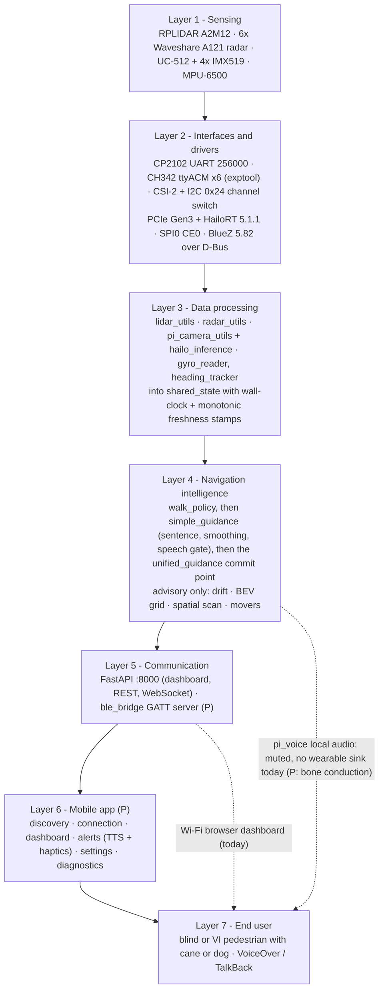

The per-module data flow is in [03 §2](#doc-03-perception-and-navigation-pipeline), and the BLE process layout is in [04 §8.1](#doc-04-bluetooth-communication-architecture).

## 2. Component diagram (processes and threads)

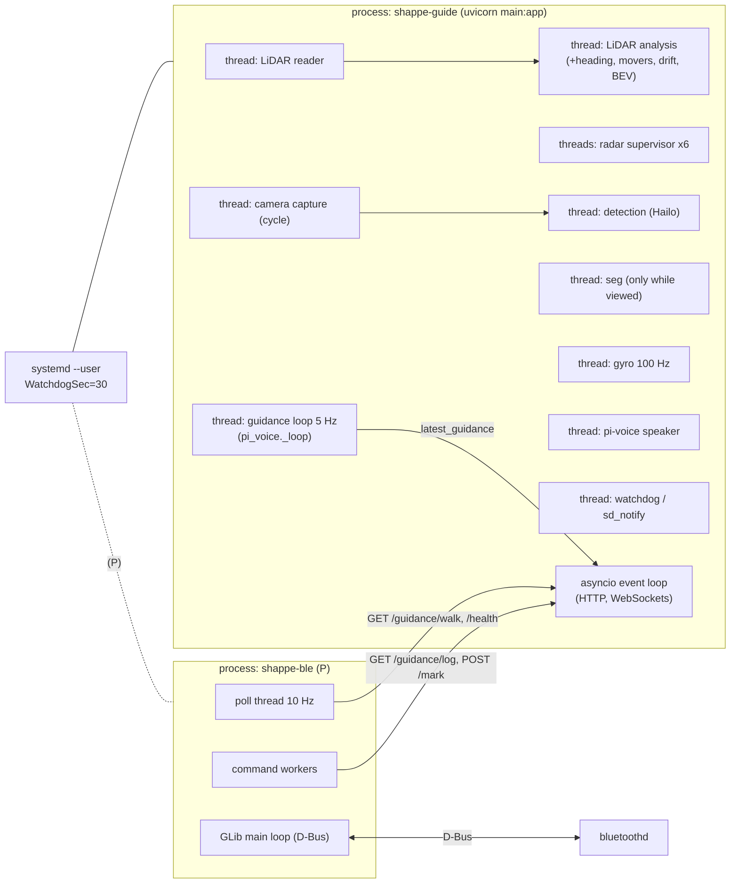

## 3. Communication flows

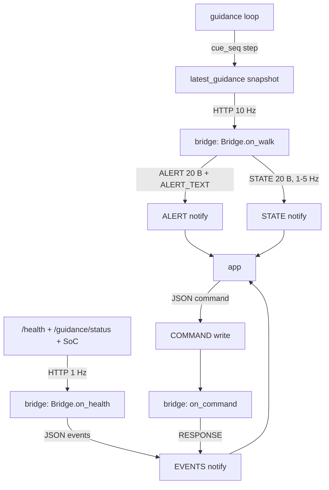

## 4. Sequence diagrams

### 4.1 Hardware boot and initialisation

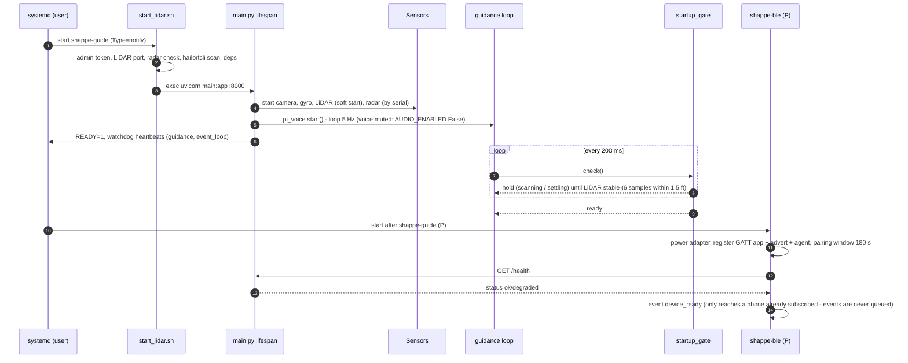

### 4.2 Bluetooth discovery and pairing (P)

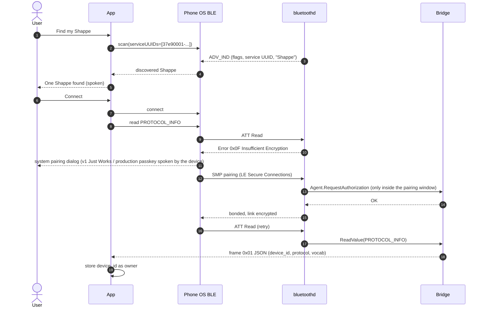

### 4.3 First successful connection (handshake)

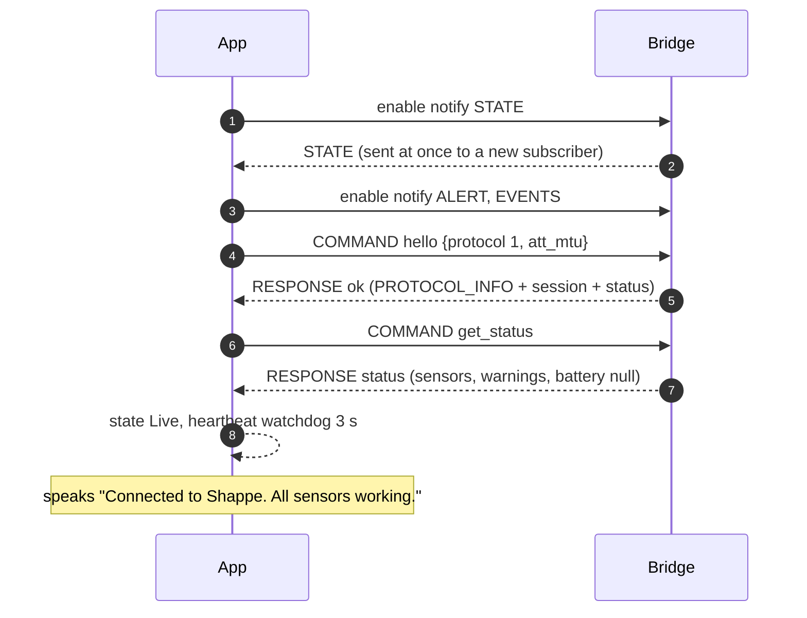

### 4.4 Starting a navigation session

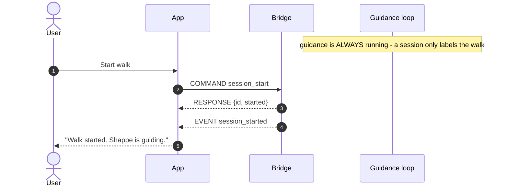

### 4.5 Camera obstacle detection

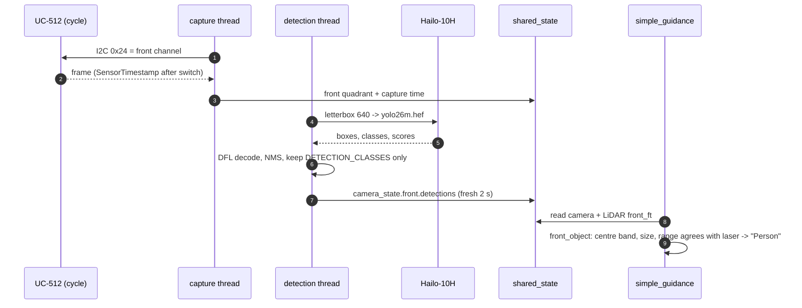

### 4.6 LiDAR obstacle detection

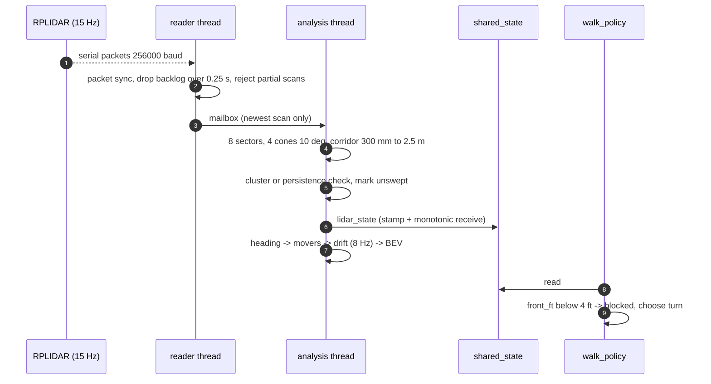

### 4.7 Radar data processing

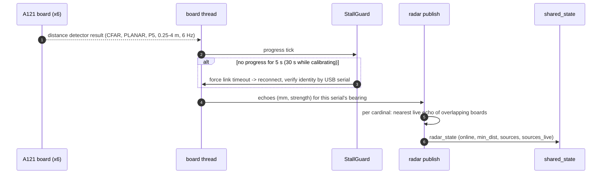

### 4.8 Sensor fusion and hazard assessment

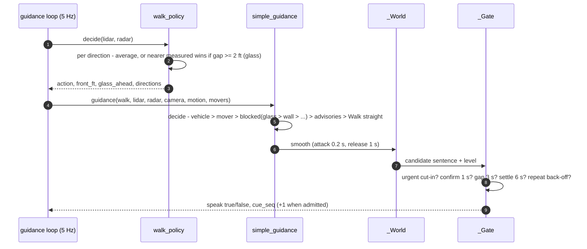

### 4.9 Hazard notification delivery

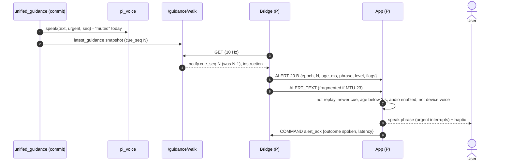

### 4.10 Mobile-to-hardware command

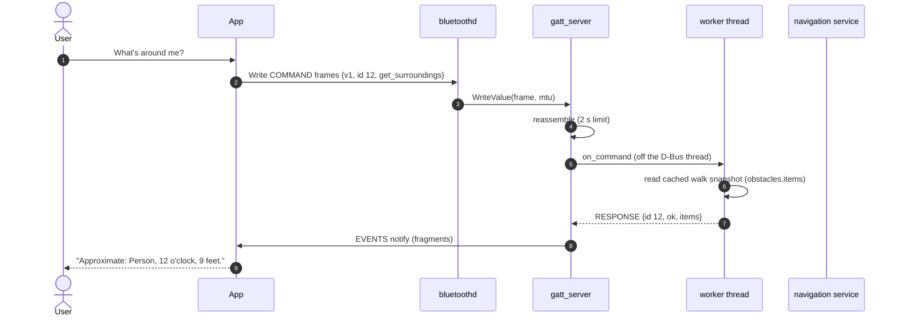

### 4.11 Bluetooth disconnection

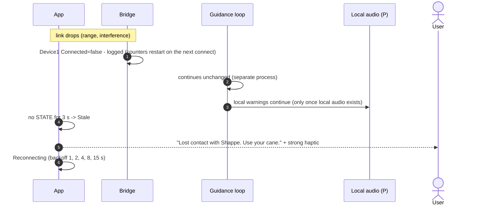

### 4.12 Reconnection

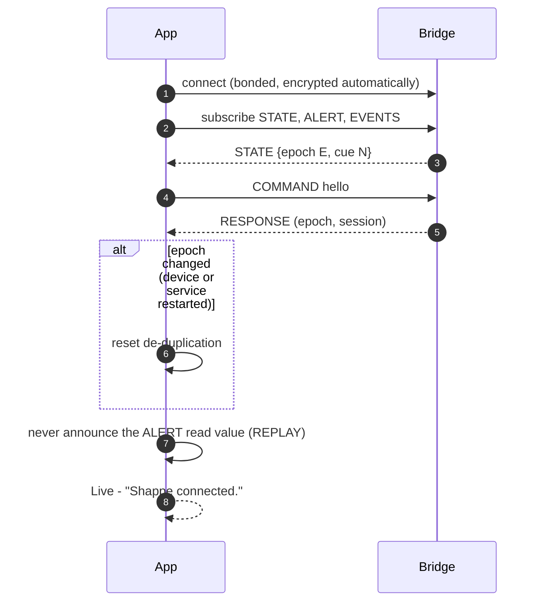

### 4.13 Low-battery warning

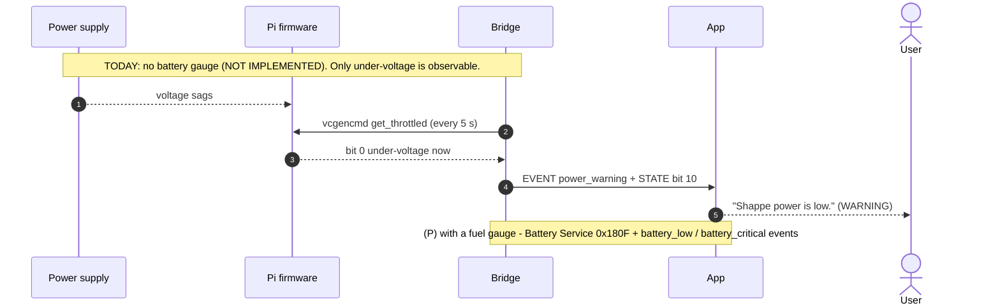

### 4.14 Sensor failure

```mermaid
sequenceDiagram
  autonumber
  participant L as LiDAR
  participant SG as simple_guidance
  participant H as /health
  participant BR as Bridge
  participant APP as App
  actor U as User
  L--xSG: scans stop
  SG->>SG: stale -> hold, nothing new said
  SG->>SG: scan older than 2 s -> "Sensors offline" (level 2, cue_seq +1)
  H-->>BR: status down, lidar_ok false, warning "LiDAR signal lost"
  BR->>APP: ALERT phrase 14 + EVENT sensor_degraded{lidar} + health_changed
  BR->>APP: STATE status 2
  APP-->>U: "Shappe cannot see. Use your cane." (SYSTEM FAILURE)
```

### 4.15 Hardware / service restart

```mermaid
sequenceDiagram
  autonumber
  participant SD as systemd
  participant NAV as shappe-guide
  participant BR as Bridge
  participant APP as App
  NAV--xBR: HTTP refused (crash)
  BR->>APP: EVENT service_unreachable + STATE status 3 (all bits 0)
  APP-->>APP: SYSTEM FAILURE announcement
  SD->>NAV: Restart=always
  NAV-->>BR: /guidance/walk cue_seq 0 (was 57)
  BR->>BR: epoch +1, learn cue 0 (no alert)
  BR->>APP: EVENT service_restarted {epoch}
  NAV-->>BR: /health ok (speech may still be held by the start-up gate)
  BR->>APP: EVENT device_ready
  APP-->>APP: "Shappe ready."
```

### 4.16 Session termination

```mermaid
sequenceDiagram
  autonumber
  actor U as User
  participant APP as App
  participant BR as Bridge
  U->>APP: End walk
  APP->>BR: COMMAND session_stop
  BR-->>APP: RESPONSE {id, started, duration_s}
  BR-->>APP: EVENT session_stopped
  APP-->>U: "Walk ended, 24 minutes."
  Note over BR: device guidance keeps running - the session is a label, not a switch
  opt user disconnects
    APP->>BR: disconnect
  end
```


<div class="pagebreak"></div>

<a id="doc-references"></a>

# References

All accessed **2026-10-09**. Tags:
- **[DS]** datasheet
- **[OD]** official documentation
- **[SPEC]** specification or standard
- **[VM]** vendor marketing (not a validated system claim)
- **[3P]** third party

Source IDs `[Sx]` are cited in docs 02 and 08. Where sources disagree, the documents state the disagreement rather than picking one.

## Hardware

| ID | Title (version) | URL | Tag |
|---|---|---|---|
| S1 | Arducam, 16MP IMX519 Autofocus Synchronized Quad-Camera Kit (B0388) | https://www.arducam.com/blog/product/arducam-16mp-imx519-autofocus-synchronized-quad-camera-kit-for-raspberry-pi-nvidia-jetson/ | VM |
| S2 | Arducam Wiki, Quick Start Guide for Arducam CamArray HAT Kit | https://docs.arducam.com/Raspberry-Pi-Camera/Multi-Camera-CamArray/quick-start/ | OD |
| S3 | Arducam Wiki, Multi-Camera CamArray | https://docs.arducam.com/Raspberry-Pi-Camera/Multi-Camera-CamArray/Multi-Camera-CamArray/ | OD |
| S4 | Arducam Wiki, 16MP IMX519 | https://docs.arducam.com/Raspberry-Pi-Camera/Native-camera/16MP-IMX519/ | OD |
| S5 | Arducam, 16MP IMX519 Camera Module (80°D/67°H/53°V) | https://www.arducam.com/blog/?p=105181 | VM |
| S6 | Arducam forum, CamArray frame rate thread (vendor staff posts) | https://forum.arducam.com/t/why-cant-i-reach-120fps-using-4-imx519-cameras-with-camarray-hat/5368 | 3P |
| S7 | raspberrypi/linux `drivers/media/i2c/imx519.c` (rpi-6.12.y) | https://raw.githubusercontent.com/raspberrypi/linux/rpi-6.12.y/drivers/media/i2c/imx519.c | OD |
| S8 | Raspberry Pi documentation, Camera software | https://www.raspberrypi.com/documentation/computers/camera_software.html | OD |
| S9 | SLAMTEC, RPLIDAR A2 Introduction and Datasheet, model A2M12 (rev 1.0, 2022-04-08) | https://cdn.robotshop.com/media/r/rpk/rb-rpk-22/pdf/rplidar-a2m12-360-laser-range-scanner-datasheet.pdf | DS |
| S10 | SLAMTEC LR001, Interface Protocol and Application Notes (rev 2.2, 2021-02-25) | https://cdn.robotshop.com/media/r/rpk/rb-rpk-07/pdf/lr001_slamtec_rplidar_protocol_v2.2_en.pdf | OD |
| S11 | SLAMTEC, Common Indoor SLAM Failure Scenarios | https://www.slamtec.com/en/news/detail/855 | VM |
| S12 | Acconeer, A121 Pulsed Coherent Radar Datasheet (v1.8, 2025-02-03) | https://developer.acconeer.com/download/a121-datasheet | DS |
| S13 | Acconeer, XM125 Datasheet (v1.2, 2023-10-04) | https://developer.acconeer.com/download/xm125-datasheet | DS |
| S14 | Acconeer docs, Distance Detector (Exploration Tool 7.18.2) | https://docs.acconeer.com/en/latest/detectors/a121/distance_detector.html | OD |
| S15 | Acconeer docs, Presence Detector | https://docs.acconeer.com/en/latest/detectors/a121/presence_detector.html | OD |
| S16 | Acconeer docs, Speed Detector | https://docs.acconeer.com/en/latest/detectors/a121/speed_detector.html | OD |
| S17 | Acconeer docs, Exploration Tool changelog | https://docs.acconeer.com/en/latest/exploration_tool/changelog.html | OD |
| S18 | Waveshare Wiki, A121 Range Sensor (SKU 33777) | https://www.waveshare.com/wiki/A121_Range_Sensor | OD |
| S19 | Waveshare, A121 Range Sensor product page | https://www.waveshare.com/a121-range-sensor.htm | VM |
| S20 | WCH CH342 datasheet (summary only) | https://cdn.sparkfun.com/assets/8/e/f/5/1/CH342_Datasheet.pdf | 3P |
| S21 | Raspberry Pi 5 product page | https://www.raspberrypi.com/products/raspberry-pi-5/ | VM |
| S22 | Raspberry Pi documentation, Raspberry Pi computer hardware | https://www.raspberrypi.com/documentation/computers/raspberry-pi.html | OD |
| S23 | Raspberry Pi news, Introducing Raspberry Pi 5 (2023-09-28) | https://www.raspberrypi.com/news/introducing-raspberry-pi-5/ | VM |
| S24 | Raspberry Pi 27W USB-C Power Supply | https://www.raspberrypi.com/products/27w-power-supply/ | VM |
| S25 | Raspberry Pi Active Cooler | https://www.raspberrypi.com/products/active-cooler/ | VM |
| S26 | Raspberry Pi AI HAT+ 2 Product Brief (RP-009655-MM-6, July 2026) | https://pip-assets.raspberrypi.com/categories/1319-raspberry-pi-ai-hat-2/documents/RP-009655-MM-6-raspberry-pi-ai-hat-plus-2-product-brief.pdf | OD |
| S27 | Raspberry Pi documentation, AI HATs | https://www.raspberrypi.com/documentation/accessories/ai-hat-plus.html | OD |
| S28 | Raspberry Pi documentation, AI software | https://www.raspberrypi.com/documentation/computers/ai.html | OD |
| S29 | Raspberry Pi news, Introducing the AI HAT+ 2 | https://www.raspberrypi.com/news/introducing-the-raspberry-pi-ai-hat-plus-2-generative-ai-on-raspberry-pi-5/ | VM |
| S30 | Raspberry Pi news, When and why you might need the AI HAT+ 2 | https://www.raspberrypi.com/news/when-and-why-you-might-need-the-raspberry-pi-ai-hat-plus-2/ | VM |
| S31 | Hailo-10H product page | https://hailo.ai/products/ai-accelerators/hailo-10h-ai-accelerator/ | VM |
| S32 | RidgeRun wiki, Hailo Dataflow Compiler | https://developer.ridgerun.com/wiki/index.php/Hailo/Hailo-8/AI_Software_and_Tools/Hailo_Dataflow_Compiler | 3P |
| S33 | Raspberry Pi forum, AI HAT + NVMe thread | https://forums.raspberrypi.com/viewtopic.php?t=395552 | 3P |
| S34 | Intel, USB 3.0 RFI Impact on 2.4 GHz Wireless Devices (327216-001, Apr 2012) | https://www.usb.org/sites/default/files/327216.pdf | OD |
| S35 | TDK InvenSense MPU-6500 Product Specification (rev 1.0) | https://ocw.cs.pub.ro/courses/_media/pm/prj2017/amocanu/mpu_6500_rev1.0_1_.pdf | DS |
| S36 | TDK MPU-6500 product page | https://invensense.tdk.com/products/motion-tracking/6-axis/mpu-6500/ | VM |
| S37 | Infineon CYW43455 product page (specs not visible when fetched) | https://www.infineon.com/cms/en/product/wireless-connectivity/airoc-wi-fi-plus-bluetooth-combos/wi-fi-5-802.11ac/cyw43455/ | VM |
| S38 | DigiKey listing, Arducam B0371-1 | https://www.digikey.com/en/products/detail/arducam/B0371-1/22598757 | 3P |

**Known contradictions:**
- **IMX519 HFOV:** 66° [S1, S4] vs 67° [S5]. A pinhole calculation gives 67.1°.
- **UC-512 quad frame rates:** [S1] vs [S3].
- **Radar FOV axes:** Waveshare [S18] vs Acconeer E/H planes [S12].
- **Waveshare "accuracy 0.03 m":** this is the radial resolution, not the accuracy [S12].
- **AI HAT+ 2 performance claims:** they differ across [S26], [S30].
- **I²C bus number for the CamArray:** 4/6 [S2] vs 11 in this code (measured).

## Bluetooth

| Title | URL | Tag |
|---|---|---|
| BlueZ 5.82 D-Bus API docs: GattManager, GattService, GattCharacteristic (Oct 2023), LEAdvertisingManager, LEAdvertisement, AgentManager, Agent | https://raw.githubusercontent.com/bluez/bluez/5.82/doc/ (canonical: https://git.kernel.org/pub/scm/bluetooth/bluez.git/tree/doc/) | OD |
| BlueZ `src/gatt-database.c`, `src/shared/gatt-server.c` (CCC auto-creation; 0x0F vs 0x05 errors) | https://github.com/bluez/bluez/tree/5.82/src | OD (source) |
| BlueZ `src/main.conf` and `doc/settings-storage.txt` (5.82) | https://github.com/bluez/bluez/blob/5.82/src/main.conf | OD |
| Debian trixie `bluez` 5.82-1.1 | https://packages.debian.org/trixie/bluez | OD |
| Bluetooth Core 5.4, Vol 3 Part F (ATT): default MTU 23, attribute value ≤ 512 B, indication confirmation | https://www.bluetooth.com/wp-content/uploads/Files/Specification/HTML/Core-54/out/en/host/attribute-protocol--att-.html | SPEC |
| Bluetooth Core 5.4, Vol 3 Part H (SMP): LE Secure Connections, association models | https://www.bluetooth.com/wp-content/uploads/Files/Specification/HTML/Core-54/out/en/host/security-manager-specification.html | SPEC |
| Bluetooth LE Primer v1.3.0 (2024-10-15) | https://www.bluetooth.com/bluetooth-le-primer/ | OD |
| Bluetooth SIG blog, Bluetooth Pairing Part 4 (2017-01-19) | https://www.bluetooth.com/blog/bluetooth-pairing-part-4/ | OD |
| Bluetooth Assigned Numbers (version date 2026-10-08) | https://www.bluetooth.com/wp-content/uploads/Files/Specification/HTML/Assigned_Numbers/out/en/Assigned_Numbers.pdf | SPEC |
| Apple, `scanForPeripherals(withServices:options:)` | https://developer.apple.com/documentation/corebluetooth/cbcentralmanager/scanforperipherals(withservices:options:) | OD |
| Apple, `connect(_:options:)` (connections do not time out) | https://developer.apple.com/documentation/corebluetooth/cbcentralmanager/connect(_:options:) | OD |
| Apple, Core Bluetooth Programming Guide: background processing (archive, 2013-09-18) | https://developer.apple.com/library/archive/documentation/NetworkingInternetWeb/Conceptual/CoreBluetooth_concepts/CoreBluetoothBackgroundProcessingForIOSApps/PerformingTasksWhileYourAppIsInTheBackground.html | OD |
| Apple TN3115, Bluetooth State Restoration app relaunch rules (rev 2025-09-15) | https://developer.apple.com/documentation/technotes/tn3115-bluetooth-state-restoration-app-relaunch-rules | OD |
| Apple, AccessorySetupKit | https://developer.apple.com/documentation/accessorysetupkit | OD |
| Apple QA1931, BLE advertising and connection parameters (2017) | https://developer.apple.com/library/archive/qa/qa1931/_index.html | OD |
| Apple, NSBluetoothAlwaysUsageDescription | https://developer.apple.com/documentation/bundleresources/information-property-list/nsbluetoothalwaysusagedescription | OD |
| Nordic DevZone, iOS pairing initiation (quotes Apple ADG §40.10) | https://devzone.nordicsemi.com/f/nordic-q-a/86794/how-to-initiate-ble-pairing-manually | 3P |
| Android, Bluetooth permissions | https://developer.android.com/develop/connectivity/bluetooth/bt-permissions | OD |
| Android 14 behaviour changes (MTU 517) | https://developer.android.com/about/versions/14/behavior-changes-all | OD |
| Android, Transfer BLE data (CCCD write) | https://developer.android.com/develop/connectivity/bluetooth/ble/transfer-ble-data | OD |
| Android, Connect to a GATT server | https://developer.android.com/develop/connectivity/bluetooth/ble/connect-gatt-server | OD |
| Android, BLE in the background | https://developer.android.com/develop/connectivity/bluetooth/ble/background | OD |
| Android, Companion device pairing | https://developer.android.com/develop/connectivity/bluetooth/companion-device-pairing | OD |
| Android, Foreground service types | https://developer.android.com/develop/background-work/services/fgs/service-types | OD |
| Punch Through, Android BLE guide (2024-04-17) | https://punchthrough.com/android-ble-guide/ | 3P |

## Mobile, accessibility and audio

| Title | URL | Tag |
|---|---|---|
| W3C WCAG 2.2 (Recommendation; dated version 12 Dec 2024) | https://www.w3.org/TR/WCAG22/ | SPEC |
| W3C, Guidance on Applying WCAG 2.2 to Mobile Applications (Group Draft Note, 6 May 2025) | https://www.w3.org/TR/wcag2mobile-22/ | OD |
| ETSI EN 301 549 (V3.2.1 2021-03; V4.1.1 2026-09-02) | https://www.etsi.org/deliver/etsi_en/301500_301599/301549/ | SPEC |
| Apple HIG, Accessibility | https://developer.apple.com/design/human-interface-guidelines/accessibility | OD |
| Apple HIG, VoiceOver | https://developer.apple.com/design/human-interface-guidelines/voiceover | OD |
| Apple, UIAccessibility.Notification.announcement | https://developer.apple.com/documentation/uikit/uiaccessibility/notification/announcement | OD |
| Android, Make apps more accessible (48 dp, contentDescription) | https://developer.android.com/guide/topics/ui/accessibility/apps | OD |
| Android 16 behaviour changes (announceForAccessibility deprecated) | https://developer.android.com/about/versions/16/behavior-changes-all | OD |
| Apple AVFAudio reference (AVAudioSession categories and options, voicePrompt mode, AVSpeechSynthesizer) | https://developer.apple.com/documentation/avfaudio | OD |
| Apple App Review Guidelines 2.5.4 | https://developer.apple.com/app-store/review/guidelines/ | OD |
| Android, Manage audio focus | https://developer.android.com/media/optimize/audio-focus | OD |
| Android, Haptics APIs | https://developer.android.com/develop/ui/views/haptics/haptics-apis | OD |
| flutter_blue_plus (2.3.14, FlutterBluePlus License v1.6) | https://pub.dev/packages/flutter_blue_plus | OD |
| flutter_reactive_ble (5.6.0, BSD-3) | https://pub.dev/packages/flutter_reactive_ble | OD |
| react-native-ble-plx (3.5.1; Apache-2.0 repo vs MIT npm) | https://github.com/dotintent/react-native-ble-plx | OD |
| react-native-ble-manager (12.5.3, Apache-2.0) | https://github.com/innoveit/react-native-ble-manager | OD |
| Nordic Android-BLE-Library (2.11.0) / Kotlin-BLE-Library (2.0 beta) | https://github.com/NordicSemiconductor | OD |
| Kable (0.45.0, Apache-2.0) | https://github.com/JuulLabs/kable | OD |
| nRF Connect for Mobile | https://www.nordicsemi.com/Products/Development-tools/nRF-Connect-for-mobile | OD |
| LightBlue | https://punchthrough.com/lightblue/ | OD |
| bless (0.3.0, MIT) | https://pypi.org/project/bless/ | OD |
| Bumble (Google) | https://google.github.io/bumble/ | OD |
| Android Emulator netsim / advanced networking | https://developer.android.com/studio/run/emulator-networking-advanced | OD |

## Safety, regulation and ethics (scope only)

| Title | URL / reference | Tag |
|---|---|---|
| ISO 14971:2019 Medical devices: application of risk management | ISO catalogue | SPEC |
| IEC 62366-1:2015+AMD1:2020 Usability engineering | https://webstore.iec.ch/publication/67220 | SPEC |
| IEC 62304:2006+A1:2015 Medical device software lifecycle (Ed 2 not published as of 2026-08) | IEC catalogue | SPEC |
| ISO 13485:2016 | ISO catalogue | SPEC |
| EU MDR 2017/745, Art 2(1) | EUR-Lex (fetch failed; quoted via a 3P mirror) | SPEC |
| US 21 CFR 886.5900 Electronic vision aid | https://www.law.cornell.edu/cfr/text/21/886.5900 | 3P mirror |
| ISO 9999:2022; ISO 23599:2019; ISO 21542:2021 | ISO catalogue | SPEC |
| IEC 62368-1:2023 | https://webstore.iec.ch/publication/69308 | SPEC |
| IEC 60825-1:2014 | IEC catalogue | SPEC |
| EU RED 2014/53/EU; Delegated Reg. 2022/30; EN 18031-1/-2/-3 | OJEU | SPEC |
| ETSI EN 300 328 V2.2.2 | https://www.etsi.org/deliver/etsi_en/300300_300399/300328/ | SPEC |
| UN Manual of Tests and Criteria §38.3; IEC 62133-2:2017+AMD1:2021 | https://webstore.iec.ch/publication/70017 | SPEC |
| EU Accessibility Act 2019/882 (applies from 28 Jun 2025) | https://commission.europa.eu/ (EAA page) | OD |
| WMA Declaration of Helsinki (rev. Oct 2024) | https://www.wma.net/ | OD |
| ISO 14155:2026 Clinical investigation of medical devices | ISO catalogue | SPEC |

## Project sources (CONFIRMED evidence)

- **Repository:** `~/Documents/lidar` at HEAD `e209c48`, plus the uncommitted working tree, inspected 2026-10-09.
- **On-device commands** (read-only; their outputs are quoted in 02 §2):
  - `lsusb`, `ls /dev/serial/by-id`, `bluetoothctl show`, `rfkill list`, `wpctl status`;
  - `vcgencmd measure_temp`, `get_throttled`, `pmic_read_adc`;
  - `hailortcli --version`, `dpkg -l`;
  - `/boot/firmware/config.txt`, `/usr/share/dbus-1/system.d/bluetooth.conf`.
- `docs/SHAPPE_GUIDE_AUDIT.md` (2026-09-29 safety audit) and `README.md`.
